# Northgate Dental

A dental practice system and patient app for a fictional US dental group with three clinics in the Boston area: Back Bay, Cambridge and Quincy.

**Every patient, staff member, visit and document here is fictional, generated test data.** X-rays and images are licensed or generated and credited. No real patient data is used anywhere.

| Home | Booking | Visit record |
| --- | --- | --- |
|  |  |  |

| Records | Aligner timer | Profile |
| --- | --- | --- |
|  | 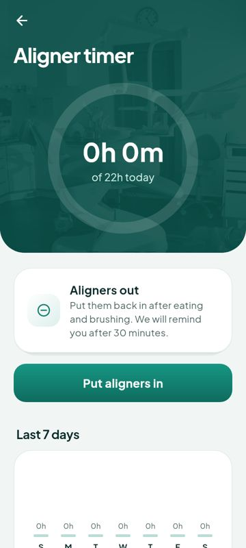 |  |

## Architecture

Northgate is deliberately lean. Patient data lives in **one place**, a managed Postgres database (Supabase, US East). Everything else either reads from it under the database's own access rules, or holds no patient data at all. That makes the most important question a healthcare client asks, "where does my data go?", short to answer.

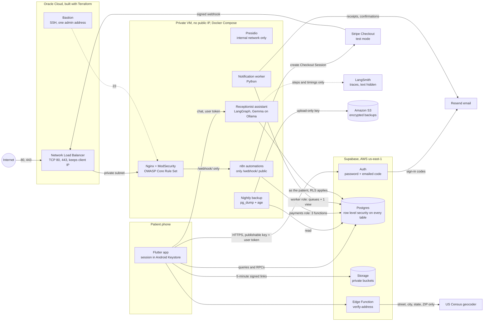

<details>
<summary><b>How a request is protected, layer by layer</b></summary>

1. **On the phone:** the session token is kept in the Android Keystore through `flutter_secure_storage`, never in plain preferences. The app holds only a publishable key, which grants nothing on its own.
2. **Sign-in:** an email and password, then a 6-digit code emailed at every sign-in. Until the code is confirmed, the session is marked unverified in `private.verified_sessions`, and every patient policy refuses it.
3. **In the database:** every table has row level security. A patient's queries pass through `private.my_patient_ids()` (their own record, plus children they are a proxy for), so a query for someone else's record returns nothing rather than an error. Staff policies additionally require a second factor (`aal2`).
4. **Writes go through functions:** booking, cancelling, linking a record and updating details are Postgres functions that check the caller themselves. The patient's identity comes from the signed-in session, never from a parameter the app sends.
5. **Files:** X-rays and visit summaries sit in a private bucket. The app receives a signed link valid for 5 minutes and opens the PDF inside the app.
6. **On the server:** every public request passes through ModSecurity with the OWASP Core Rule Set, which refuses cross-site scripting, SQL injection, path traversal and command injection with a 403, before any service sees the request.

</details>

<details>
<summary><b>Where each kind of data lives</b></summary>

| Data | Stored in | Region | Who can read it |
| --- | --- | --- | --- |
| Patient records, visits, charts, plans, appointments | Supabase Postgres | us-east-1 | The patient (and parent proxies) under row level security; staff with 2FA at their locations |
| X-rays, visit summaries | Supabase Storage, private bucket | us-east-1 | Same rules as the records; 5-minute signed links |
| Sign-in session | The phone's Keystore | On the device | The app only; cleared on sign-out |
| Aligner wear log | The phone, encrypted | On the device | The app only; wiped on sign-out |
| Audit log | Supabase Postgres, append-only | us-east-1 | Administrators; updates and deletes are revoked |
| Web access logs | Oracle VM | af-johannesburg-1 | Operators; path and status only, never query strings or bodies |
| Backups | Amazon S3, encrypted twice | eu-north-1 | Nobody on the server: the VM can add files but not read or delete them |

The Oracle VM and the S3 bucket sit outside the US. That is a recorded exception, allowed only because no real patient data exists here, and caused by account regions that cannot be changed. A deployment with real patient data would move both into US regions before going live.

</details>

## Why each technology was chosen

<details>
<summary><b>Supabase (Postgres, Auth, Storage, Edge Functions)</b></summary>

A dental group's data is relational: patients, appointments, clinicians, rooms, services, prices and plans all refer to each other. Postgres is the natural home for it. Supabase adds sign-in, file storage and small server functions around the same database, so there is no separate API server to secure.

- **Row level security** puts the access rules next to the data. A forgotten check in an API endpoint cannot leak records, because the database itself refuses the query.
- **Exclusion constraints** (with `btree_gist`) make double booking impossible at the database level: two appointments for the same clinician or room cannot overlap, even if two people book at the same instant.
- **pgTAP** tests every policy with real sign-ins, for both what each role may do and what it must be refused.
- **Region:** us-east-1, so US patient data stays in the US.
- **Trade-off accepted:** the free plan has no point-in-time recovery, which is why the nightly encrypted backup exists.

</details>

<details>
<summary><b>Supabase Queues, the transactional outbox and the notification worker</b></summary>

Everything that happens *after* a change (confirmations, reminders, cancellations, later payments and check-ins) runs through queues inside the same Postgres database. Northgate uses **Supabase Queues** (the `pgmq` extension) instead of a separate broker such as RabbitMQ. With one database there is one store to secure, back up and explain, and a queue message can be written in the same transaction as the data change that caused it.

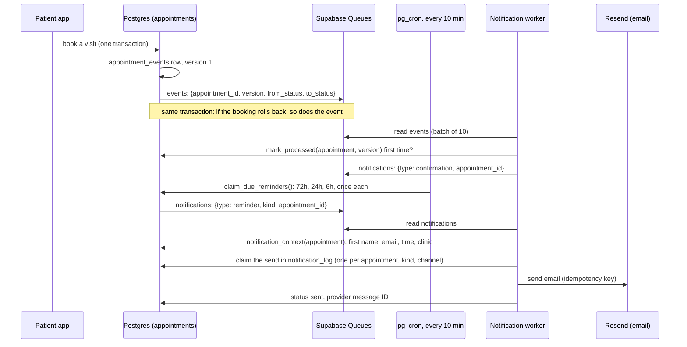

**Why it is built this way:**

| Design choice | What it prevents |
| --- | --- |
| **Transactional outbox:** a trigger on `appointment_events` sends the event in the same transaction as the change | An event lost because the app crashed between saving and publishing, or a published event for a change that rolled back |
| **Events carry IDs, a version and statuses only** | Names, contact details or clinical text sitting in queue tables (tested) |
| **Version numbers per appointment** | Changes applied out of order; the worker checks the appointment's current status before sending, so a late "booked" never confirms a cancelled visit |
| **`mark_processed(consumer, key)`**, true only the first time | A redelivered message running twice |
| **`notification_log`, unique per appointment, kind and channel**, claimed *before* sending | Two confirmation emails, even if the worker crashes after sending and the message is retried |
| **Resend idempotency key** on every email | A second guard behind the log, for 24 hours |
| **Reminders claimed in `reminder_log`** (unique per appointment and kind), each with a two-hour window | Duplicate reminders, and very late reminders after an outage |
| **Quiet hours** 21:00 to 08:00 in the clinic's time zone; a reminder that would fall inside them moves to 20:00 the evening before | Messages at night |
| **A separate `urgent` queue** for clinical messages | A red-flag message waiting behind a campaign |
| **Fixed batches of 10, one message per transaction, dead-letter after 5 failures** | A worker taking more than it can finish, and a poison message blocking the queue |
| **pg_cron inside the database** runs the reminder scanner | A separate scheduler that can stop without anyone noticing |

**What a patient message contains:** first name, the service, the date and time in the clinic's own time zone, the clinic and its phone number. It never contains a surname, date of birth, record number, address, insurance or anything clinical, because email providers and WhatsApp sign no BAA. The worker reads a visit only through `private.notification_context()`, a database function that returns exactly those fields to the worker's role and nothing to anyone else.

**Who can touch the queues:** neither patients nor staff. The schema is closed to `anon` and `authenticated`, and a dedicated `northgate_worker` role gets the queues, the send log and the idempotency check only. Its login is created by hand on each project, so no password lives in Git.

**Proof:**
- 24 database tests (`20_queues`, `21_worker_context`).
- The worker's tests, including one against a real database. It books a visit for the canary patient, checks that exactly one email is sent and that a repeat sends nothing, and scans the logs for every canary value.

</details>

<details>
<summary><b>Payments with Stripe Checkout (test mode), relayed by n8n, decided in Postgres</b></summary>

A receptionist (or, from section 09, the assistant) asks for a payment link for a visit; the patient pays on Stripe's hosted Checkout page; Stripe tells us it was paid; the patient gets a receipt. Stripe Checkout was chosen over building a card form because **card numbers never touch Northgate's systems at all**, which keeps the product out of PCI DSS scope beyond the simplest self-assessment (SAQ A).


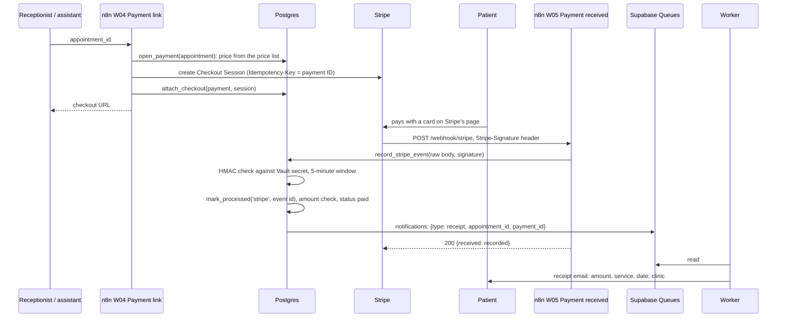

**The key decision: n8n relays, Postgres decides.** All money rules live in three database functions with 17 pgTAP tests. n8n holds no logic and no secret it could leak: the webhook signing secret is in **Supabase Vault**, loaded there by the deploy workflow from a GitHub environment secret, and was piped from Stripe's API into GitHub without ever being printed.

| Design choice | What it prevents |
| --- | --- |
| **The amount comes from `location_services.price_cents`** inside `open_payment()`, never from the caller | A tampered or mistaken request charging the wrong amount |
| **One live payment per visit** (partial unique index on `appointment_id` where status is pending or paid) | Two payment links, and a visit paid twice |
| **Stripe idempotency key = our payment ID** | A retried request creating a second Checkout Session |
| **HMAC-SHA256 signature check over the exact raw body**, in Postgres with `pgcrypto` | Anyone who finds the webhook URL marking a payment as paid |
| **Five-minute timestamp window** | A captured, genuine event being replayed later |
| **`mark_processed('stripe', event.id)`** | Stripe's at-least-once delivery recording a payment (and sending a receipt) twice |
| **Amount and currency must match** what we asked for | A session paid at a different price being accepted |
| **Adaptive Pricing switched off** | A US clinic being paid in the payer's local currency (it showed Kenyan shillings in testing until disabled) |
| **Unknown sessions are ignored, not errors** | The shared test account's other products' events filling the error log |
| **Money in whole cents** (integers) | Floating-point rounding errors |
| **A dedicated `northgate_payments` role** with execute on three functions and nothing else | A leaked n8n credential reading patient records (tested: it cannot) |
| **n8n trusts Supabase's root CA** (fingerprint checked against Supabase's published copy) instead of skipping certificate checks | A man-in-the-middle on the database connection |
| **W05 keeps no data from failed runs**, and successful runs keep none either | The email a payer types at Checkout lingering in n8n's database |

**What Stripe receives:** an amount in cents, the item name "Northgate Dental visit" and our payment ID. Never the patient's name, email, date of birth or the service (a service name is health information). Stripe does not sign a BAA, but HIPAA exempts payment processing (Social Security Act section 1179), so the rule here is simple: nothing clinical goes to Stripe.

**Products considered:** Payments (Checkout and webhooks) is used now. Billing (invoices) fits patient statements and arrives with W06. Connect was rejected: it is for platforms paying out to *other* businesses, and Northgate is one dental group with one bank account, so it would add onboarding, compliance and fees for nothing.

**Proof:**
- `22_payments.test.sql`: tampered body, wrong secret, a replay older than five minutes, a wrong amount, a duplicate event, and writes by a signed-in user are all refused; a correct event is recorded once and queues one receipt carrying IDs only.
- The worker test signs an event in Python, so it proves Python's HMAC and Postgres's agree byte for byte.
- On staging, a real test-mode payment went from link to receipt email (see Deployments).

</details>

<details>
<summary><b>n8n for event and time based automations</b></summary>

n8n runs the automations a clinic changes most often: payment links, payment webhooks and, next, statements and post-visit check-ins. It is self-hosted on the VM, not n8n Cloud, so patient-adjacent events never leave infrastructure we control.

- **Built through n8n's MCP server.** Each workflow is written as n8n Workflow SDK code (`n8n/sdk/*.ts`), validated by the MCP server's `validate_workflow`, created with `create_workflow_from_code`, tested, then exported as JSON to `n8n/workflows/`. The JSON holds credential *references* only (an ID and a name), never a secret.
- **Same version everywhere:** n8n 2.43.7 on the laptop and on the VM.
- **Only webhooks are public.** Nginx proxies `https://n8n.84-12-126-31.sslip.io/webhook/*` through the WAF and answers 404 for everything else, including the editor and the REST API (tested in CI).
- **The editor is reached through an SSH tunnel** over Oracle Bastion and bound to `127.0.0.1` on the VM, so it has no internet-facing login page to attack.

**How to open the editor:**

| Who | How | Address |
| --- | --- | --- |
| The admin, today | `TUNNEL=15678 infra/scripts/ssh-vm.sh deploy` (leave it running; works without Terraform installed) | http://localhost:15678 |
| The developer's laptop copy | The local n8n where workflows are built through the MCP server | http://localhost:5678 |
| A team, without the tunnel (option) | Tailscale on the VM and each person's device; free for small teams; the editor stays off the internet | http://northgate-vm:5678 |
| A public demo (option) | Route the editor through the WAF with n8n's own login, two-factor required and an IP allow-list | https://n8n.84-12-126-31.sslip.io |

The first visit to a new n8n asks for the owner account; only someone who can already reach the editor can create it.

**Step by step: opening the VM's n8n through the tunnel**

1. Prerequisites, once per laptop: the OCI CLI signed in (`~/.oci/config`), the SSH key `~/.ssh/northgate_oracle` loaded (`ssh-add ~/.ssh/northgate_oracle`), and your current public IP in the Bastion's allowed range (`client_cidr` in `infra/terraform/oci/terraform.tfvars`).
2. In a terminal, from the repository folder, open the tunnel and leave it running:
   ```bash
   cd ~/practice-projects/Northgate-Dental
   TUNNEL=15678 infra/scripts/ssh-vm.sh deploy
   ```
   The script finds or creates an Oracle Bastion session (up to three hours), then forwards `localhost:15678` on the laptop to `127.0.0.1:5678` on the private VM. It prints nothing while the tunnel is open.
3. In a browser, open **http://localhost:15678**. Local port 15678 avoids the laptop's own n8n on 5678.
4. The first time, create the owner account; after that, sign in. W03, W04, W05, W06 and W11 are listed and active.
5. To close the tunnel, press Ctrl+C in that terminal.

If the page does not load: the Bastion refuses sessions from an IP outside `client_cidr` (update it and run `terraform apply`), and a brand-new session takes about ten seconds before it accepts the key.
- **Its own Postgres** (`n8n-db`, on the internal `data` network) for workflows and encrypted credentials; it joins the nightly encrypted backup.
- **Hardening:** `N8N_BLOCK_ENV_ACCESS_IN_NODE` stops Code nodes reading server secrets; successful runs save no data; failed runs are pruned after 7 days; telemetry is off.
- **Credentials** are imported with `n8n import:credentials` from stdin inside the container, so passwords never sit on the VM's disk or in shell history. The Stripe key is read from the VM's own `.env` and never travels again.
- **n8n never does AI.** The project rule is one assistant, built in LangGraph; n8n only runs triggered automations and, from section 09, publishes a few workflows as MCP tools for it.

</details>

<details>
<summary><b>Links in patient emails: cancel, check-in and pay, single use and never naming the patient</b></summary>

Confirmations, reminders, check-ins and balance reminders each carry at most one link. Each link is a random 32-character token; the database stores only its SHA-256 hash (`private.action_tokens`), so a copy of the database cannot be turned into working links.

| Link | Sent in | What the page does | Rule enforced in Postgres |
| --- | --- | --- | --- |
| **Cancel** (W03) | Confirmation and every reminder | Shows the visit; the button cancels | Not inside the clinic's cancellation window (24 hours by default, per location); works once; the cancellation then goes through the outbox like any other |
| **Check-in** (W11) | 10:00 clinic time, 1 and 3 days after a completed visit | "Fine" or "I have a concern", plus an optional note | Fixed red-flag rules (bleeding that will not stop, spreading swelling, fever, trouble breathing or swallowing, lasting numbness, signs of infection, severe pain); a flag tells the patient to call now or 911, opens an urgent staff task and goes on the `urgent` queue; no AI model reads the note |
| **Pay** (W06) | Balance reminders on days 0, 14 and 28 after a visit; a billing task on day 35 | Redirects to Stripe Checkout through W04 | The amount comes from the price list; a paid link shows "already paid" |

**Opening a link never changes anything.** Mail scanners and link previews open links automatically, so a GET only shows the page; only the button (a POST) acts. Pages name the service, time and clinic, never the patient, because links get forwarded. Each workflow's database login (`northgate_actions_app`) can call four functions and read no table.

**The worker** adds the link when it writes the email, inside the same transaction as the send, so a failed send also discards its link. Urgent check-in alerts go to the clinic inbox at once, carrying IDs only; the patient's words stay in Postgres.

</details>

<details>
<summary><b>Conflict scanner (W22) and the staff task inbox</b></summary>

When a dentist books leave or a clinic closes, visits already booked can become impossible. `private.detect_schedule_conflicts()` finds four kinds: the clinician unavailable (leave, training, sick), the location closed, too little travel time between two clinics for the same clinician, and the same patient booked within 30 minutes of another visit.

- **When it runs:** a trigger on every change to leave or closures, so a conflict shows within seconds; and pg_cron every 15 minutes over the next 30 days, for changes no trigger sees.
- **Recorded once:** `schedule_conflicts` is unique per appointment and conflict type; scanning again raises nothing new.
- **Fixes itself:** when the leave is cancelled or the visit moved, the conflict is resolved and its task closed.
- **One inbox:** `staff_tasks` holds schedule conflicts, check-ins that need a clinician, balances that need billing follow-up and shop orders to set aside, each pointing at an appointment or order by ID. Staff see only their own clinics' tasks; patients see none. The web portal (next section) shows this inbox.
- **Nothing is sent to a patient from here:** a person decides, as the blueprint requires.

</details>

<details>
<summary><b>PDF receipts from an internal renderer</b></summary>

Receipt emails carry a PDF receipt, rendered from HTML by **Gotenberg**, a maintained container that wraps headless Chromium. It does the job the blueprint gives Puppeteer without any browser code of our own to keep patched.

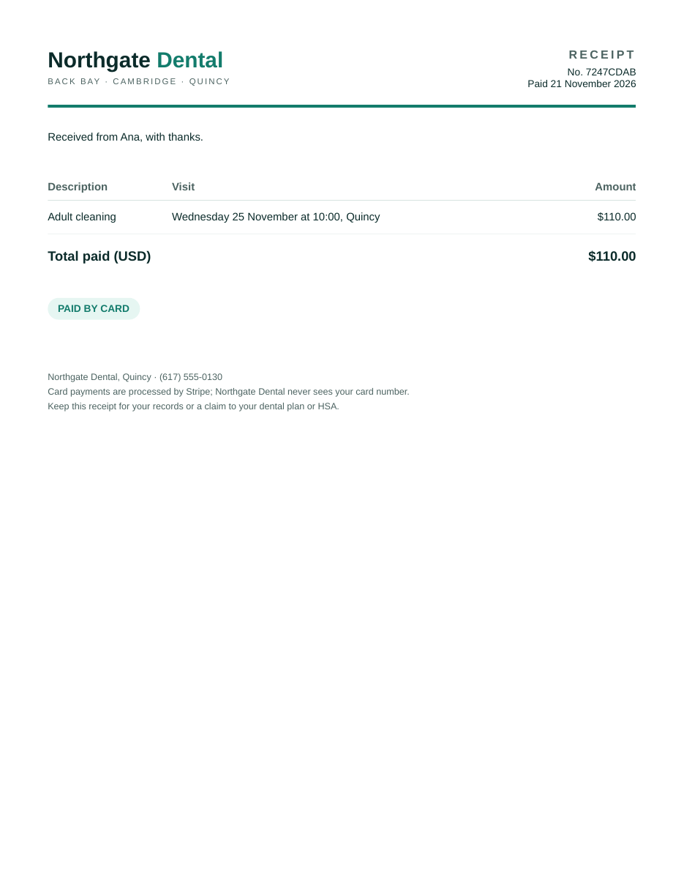

- **Internal only:** it sits on the `data` network, which has no route in or out; only the worker can reach it.
- **Locked down:** JavaScript is off and it may load nothing but the HTML it is sent; the receipt document is self-contained (no fonts, images or scripts to fetch).
- **Never blocks a receipt:** if the renderer is down, the email still goes without the attachment and the log says so (tested).

</details>

<details>
<summary><b>The dental shop: clinician-curated, with refills and sales tax</b></summary>

A small shop inside the patient app for the products our dentists and hygienists already recommend at the chair. It is not a marketplace: its value over Amazon is trust and fit, "what my dentist recommends for my mouth".

| Shop | Product | Bag | Stripe Checkout |
| --- | --- | --- | --- |
| 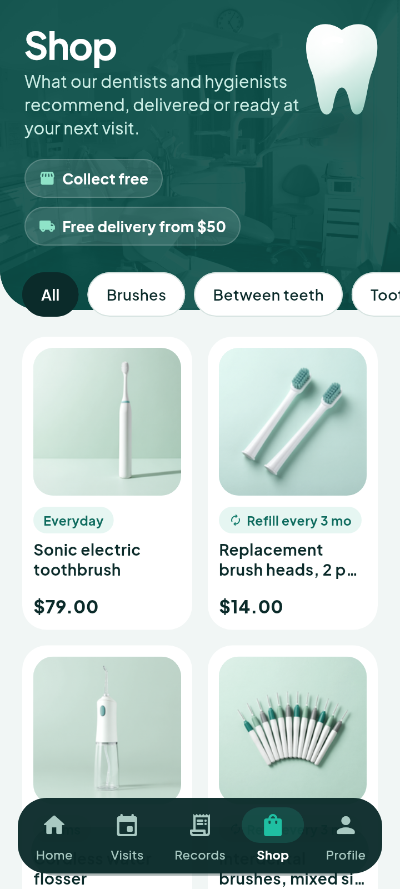 | 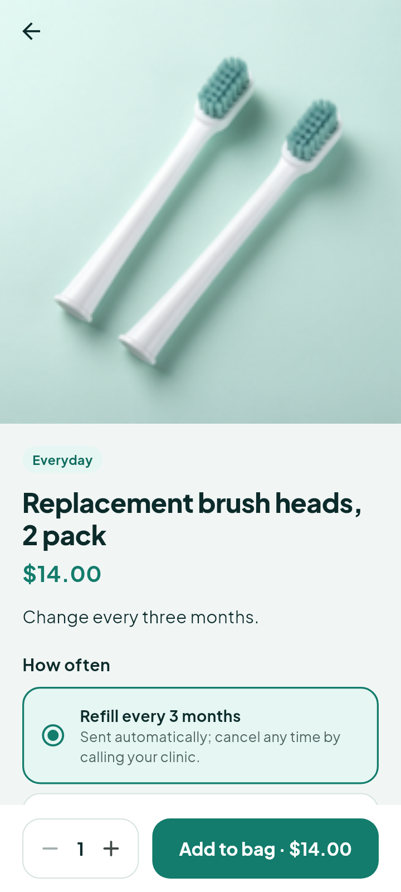 |  |  |

**Benchmarks, and what was taken from each:**

| Benchmark | What it does well | Taken here |
| --- | --- | --- |
| quip | Refill subscriptions as the default | Refills every 1, 2, 3 or 6 months through Stripe Billing, offered first on refillable products |
| Oral-B and Philips Sonicare apps | Replacement reminders tied to the product | Brush heads on a 3-month refill |
| Byte, Invisalign aftercare | Aftercare kits at the moment of treatment | An aligner category: chewies, cases, cleaning crystals |
| Hims and Hers, Curology | Clinician-gated products | Prescription-strength items locked until a dentist approves them for that patient |
| DUA, Fellow | Calm premium retail | Category chips, large product cards on one consistent mint stage, benefit labels |

**Rules, all enforced on the server** (`create_shop_order`, 25 database tests):

| Rule | How |
| --- | --- |
| The price is the catalogue's | The app sends product IDs, quantities and refill choices only; a price it sends is ignored (tested) |
| Prescription-strength items need a dentist | `shop_approvals`, per patient and product, expiring; only a clinician who can see the patient may approve |
| Whitening is for adults with a recent exam | Age 18 or over and an exam encounter in the last 12 months |
| Collection needs stock | `shop_stock` per clinic; paid collection orders take the stock |
| Refills only where offered | `refill_interval_months` on the product |
| Payment matches the order | W05 compares Stripe's item subtotal and shipping with the order, then records the tax Stripe calculated |

**Paying:** W12 turns the order's lines into a Stripe Checkout Session: subscription mode when any line is a refill (Stripe Billing), payment mode otherwise; **Stripe Tax** on (Massachusetts registration, 6.25 per cent verified); a US address and a flat $7.99 rate when delivered (free from $50), or only country and ZIP when collected; Adaptive Pricing off, so a US clinic always charges US dollars. Each refill cycle (`invoice.paid`) becomes a new paid order with a fulfilment task.

**What Stripe receives:** product names (deliberately non-diagnostic: "High-fluoride toothpaste", never a condition), amounts and our order ID; the patient types their own card, email and address on Stripe's page.

**Product photography:** one approved style for every product (white product, teal accent, pale mint stage, soft studio light), generated and checked on a sample before the set.

</details>

<details>
<summary><b>The receptionist assistant: LangGraph, 8 languages, safety first</b></summary>

A virtual receptionist in the patient app, benchmarked on OralSync's "Lisa" (the leading AI receptionist for Dutch dental practices), without the phone line. It books, moves and cancels visits, answers questions about the clinics, payments and the shop, and hands anything else to the team with a written summary.

| Chat | Confirm a booking |
| --- | --- |
|  | 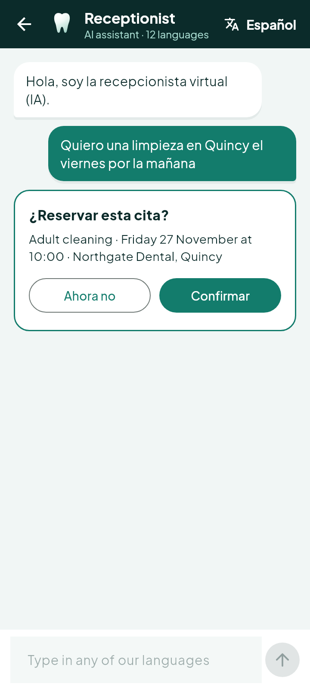 |

**How a message is handled** (`services/agent/src/agent/graph.py`):

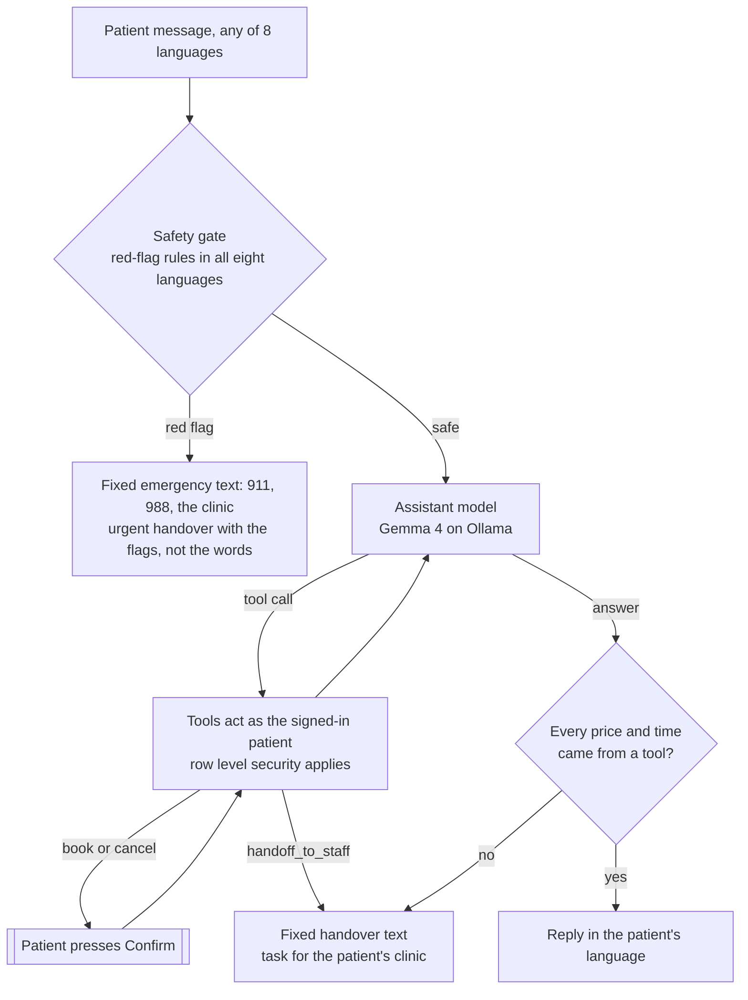

**What Lisa does, and how Northgate does it:**

| Lisa | Northgate |
| --- | --- |
| Answers the phone around the clock | Chat in the app around the clock (website next, with the portal) |
| Books in slots the practice keeps free | The same `available_slots`, `hold_slot` and `confirm_booking` the app uses, under the patient's own session |
| The team gets a summary after each conversation | `request_handover`: a task for the patient's own clinic with a short English summary, whatever language the patient used |
| AI Act text for the practice's website | The first message of every conversation says it is an AI (EU AI Act Article 50, US state bot-disclosure laws) |
| Specialty variants (orthodontics, implants, children) | Planned as reviewed playbooks per service family |

**Safety rules, each with a test** (`services/agent/tests/`, 28 tests):

| Rule | How it is enforced |
| --- | --- |
| Emergencies never reach the model | Red-flag patterns for breathing or swallowing trouble, heavy bleeding, spreading swelling, chest pain and self-harm, in every language, run on every message; a match returns fixed text and an urgent handover |
| Safety text is never generated | Disclosure, emergency, "I can't give medical advice", handover and the confirmation card come from `texts/fixed.yaml`, one reviewed entry per language |
| No medical advice | Any question about symptoms, medicines or treatment goes to the team with the fixed reply |
| Identity is never a model argument | The patient comes from the verified token; tools call Supabase with that token, so the database decides what the assistant may see |
| Nothing is booked or cancelled without the patient | LangGraph pauses (`interrupt`) until the patient presses Confirm; declining books nothing (tested) |
| No invented prices or times | A grounding check replaces a reply whose price or time no tool returned, and really hands it over |

**Languages:** English, French, Dutch, German, Spanish, Italian, Lithuanian and Swedish (Fiona's choice, 23 November 2026). Every non-English safety text is marked draft until a native speaker reviews it, as health messaging requires.

**Model:** `model_for(role)` picks the model from one setting. The demo runs Gemma 4 on Ollama, so nothing leaves our own machines. On a CPU a reply takes 30 to 60 seconds, so the app says so while it waits; Amazon Bedrock is one setting away if speed matters more than keeping everything in-house.

**Tracing:** LangSmith records each conversation's steps, tool calls, timings and outcomes, with inputs and outputs hidden: what the patient wrote never leaves the service.

</details>

<details>
<summary><b>The tooth chart: sculpted arches, painted surfaces</b></summary>


Both jaws seen from above, as a dentist sees them: two U-shaped arches set in the gums, the patient's right on the left of the screen (Universal numbering). Each tooth is drawn by type and shaded like enamel: molars with four cusps and their grooves, premolars with two, pointed canines, thin incisors. What happened is painted on the surface it happened to, read from the record's surface letters (top, front, back, cheek or tongue side): planned treatment in apricot, treatment done in teal, older fillings in silver, crowns in gold, implants in steel, decay as a dark spot, a crack as a line, a missing tooth as a dashed gap. The ring marks only what needs attention. Tapping a tooth opens its name in plain words ("Upper left first molar") and what was done, planned or noted. Drawn with Flutter's `CustomPainter`: no 3D engine, so it stays sharp, fast and readable by screen readers.

</details>

<details>
<summary><b>Flutter for the patient app</b></summary>

One codebase for Android now and iOS later, with full control over every pixel. That matters for an app that has to feel trustworthy, not generic.

- **Riverpod** for state: each screen watches small providers (`careSummaryProvider`, `dentistsProvider`), so data loads once and refreshes where it is used.
- **go_router** for navigation, with a gate that sends people to sign-in, the code screen or their records depending on the session.
- **pdfx** renders documents with Android's own PDF renderer, so patients read their files without downloading them.
- **flutter_local_notifications** schedules visit reminders and aligner alerts on the device. The reminder text is generic ("Dental visit tomorrow at 09:30"), because a lock screen is not private.
- **Fonts are bundled**, never fetched from a font service at runtime, so the app makes no third-party requests that could reveal who is using it.
- **Online-first:** Boston patients have reliable connectivity. Only the session and the aligner log live on the phone, and both are encrypted and wiped on sign-out.

</details>

<details>
<summary><b>Edge Function and the US Census geocoder for addresses</b></summary>

The app accepts only real, verified home addresses. The US Census Bureau geocoder is free, needs no key and covers every US address, but it refuses requests from outside the US. The `verify-address` Edge Function calls it from Supabase's US region, sends only the street line, city, state and ZIP code (no name or record number), and returns up to three official matches for the patient to confirm.

</details>

<details>
<summary><b>Resend for sign-in emails</b></summary>

Supabase sends the sign-in codes through Resend's SMTP service, with branded templates in `supabase/templates/`. The emails carry a code and nothing clinical.

</details>

<details>
<summary><b>Oracle Cloud: a private VM behind a Network Load Balancer, built with Terraform</b></summary>

The always-on services run on one Oracle Cloud VM with Docker Compose. Everything around it is code in `infra/terraform/oci/`, so the whole server can be destroyed and rebuilt from this repository, and every infrastructure change is reviewed as a pull request with a `terraform plan`.

- **No public IP on the VM.** It sits in a private subnet that forbids public addresses. The only way in from the internet is the Network Load Balancer on ports 80 and 443; outbound traffic (updates, image pulls, backups) leaves through a NAT gateway.
- **Network Load Balancer, not an HTTP load balancer:**
  - it passes traffic straight through and keeps each visitor's real IP, so the WAF and rate limits work per visitor (shown in the WAF log);
  - TLS stays end to end to our own Nginx, where it is tested in CI;
  - an HTTP load balancer would end TLS itself and replace every visitor's address with its own.
- **SSH only through Oracle Bastion.** Port 22 is closed to the internet. Sessions last at most three hours and can only be opened from one admin address. `infra/scripts/ssh-vm.sh` opens a session and signs in, in one command.
- **Least-privilege security lists:** the public subnet takes 80 and 443 only. The private subnet takes 80 and 443, and SSH only from the bastion's subnet.
- **Its own compartment,** and every resource tagged with product, environment and `managed_by=terraform`.
- **Shape:** VM.Standard.E3.Flex (1 core, 8 GB) while Johannesburg has no free Ampere A1 capacity. `infra/terraform/oci/retry-a1.sh` checks Oracle's capacity report and moves to the Always Free A1 when it can. The new VM is built before the old one is removed, so a failed attempt never leaves the site without a server.

- **Three networks:** `edge` faces the internet and only the WAF is on it; `app` is for services; `data` is internal-only, with no route in or out, and holds Presidio.
- **Every container** has a pinned version, a memory limit, a health check and log rotation, and every image has amd64 and arm64 builds.
- **Hardening** (`infra/scripts/bootstrap-vm.sh`, run automatically on first boot): keys-only SSH, no root sign-in, fail2ban, automatic security updates, a host firewall for 80 and 443, and a non-root `deploy` user.

</details>

<details>
<summary><b>AWS account baseline, built with Terraform</b></summary>

The AWS account holds backups only, so it is locked down to match. `infra/terraform/aws/` manages:

- **CloudTrail `northgate-audit`:** records every action in every region, including IAM and sign-ins. Log file validation proves no log was changed or deleted. The logs go to a private, versioned, encrypted bucket that refuses plain HTTP.
- **Account-wide S3 Block Public Access:** no bucket can be made public, whatever its own settings say.
- **Password policy:** at least 14 characters with every character class, and the last 24 passwords blocked. There is no forced expiry, following NIST SP 800-63B; MFA protects instead.
- **Cost alerts:** Cost Anomaly Detection sends a daily email if unusual spend reaches US$1, alongside a US$1 budget.
- **Storage Lens dashboard** for storage use by region and bucket.

IAM Access Analyzer would normally be part of this baseline. AWS blocks it on free plan accounts with a service control policy, so it waits until the account is upgraded.

</details>

<details>
<summary><b>Two clouds, two jobs: how the Oracle and AWS designs map onto each other</b></summary>

Northgate deliberately uses two providers for two different jobs, so a failure or a mistake in one cannot take the other with it: **Oracle Cloud runs the services** (always-on compute at low cost) and **AWS keeps the backups and the audit trail** (S3's durability and CloudTrail). The backups are encrypted with `age` *before* they leave Oracle, so AWS only ever stores ciphertext, and the key that decrypts them lives on neither cloud.

Both are built with Terraform, so the same habits apply in each: a plan reviewed before every apply, every resource tagged with product, environment and `managed_by=terraform`, and no console clicking that the code does not know about.

| Concern | Oracle Cloud (compute) | AWS (backups and audit) | Why it is done this way |
| --- | --- | --- | --- |
| Isolation boundary | Compartment `northgate` | The account itself, guarded by account-wide S3 Block Public Access | Blast radius: a mistake elsewhere cannot touch these resources |
| Private network | VCN `10.20.0.0/16`, public and private subnets | Not needed: no compute runs on AWS | Build only what a job needs |
| Way in from the internet | Network Load Balancer, TCP 80 and 443, client IP preserved | None: S3 is reached with signed API calls | The WAF must see real visitor IPs for its rate limits |
| Firewall rules | Security lists per subnet, plus the host firewall | Bucket policies that refuse plain HTTP | Defence in depth: two layers, each enough on its own |
| Admin access | Oracle Bastion: time-limited sessions, one source IP, no port 22 open | IAM users per job: upload-only for the VM, read-only for restores | Least privilege; the VM can add backups but never read or delete them |
| Way out | NAT gateway, plus a service gateway for Oracle services | Not applicable | The VM needs updates and images without a public IP |
| Audit | Oracle's audit log (default, 365 days) | CloudTrail in every region, with log file validation | Evidence that cannot be quietly edited |
| Cost guardrails | Always Free limits; `retry-a1.sh` moves to the free Ampere A1 | A US$1 budget and Cost Anomaly Detection | Cost alerts exist before the resources they watch |
| Storage insight | Boot volume metrics | S3 Storage Lens dashboard | Know what is stored where, by region and bucket |
| Region | Johannesburg (Oracle's accepted home region, ADR 0004) | Stockholm (fixed for this account, ADR 0003) | Test data only; a real US client would move both to US regions |

**The same idea in AWS terms:** if the VM moved to AWS, the design would be an EC2 instance in a private subnet behind a Network Load Balancer, Systems Manager Session Manager instead of Oracle Bastion (no SSH port at all), security groups instead of security lists, and an instance role instead of a stored access key for backups. The warm standby planned for section 16 is exactly that.

</details>

<details>
<summary><b>Nginx with ModSecurity and the OWASP Core Rule Set</b></summary>

The WAF is the single public entrance to the server. The OWASP Core Rule Set is the standard open-source rule set against the common web attacks, and OWASP's official image runs it inside Nginx.

- **HTTPS only:** HSTS, TLS 1.2 and 1.3, plus a strict Content Security Policy, frame denial and nosniff headers.
- **Rate limits per client address:** a flood gets 429 Too Many Requests.
- **Logs by allow-list:** the JSON access log records the path without its query string, the status and the timing. A token or ID passed in a URL never reaches a log.
- **A pitfall the tests caught:** Nginx's `return` directive answers before ModSecurity and the rate limiter run, so even a health check written with `return` would skip the WAF. Every answer is served as a file instead, after the checks.
- **Certificates:** from Let's Encrypt through Certbot. Hostnames come from sslip.io, a free wildcard DNS service, so no paid domain is needed.

</details>

<details>
<summary><b>Microsoft Presidio for redaction</b></summary>

Before any text leaves our infrastructure (into a log, an error report, or a model with no data agreement), Presidio finds and replaces names, phone numbers, emails and Northgate's own identifiers: record numbers (`NG` and seven digits) and insurance member IDs. It runs on the internal network with no published port.

Two findings from testing with the canary record:

- Presidio's email recognizer accepts only real top-level domains, so a test address on a made-up domain slipped through. An extra pattern now catches any address.
- With every recognizer switched on, a US phone number was read as a UK NHS number and an email was split into fragments. Callers now ask only for the entity types a US practice handles.

</details>

<details>
<summary><b>Nightly encrypted backups to Amazon S3</b></summary>

Losing the VM, or even the Oracle account, must never mean losing data.

- **Every night at 02:00 UTC:** `pg_dump` (Postgres 17, run in a container) dumps the production database, `age` encrypts the dump with a public key, and the encrypted file is uploaded to S3.
- **The VM can only add backups:** its key allows uploads to one prefix and nothing else, so an attacker on the VM cannot read or delete the history (this was tested).
- **The keys to restore are kept off the VM:** the decryption key and the read-only key both stay elsewhere.
- **The bucket:** blocks public access, keeps versions and encrypts again at rest. A lifecycle rule keeps 30 days.
- **A monthly restore test** (`infra/scripts/restore-test.sh`) restores the latest file into Supabase's own Postgres image and counts the rows. A backup that has never been restored is not a backup.

</details>

<details>
<summary><b>Test data generator (Python, uv)</b></summary>

About 3,000 dental patients with visits, tooth charts, findings and treatment plans, plus named test personas. It also plants **canary records**: unmistakable fake values that must never appear in a log, trace or message. `scripts/canary-scan.sh` fails if one does.

</details>

<details>
<summary><b>GitHub Actions</b></summary>

Every pull request runs:

- a secret scan (gitleaks);
- a guard against private files;
- a house-style check on the documentation;
- the database tests (pgTAP on a fresh database with generated patients);
- the generator tests;
- the Flutter tests;
- the WAF and Presidio tests against a real running stack;
- shellcheck on the server scripts.

Merges into `develop` apply database migrations to staging automatically.

</details>

## Engineering principles, and where they show in the code

Each principle below comes from a well-known software engineering book, and each is tied to something in this repository you can open and check.

<details>
<summary><b>From the books to this repository</b></summary>

| Principle | Book | Where it is applied here |
| --- | --- | --- |
| **The transactional outbox**: publish events in the same transaction as the change | *Designing Data-Intensive Applications*, Martin Kleppmann; *Microservices Patterns*, Chris Richardson | `private.publish_appointment_event()` writes to the queue inside the booking's own transaction, so an event can never be lost or describe a change that rolled back |
| **Idempotent consumers**: at-least-once delivery plus de-duplication gives an exactly-once *effect* | *Designing Data-Intensive Applications* | `private.mark_processed()` for appointment events and Stripe events; `notification_log` claimed before every email; Stripe and Resend idempotency keys |
| **Ordering with version numbers** | *Designing Data-Intensive Applications* | Every appointment event carries a version; the worker re-reads the current status before sending, so a late "booked" never confirms a cancelled visit |
| **Stability patterns: timeouts, bulkheads, steady state, fail fast** | *Release It!*, Michael Nygard | HTTP timeouts in the worker; a separate `urgent` queue and separate Docker networks (bulkheads); fixed batches of 10 and pruned n8n executions (steady state); bad signatures refused before any work is done (fail fast) |
| **Dead-letter queue for poison messages** | *Enterprise Integration Patterns*, Gregor Hohpe and Bobby Woolf | After five failed tries a message moves to `dead_letter` instead of blocking the queue |
| **Deep modules: a narrow interface over a lot of behaviour** | *A Philosophy of Software Design*, John Ousterhout | `record_stripe_event(raw_body, signature)` is one call that hides signature checks, replay protection, de-duplication, amount checks, state changes and the receipt; `notification_context()` hides every join the worker would otherwise need |
| **Make illegal states unrepresentable** | *Domain Modeling Made Functional*, Scott Wlaschin | Check constraints: a payment is `paid` if and only if `paid_at` is set; money is whole cents; one live payment per visit is a unique index, not a hope |
| **Ubiquitous language** | *Domain-Driven Design*, Eric Evans | Tables, functions and files use the clinic's own words (appointment, hold, proxy, recall), kept in a glossary |
| **Test first, and test the thing that must be refused** | *Test-Driven Development: By Example*, Kent Beck | 382 database tests, each security rule with an allowed and a denied case; every edge case has a test before the code |
| **Don't live with broken windows; automate everything** | *The Pragmatic Programmer*, Andrew Hunt and David Thomas | Pre-commit hooks, gitleaks, shellcheck and a commit-message guard; CI blocks merges on any failure; deployments run from GitHub Actions, not by hand |
| **Small batches, trunk-based flow, deployment automation** | *Accelerate*, Nicole Forsgren, Jez Humble and Gene Kim | One small pull request per ticket into `develop`; every merge deploys migrations to staging; production waits for a required reviewer |
| **Infrastructure as code, immutable servers** | *Infrastructure as Code*, Kief Morris | Terraform for both clouds; the VM is replaced, not patched by hand (`create_before_destroy`); cloud-init hardens it on first boot |
| **Service level objectives and error budgets** | *Site Reliability Engineering*, Google | Reminders within 5 minutes of their due time and queue age under 60 seconds are written targets, alerted on in section 12 |
| **Least privilege and defence in depth** | *Security Engineering*, Ross Anderson | Separate database roles for the app, the worker and payments; WAF, network rules and row level security, each sufficient alone |
| **Refactor in small, safe steps** | *Refactoring*, Martin Fowler | Changes such as the receipt type were added behind the existing worker loop with tests around them, not as a rewrite |
| **The simplest thing that could possibly work** | *Extreme Programming Explained*, Kent Beck | One database (no separate broker, cache or vector store) until a measured need says otherwise |

</details>

## Patient emails

Every email the practice sends is built by the worker from one shared frame: tables instead of modern CSS so Gmail, Apple Mail and Outlook render it the same, system fonts, dark mode, one main button, and the clinic's number as a tap-to-call link. Service emails carry no images at all, so nothing is fetched and nothing breaks when images are blocked. Campaign emails add one hero picture, an offer card and up to three reasons, in the style of a well-run Mailchimp account, and always carry one-click unsubscribe.

<p align="center">
  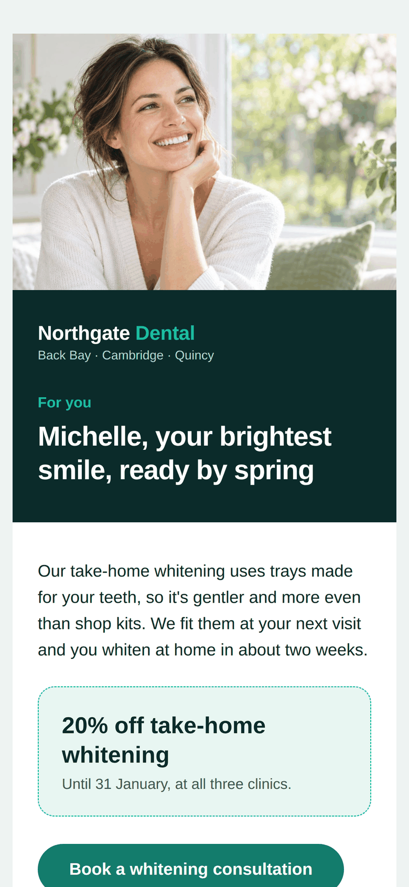
  
  
  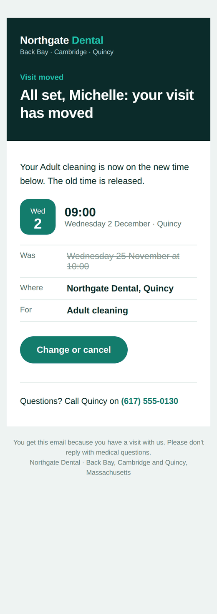
</p>
<p align="center">
  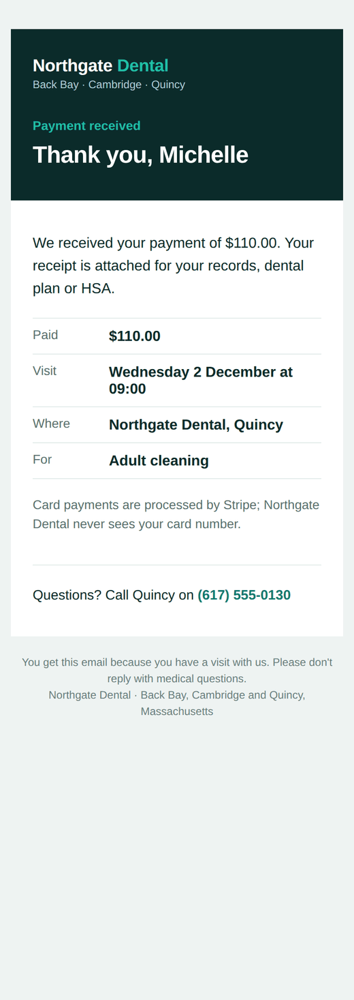
  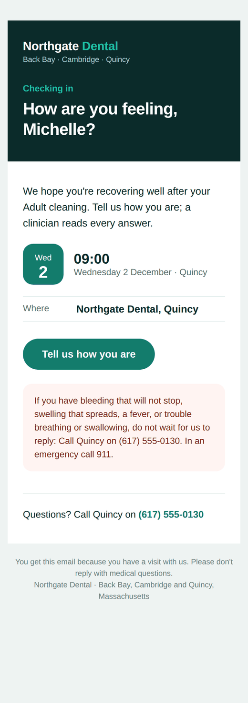
</p>

<details>
<summary><b>What an expert email marketer would check, and how each email passes</b></summary>

| Check | How it is done here |
| --- | --- |
| Subject and preview text do the selling | Subjects carry the day and time (never the treatment, because subjects show on lock screens); a hidden preheader sets the inbox preview |
| One job per email | Exactly one main button: change or cancel, pay, tell us how you are, or book the offer |
| Pictures that help, text that survives without them | Campaign hero photos are hosted in a public Supabase Storage bucket at a fixed address with alt text; service emails have no images, so they render in full even when images are blocked |
| No tracking pixels | The picture address is the same for every recipient; a test refuses a per-recipient query string |
| Mobile first | 600 px card that goes full width under 620 px; the three reasons stack on a phone |
| Dark mode | `prefers-color-scheme` swaps the card and ink colours |
| Deliverability | Plain-text part on every email; one-click unsubscribe (`List-Unsubscribe` headers) on campaigns; Resend idempotency keys so retries never double-send |
| Consent | Campaigns go only to patients who opted in; the footer says why they got it |
| Privacy | First name, service, time, clinic and phone only; no surname, record number or clinical detail; campaigns never mention anyone's treatment (tested) |

The pictures were generated for the fictional practice (no stock licence to track, no real people) and cropped to 3:2 at 1200 by 800 pixels.

</details>

## What the patient app does

<details>
<summary><b>Features</b></summary>

- **Sign in** with email and password, then a code emailed at every sign-in.
- **Find or create a record:** match an existing record by email and date of birth, or register as a new patient.
- **Book, reschedule and cancel:**
  - choose a clinic, then a service (each explained in plain words, searchable and grouped with pictures), then a dentist or "any available", then a time;
  - a slot is held for 10 minutes while the patient confirms.
- **Dentist profiles:** portraits, focus and the clinics each dentist works at.
- **Clinic pages:**
  - a photo, open or closed right now, and the opening hours;
  - directions and a call button;
  - the services offered and the team at that clinic.
- **Visit records:** the reason for the visit, a sculpted tooth chart (tap any tooth), what was done, the findings and the treatment plan.
- **Receptionist assistant:** chat in 8 languages to book, move, cancel or pay, with confirm buttons, and a handover to the team for anything else.
- **Documents from the practice:** visit summaries and X-rays, opened in an in-app PDF viewer.
- **Reminders and recall:** visit reminders the evening before and on the day, check-up recall, and aftercare sheets after treatment.
- **Clear aligner timer** with in-app notifications.
- **Details:** insurance plans picked from a list, and a verified home address.
- **Family access:** parents see their children's records, with limits for teenagers.
- **Payments:** each booked visit shows its price with Pay now or Paid; Payments, under Profile, lists what is due and the receipts; card details go only to Stripe.
- **Shop:** clinician-recommended products by category, refills every few months, collection at a chosen clinic or delivery, prescription items unlocked by the dentist, and orders under Profile.

</details>

## Deployments

<details>
<summary><b>24 November 2026: campaign emails with pictures, Stream call tokens, the LangSmith and Stream decisions</b></summary>

**What was built:**
- the campaign email redesign: hero picture, offer card, three reasons, gold accent for December; two campaigns (spring whitening, December treat) sent to the staging inbox through Resend;
- `POST /assistant/stream-token` is the address (the earlier `/stream/token` name was not proxied by Nginx);
- a public `marketing` bucket in Supabase Storage for campaign pictures (migration `20261124000100_marketing_assets.sql`), created on staging and holding both pictures;
- `POST /assistant/stream-token` in the assistant service: a one-hour Stream Video token for the signed-in patient, signed on the server with the standard library (no SDK), refused without a valid session or when Stream is not configured;
- two decisions recorded: LangSmith tracing with inputs and outputs hidden (ADR 0014) and Stream as the call transport with Nora's brain unchanged (ADR 0015).

**How it was proved:**
- worker: 24 tests, including that a campaign button never points at the bare site root and that a picture address cannot carry a per-recipient tracker;
- assistant: 37 tests, including a token that names only the user ID and dies after an hour, and no token without a session;
- both campaign emails delivered and read back from the inbox, pictures loading from the public bucket.

**Commands:**

```bash
cd services/worker && uv run pytest -q
cd services/agent && uv run pytest -q
supabase projects api-keys --project-ref <staging ref> -o json        # the service key, never printed
curl -X POST "$SUPABASE_URL/storage/v1/bucket" -H "Authorization: Bearer <service key>" -d '{"id":"marketing","name":"marketing","public":true}'
curl -X POST "$SUPABASE_URL/storage/v1/object/marketing/emails/promo-spring.jpg" -H "Authorization: Bearer <service key>" -H "Content-Type: image/jpeg" --data-binary @.github/readme/emails/promo-spring.jpg
scripts/shot.sh file://.../spring.html docs/media/emails/promotion-spring-phone.png phone
```

**Screenshots still to take:**
- [ ] Gmail on the phone: the December email with the picture loaded, light and dark mode
- [ ] Supabase staging, Storage: the `marketing` bucket with the two pictures
- [ ] Stream dashboard: the app's region and the three call types once created

</details>

<details>
<summary><b>22 November 2026: the receptionist assistant, the sculpted tooth chart, LangSmith</b></summary>

**What was built and merged (PRs #93 and #94):**
- the sculpted tooth chart, installed on the test phone;
- the receptionist assistant service (`services/agent`), its chat screen in the app, and `request_handover` on staging;
- LangSmith connected (a test trace and the `northgate-assistant` project);
- a CI job for the assistant's tests.

**Not yet live:** the assistant on the VM. Gemma needs about 6 GB of memory and the VM has about 4 GB free; it goes live on the free Ampere A1 (24 GB) as soon as Oracle has capacity, or sooner with more memory on the current VM.

**How it was proved:**
- 28 assistant tests: emergencies caught in all eight languages, ordinary questions left alone, the model never called on a red flag, clinical questions handed over, bookings waiting for the button, invented prices refused;
- 457 database tests, 72 app tests;
- Gemma 4 on the laptop called the booking tool correctly from Spanish (and, before the language change, Haitian Creole).

**Problems found and fixed on the way:**
- The confirmation card showed a clinic code and English buttons in a Spanish chat: it now shows the clinic and service names, and its wording comes from the reviewed texts in the patient's language.
- The chat header overflowed on a 360-wide phone with a long language name: the title and language button now shrink.
- LangSmith refused the first keys with 403: the account is on LangSmith's AWS deployment, and the free plan needs a Personal Access Token.

**Commands:**

```bash
cd services/agent && uv init --package && uv add fastapi uvicorn langgraph langchain-core langchain-ollama langsmith httpx pydantic pyyaml
uv run pytest -q
uv run python evals/smoke_live_model.py
gh pr create --base develop --title "feat(assistant): multilingual receptionist with a safety gate, confirmations and team handover"
flutter build apk --release --dart-define-from-file=staging.env && adb install -r build/app/outputs/flutter-apk/app-release.apk
```

**Screenshots still to take:**
- [ ] LangSmith: the `northgate-assistant` project with a conversation's steps (and the hidden inputs)
- [ ] The app on the phone: a visit's tooth chart, and a tooth's sheet after tapping it
- [ ] Supabase staging, Table editor: `assistant_handovers` and the matching `staff_tasks` row after a handover

</details>

<details>
<summary><b>21 November 2026 (late): section 07 finished, paying in the app, and the dental shop</b></summary>

**What went live (PRs #87 to #91):**
- W22 conflict scanner and the staff task inbox;
- cancel (W03), check-in (W11) and pay (W06) links with their n8n pages;
- PDF receipts (Gotenberg on the internal network);
- paying for visits in the app;
- the dental shop: catalogue, rules, W12 checkout with Stripe Billing refills and Stripe Tax, order emails, and the Shop tab;
- sticky notes on every n8n workflow, placed above the nodes.

**Proved on staging, end to end:** a toothbrush plus brush heads on a 3-month refill, collected at Quincy. Stripe charged $98.81 ($93.00 plus $5.81 Massachusetts tax) and created the subscription; the order became paid, Quincy's stock fell from 12 to 11, the clinic got a set-aside task and the confirmation email was sent. A forged webhook was refused (400); a cancel link opened without cancelling, cancelled on the button and refused a second press.

**Problems found and fixed on the way:**
- Refill checkouts showed Kenyan shillings (Adaptive Pricing): now off for every checkout.
- Collection orders asked for a full billing address: now only what Stripe Tax needs.
- A snackbar after "Add to bag" covered the next product's button: removed, the bag button confirms instead.
- Product cards overflowed by 5 pixels on a 360-wide phone: taller cards.

**Commands (secrets replaced with placeholders):**

```bash
# Stripe Tax: Massachusetts registration (test mode), then a check
curl -s -u "$STRIPE_SECRET_KEY:" https://api.stripe.com/v1/tax/registrations -d country=US -d "country_options[us][state]=MA" -d "country_options[us][type]=state_sales_tax" -d active_from=now  # gitleaks:allow
# webhook: refills too
curl -s -u "$STRIPE_SECRET_KEY:" https://api.stripe.com/v1/webhook_endpoints/<endpoint id> -d "enabled_events[]=invoice.paid" ...  # gitleaks:allow

# workflows: built through the n8n MCP server, exported, notes added, imported on the VM
python3 n8n/add_notes.py
docker exec -i <n8n container> n8n import:workflow --input=/tmp/w12-shop-checkout.json
docker exec <n8n container> n8n update:workflow --id=<id> --active=true

# VM: worker with links, order emails and PDF receipts, plus the renderer
docker compose --profile worker up -d --build worker pdf

# app: build for the test phone and install
flutter build apk --release --dart-define-from-file=staging.env
adb install -r build/app/outputs/flutter-apk/app-release.apk
```

**Screenshots still to take:**
- [ ] Stripe Dashboard, Subscriptions: the brush-head refill (https://dashboard.stripe.com/test/subscriptions)
- [ ] Stripe Dashboard, Tax: the Massachusetts registration (https://dashboard.stripe.com/test/tax/registrations)
- [ ] The order confirmation email and a receipt email with its PDF attachment
- [ ] The app on the phone: Shop tab, a product, the bag, Payments and Orders under Profile
- [ ] Supabase staging, Table editor: `shop_orders` (the paid order) and `staff_tasks`
- [ ] The n8n editor through the tunnel: the workflow list, and W12 with its notes

</details>

<details>
<summary><b>21 November 2026 (night): payments live in Stripe test mode, and n8n on the VM</b></summary>

**What went live:**
- the payments table and functions on staging (#83);
- n8n workflows W04 (payment link) and W05 (payment received) on the VM's n8n;
- the worker's receipt email;
- n8n verifying Supabase's certificate (#84).

**How it was proved, on staging, end to end:**
1. W04 created a real Checkout Session for a booked visit: $110.00, the price list's amount for that service at Quincy.
2. A headless browser paid it with Stripe's test card 4242 4242 4242 4242.
3. Stripe sent a signed webhook to `https://n8n.84-12-126-31.sslip.io/webhook/stripe`, through the Network Load Balancer and the WAF.
4. Postgres checked the signature, recorded the payment as paid and queued a receipt; the worker sent it.
5. A forged event signed with a guessed secret was refused with HTTP 400, and the n8n editor still answers 404 from the internet.

| Stripe Checkout | Forged webhook refused | Tests |
| --- | --- | --- |
|  |  |  |

**Two problems caught along the way:**
- Stripe's Adaptive Pricing showed the price in Kenyan shillings, because the test browser was in Kenya. W04 now turns it off, so a US clinic always charges USD.
- n8n's Postgres connection rejected Supabase's certificate, because Supabase signs with its own root CA. Rather than switch verification off, the root CA was checked against Supabase's published copy and added to n8n's trust store.

**Commands (secrets replaced with placeholders):**

```bash
# n8n workflows built through the n8n MCP server: validate, then create, then export to Git
#   validate_workflow(code) -> create_workflow_from_code(code) -> publish_workflow(id)
docker exec n8n-n8n-1 n8n export:workflow --id=<id> --output=/tmp/w04-payment-link.json

# Stripe webhook endpoint created by API; the signing secret goes straight into GitHub, never printed
curl -s -u "$STRIPE_SECRET_KEY:" https://api.stripe.com/v1/webhook_endpoints -d url=https://n8n.84-12-126-31.sslip.io/webhook/stripe -d "enabled_events[]=checkout.session.completed" -d "enabled_events[]=checkout.session.expired" | jq -r .secret | gh secret set STRIPE_WEBHOOK_SECRET --env staging  # gitleaks:allow (the key comes from infra/.env)

# merge to develop: GitHub Actions applies the migration to staging and loads the secret into Vault
gh pr merge 83 --squash

# payments login on staging: only a SCRAM hash of the password reaches the database
create role northgate_payments_app login password '<SCRAM-SHA-256 hash>' in role northgate_payments;

# on the VM: pull, rebuild the worker, import credentials from stdin and the workflows
git pull --ff-only origin develop
docker compose --profile worker up -d --build worker
<credentials json> | docker exec -i <n8n container> sh -c 'cat > /tmp/c.json; n8n import:credentials --input=/tmp/c.json; rm /tmp/c.json'
docker exec -i <n8n container> n8n import:workflow --input=/tmp/w05-stripe-payment-received.json
docker exec <n8n container> n8n update:workflow --id=<id> --active=true
docker compose --profile n8n up -d n8n
```

**Screenshots still to take:**
- [ ] Stripe Dashboard → Payments, showing the $110.00 test payment: https://dashboard.stripe.com/test/payments
- [ ] Stripe Dashboard → Workbench → Webhooks, the endpoint and its successful delivery: https://dashboard.stripe.com/test/workbench/webhooks
- [ ] The receipt email in your inbox (subject "Payment received")
- [ ] Supabase staging → Table editor → `payments`, the paid row: https://supabase.com/dashboard/project/dxkfsslymzqbgtoijuut/editor
- [ ] Supabase staging → Integrations → Vault, showing `stripe_webhook_secret` exists (value hidden)
- [ ] The n8n editor through the tunnel, with W04 and W05 active (see below). The first visit asks you to create the owner account; it can only be reached through the tunnel, so nobody else can claim it first.
- [ ] GitHub → Settings → Environments → staging, showing `STRIPE_WEBHOOK_SECRET`

**Opening the n8n editor on the VM:** it has no public address on purpose. Open a tunnel through Oracle Bastion, then browse to `http://localhost:15678` (15678, because the laptop's own n8n uses 5678):

```bash
TUNNEL=15678 infra/scripts/ssh-vm.sh deploy   # leave it running, then open http://localhost:15678
```

</details>

<details>
<summary><b>21 November 2026 (evening): notification worker live, sending booking confirmations</b></summary>

**What went live:**
- the queues and outbox (#79);
- the notification worker (#80), running on the private VM. For the demo it serves the staging project, which is the one the app on the test phone uses.

**How it was proved:**
- **Least privilege:** the worker's own database login can read the queues, but reading `patients` is denied.
- **End to end:** a booking made in the database became an event, then a confirmation request, then an email. The worker log shows each step with IDs only.
- **A failure caught along the way:** the first send failed with HTTP 401, because the email key had been copied one character short. The message stayed on the queue, and it was sent once the key was corrected: nothing was lost and nothing was sent twice.

```bash
# worker login: only a SCRAM hash of the password reaches the database
create role northgate_worker_app login inherit password '<SCRAM-SHA-256 hash>' in role northgate_worker;

# settings onto the VM through the Bastion, never printed
printf 'WORKER_DB_URL=<url>\nRESEND_API_KEY=<send-only key>\n' | infra/scripts/ssh-vm.sh deploy 'cat >> /opt/northgate/infra/.env'

# build and start (VM)
docker compose --profile worker build worker
docker compose --profile worker up -d worker
docker compose --profile worker logs -f worker
```

**Screenshots still to take:**

- [ ] The confirmation email in your inbox (subject "Your visit is booked")
- [ ] Resend's email log, showing the sends: https://resend.com/emails
- [ ] The worker log on the VM (`docker compose --profile worker logs worker`)

</details>

<details>
<summary><b>21 November 2026 (later): private VM behind a Network Load Balancer, live at <code>https://84-12-126-31.sslip.io</code></b></summary>

**What changed:**
- Terraform built a compartment, a network with public and private subnets, NAT and service gateways, a Network Load Balancer, a Bastion and a new VM with no public IP.
- The services moved to the new VM, and the first VM was deleted.

**Terraform plan:** 20 resources to add, nothing to change or destroy.

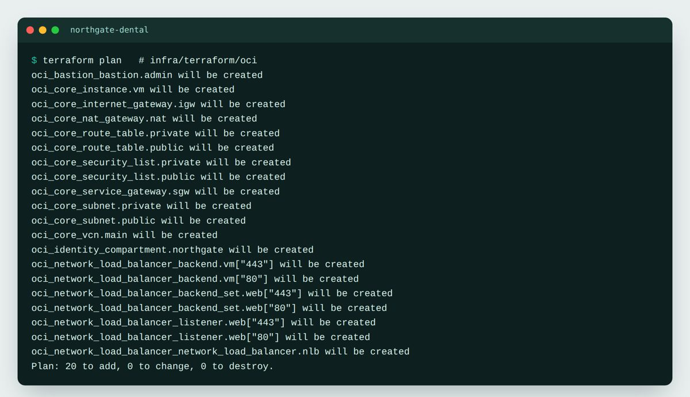

**All WAF checks pass on the new VM, behind the balancer:**

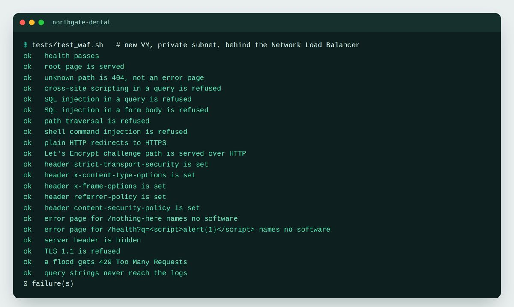

**The VM has no public IP, and the balancer answers only on 80 and 443:**

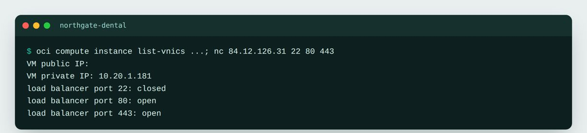

**The backup leaves the private VM through the NAT gateway:**

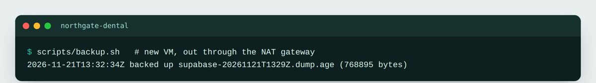

**Commands, in order:**

```bash
# Oracle API key in ~/.oci/config (console: My profile → API keys), then:
cd infra/terraform/oci
terraform init
terraform plan -out=northgate.tfplan          # 20 to add
terraform apply northgate.tfplan              # A1 had no capacity, so the shape setting switched to E3.Flex

# the VM hardens itself on first boot; sign in through the bastion
infra/scripts/ssh-vm.sh deploy
cd /opt/northgate/infra
nano .env                                     # settings copied from the first VM, DOMAIN=84-12-126-31.sslip.io
scripts/issue-certs.sh --letsencrypt          # the certificate check arrives through the load balancer
docker compose up -d --wait
tests/test_waf.sh && tests/test_presidio.sh && scripts/backup.sh

# first VM deleted together with its boot volume
oci compute instance terminate --instance-id <first VM> --preserve-boot-volume false

# move to the free Ampere A1 when Oracle has capacity
nohup infra/terraform/oci/retry-a1.sh 900 > ~/retry-a1.log 2>&1 &
```

**Console screenshots still to take:**

- [ ] Network Load Balancer, showing its listeners, backend sets and health: https://cloud.oracle.com/networking/network-load-balancers?region=af-johannesburg-1
- [ ] The VM's page, showing the private IP only and the shape: https://cloud.oracle.com/compute/instances?region=af-johannesburg-1
- [ ] The VCN with its two subnets and gateways: https://cloud.oracle.com/networking/vcns?region=af-johannesburg-1
- [ ] The Bastion and an active session: https://cloud.oracle.com/bastion/bastions?region=af-johannesburg-1
- [ ] The `northgate` compartment's resources, with their tags

</details>

<details>
<summary><b>21 November 2026: hardened server on Oracle Cloud (first VM, since replaced)</b></summary>

**What went live:**
- the WAF front door, with HTTPS from Let's Encrypt;
- Presidio for redaction;
- nightly encrypted backups of the production database to Amazon S3, with a restore test on a separate machine.

| Gateway page | On a phone |
| --- | --- |
| 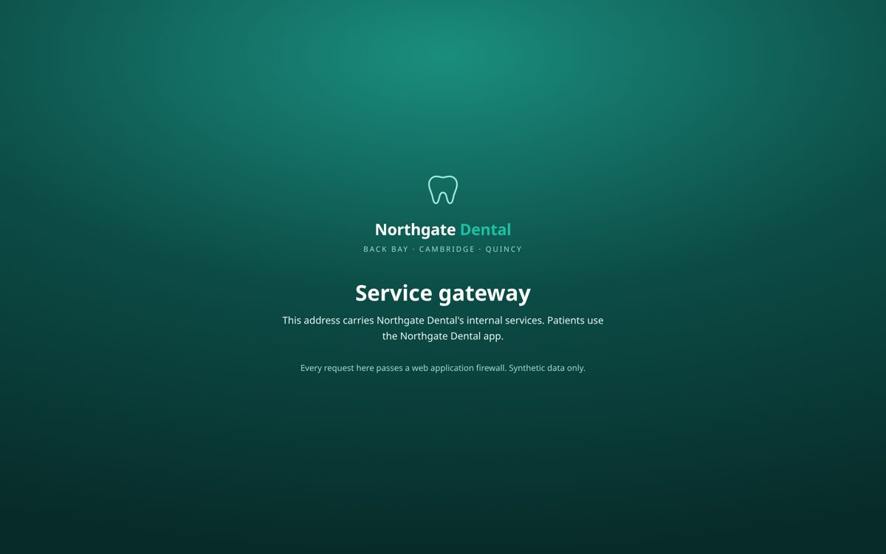 | 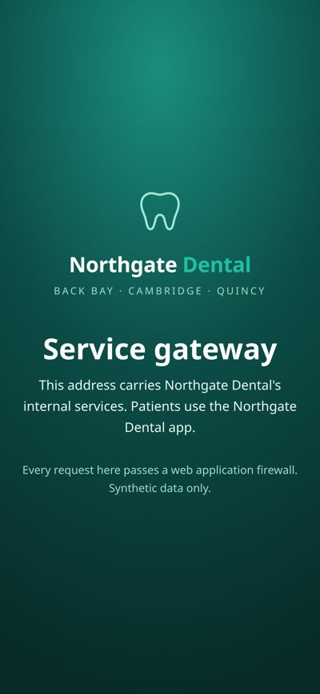 |

**The firewall, tested on the live server:** every attack is refused, the headers are set, and floods get 429.

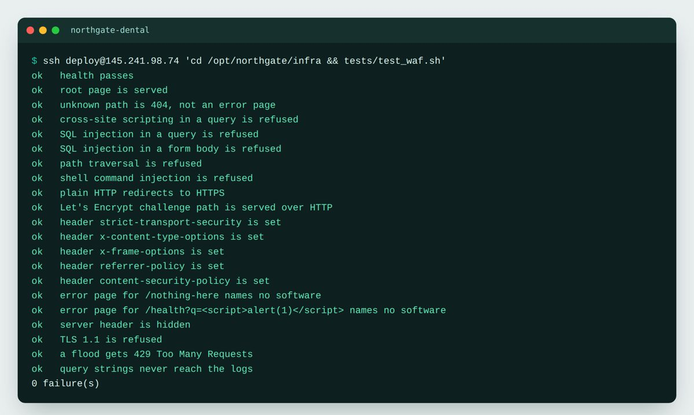

**From the internet:** attacks get 403, and the certificate is valid.

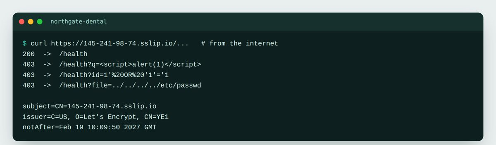

**Presidio removes every canary value:**


**Backups:** encrypted on the VM, and the VM's key can only upload.

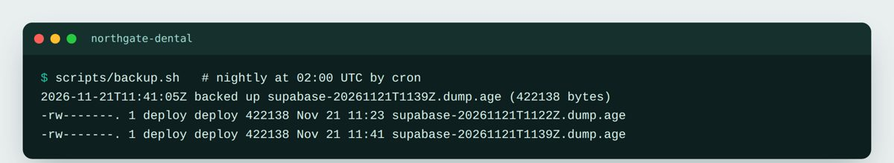


**Restore test:** downloaded with a read-only key, decrypted on a laptop, and restored into Supabase's own Postgres image.

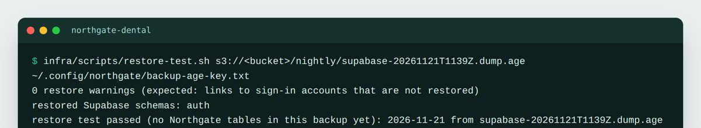

**Commands, in order** (placeholders stand in for secrets):

```bash
# one-time AWS set-up from a laptop: bucket, upload-only and read-only users, budget alert
aws login --profile northgate
infra/aws/backup-bucket.sh

# harden the VM (Oracle Linux 9): updates, firewall, fail2ban, keys-only SSH, Docker, age, deploy user, cron
ssh opc@<first VM IP> 'sudo bash -s' < infra/scripts/bootstrap-vm.sh

# backup key pair: the private key never leaves the laptop
age-keygen -o ~/.config/northgate/backup-age-key.txt

# on the VM, as the deploy user
ssh deploy@<first VM IP>
cd /opt/northgate/infra
nano .env                                   # DOMAIN, SUBDOMAINS, SUPABASE_DB_URL=<pooler URI>, backup keys
scripts/issue-certs.sh --letsencrypt         # start the WAF, get the certificate
docker compose up -d --wait                  # Presidio
tests/test_waf.sh && tests/test_presidio.sh  # prove it
scripts/backup.sh                            # first backup; cron runs it at 02:00 UTC

# back on the laptop: prove the backup restores
infra/scripts/restore-test.sh s3://<bucket>/nightly/<file>.dump.age ~/.config/northgate/backup-age-key.txt
```

**Console screenshots still to take** (they need a sign-in):

- [ ] Oracle instance page, showing the shape, OS and public IP: https://cloud.oracle.com/compute/instances?region=af-johannesburg-1
- [ ] Oracle security list with only 22, 80 and 443 open (VM page → Networking → Subnet → Security)
- [ ] S3 bucket properties, showing versioning, encryption, Block Public Access and the lifecycle rule: https://eu-north-1.console.aws.amazon.com/s3/buckets?region=eu-north-1
- [ ] The nightly backups in the bucket (`nightly/`)
- [ ] IAM user `northgate-backup-upload` with its single inline policy: https://us-east-1.console.aws.amazon.com/iam/home#/users
- [ ] Storage Lens dashboard `northgate-storage` (first data within 48 hours): https://eu-north-1.console.aws.amazon.com/s3/lens?region=eu-north-1
- [ ] AWS Budgets, showing the US$1 alert: https://us-east-1.console.aws.amazon.com/costmanagement/home#/budgets
- [ ] GitHub rulesets, showing 8 required checks on `develop` and `main`

</details>

## Repository layout

| Path | What it holds |
| --- | --- |
| `supabase/migrations/` | Every database change, in order |
| `supabase/tests/` | pgTAP tests, with allowed and refused cases for each role |
| `supabase/seed.sql` | Clinics, hours, rooms, services, prices, insurance plans and staff |
| `supabase/functions/` | Edge Functions |
| `apps/mobile/` | The Flutter patient app and its tests |
| `infra/` | The server: Compose stack, Nginx configuration, certificate, backup, restore and hardening scripts, and their tests |
| `services/worker/` | Notification worker: reads Supabase Queues, sends confirmations and reminders (Python, psycopg, Resend) |
| `infra/terraform/oci/`, `infra/terraform/aws/` | Oracle network, load balancer, bastion and VM; AWS audit trail and account baseline |
| `services/agent/` | The receptionist assistant: LangGraph graph, safety gate, tools, fixed texts in 8 languages, FastAPI |
| `n8n/` | n8n workflows: SDK source (`sdk/`), exported JSON (`workflows/`) and the notes script |
| `services/synthdata/` | Test data generator |
| `scripts/` | Local helpers: database tests, canary scan, guards, mobile toolchain setup |
| `.github/workflows/` | CI, staging deploy and staging data load |

## Running it

<details>
<summary><b>Database</b></summary>

Install Docker, the [Supabase CLI](https://supabase.com/docs/guides/local-development/cli/getting-started) and [uv](https://docs.astral.sh/uv/getting-started/installation/), then:

```bash
supabase start
supabase test db
cd services/synthdata && uv run pytest
```

`scripts/test-db.sh` runs the database tests the way CI does, on a fresh Postgres container.

</details>

<details>
<summary><b>Patient app</b></summary>

```bash
scripts/setup-mobile.sh && source ~/.bashrc     # Flutter 3.50, JDK 17, Android SDK 36, checksums verified, no sudo
cd apps/mobile
cp staging.env.example staging.env              # project URL and publishable key
flutter test
flutter run --dart-define-from-file=staging.env
flutter build apk --release --dart-define-from-file=staging.env
```

</details>

<details>
<summary><b>Server stack on a laptop</b></summary>

```bash
cd infra
sed -e 's/^DOMAIN=.*/DOMAIN=localhost/' -e 's/^HTTP_PORT=.*/HTTP_PORT=18080/' -e 's/^HTTPS_PORT=.*/HTTPS_PORT=18443/' .env.example > .env
scripts/issue-certs.sh       # starts the WAF with a placeholder certificate
tests/test_waf.sh            # 21 checks: attacks refused, headers, TLS, rate limits, logs, error pages
tests/test_presidio.sh       # canary record fully redacted
```

On the VM, `scripts/bootstrap-vm.sh` hardens the machine once, and `scripts/issue-certs.sh --letsencrypt` gets the real certificate.

</details>

<details>
<summary><b>Receptionist assistant, step by step</b></summary>

1. **Install Ollama and the model** (https://ollama.com), then in a terminal that stays open:
   ```bash
   ollama pull gemma4:e4b-it-qat
   ollama serve
   ```
2. **Install the assistant's dependencies:**
   ```bash
   cd services/agent
   uv sync
   ```
3. **Run the fast tests.** They use a scripted model, so they take about a second:
   ```bash
   uv run pytest -q
   ```
4. **Try the real model** without a database. It runs three conversations (a Spanish booking, a German medicine question, a Swedish opening-hours question); expect 30 to 60 seconds per reply on a CPU:
   ```bash
   uv run python evals/smoke_live_model.py
   ```
5. **Start the API** against a Supabase project:
   ```bash
   export SUPABASE_URL=<project URL> SUPABASE_PUBLISHABLE_KEY=<publishable key> LINK_BASE=https://n8n.<domain>/webhook
   uv run uvicorn agent.api:app --port 8100
   ```
6. **Point the app at it** and open Home, then "Ask our receptionist":
   ```bash
   cd apps/mobile
   flutter run --dart-define-from-file=staging.env --dart-define=ASSISTANT_BASE=http://<laptop IP>:8100
   ```

</details>

<details>
<summary><b>LangSmith tracing, step by step</b></summary>

1. Sign up at https://smith.langchain.com and choose the **US** region. Note the address the dashboard opens on: this account lives on LangSmith's AWS deployment (`aws.smith.langchain.com`), whose API is `https://aws.api.smith.langchain.com`.
2. **Settings → API Keys → + API Key → Personal Access Token** (on the free plan a Service Key is refused with 403). Copy the key; it starts with `lsv2_pt_` and is shown once.
3. Add to `infra/.env` (git-ignored), never to chat or Git:
   ```bash
   LANGSMITH_API_KEY=<the key>
   LANGSMITH_ENDPOINT=https://aws.api.smith.langchain.com
   LANGSMITH_PROJECT=northgate-assistant
   LANGSMITH_HIDE_INPUTS=true
   LANGSMITH_HIDE_OUTPUTS=true
   ```
4. Check it: a 200 here means the key works.
   ```bash
   curl -s -o /dev/null -w "%{http_code}\n" -H "x-api-key: $LANGSMITH_API_KEY" "$LANGSMITH_ENDPOINT/api/v1/sessions?limit=1"  # gitleaks:allow
   ```
5. Tracing switches on by itself when the key is set; the project appears in the dashboard with the first conversation. Hidden inputs and outputs mean the dashboard shows steps, tools and timings, never what a patient wrote.

</details>

## Branches and pull requests

- **Branches:** work happens on `feat/...` branches.
- **Pull requests:** every pull request targets `develop` and is squash-merged once every check passes.
- **Releases:** `main` holds releases.
