# Northgate Dental

A dental practice system and patient app for a fictional US dental group with three clinics in the Boston area: Back Bay, Cambridge and Quincy.

**Every patient, staff member, visit and document here is fictional, generated test data.** X-rays and images are licensed or generated and credited. No real patient data is used anywhere.

| Try it live | Link |
| --- | --- |
| The website | [northgate-dental.vercel.app](https://northgate-dental.vercel.app) |
| The staff portal, with sample data and no sign-in | [northgate-dental.vercel.app/portal/demo](https://northgate-dental.vercel.app/portal/demo/) |
| The staff portal (staff accounts, two-factor) | [northgate-dental.vercel.app/portal](https://northgate-dental.vercel.app/portal/) |
| Live status of every service | [status.84-12-126-31.sslip.io](https://status.84-12-126-31.sslip.io/status/northgate) |
| The Android app, version 0.3.0 (a demo on fictional data) | [Download the APK](https://github.com/FionaMich/northgate-dental/releases/tag/app-v0.3.0) |

| Home | Booking | Visit record |
| --- | --- | --- |
|  |  | 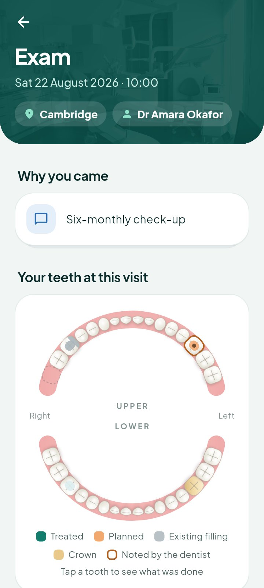 |

| Records | Aligner timer | Profile |
| --- | --- | --- |
| 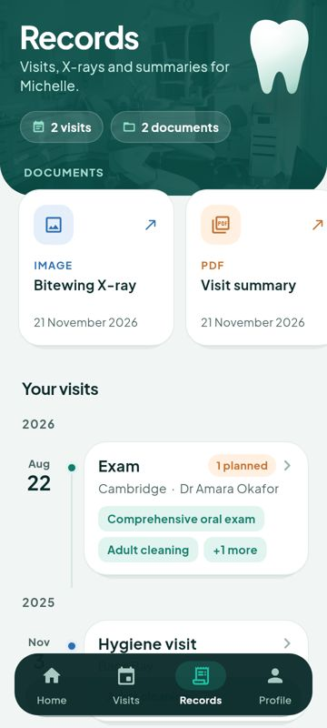 |  |  |

**The website:** [northgate-dental.vercel.app](https://northgate-dental.vercel.app): services and prices for every clinic, a page per service, the team, a voice call sample with Nora, an enquiry form and the staff portal.

| Website | A service page | Talk to Nora (sample) |
| --- | --- | --- |
| 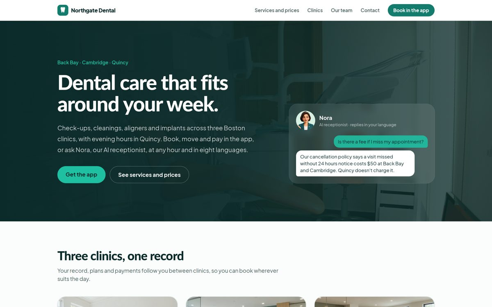 | 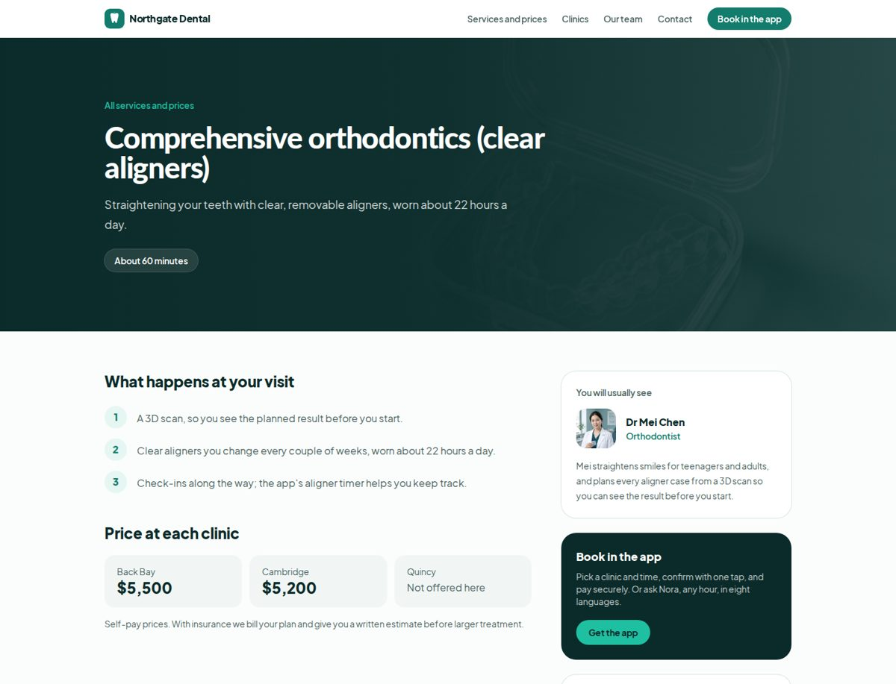 | 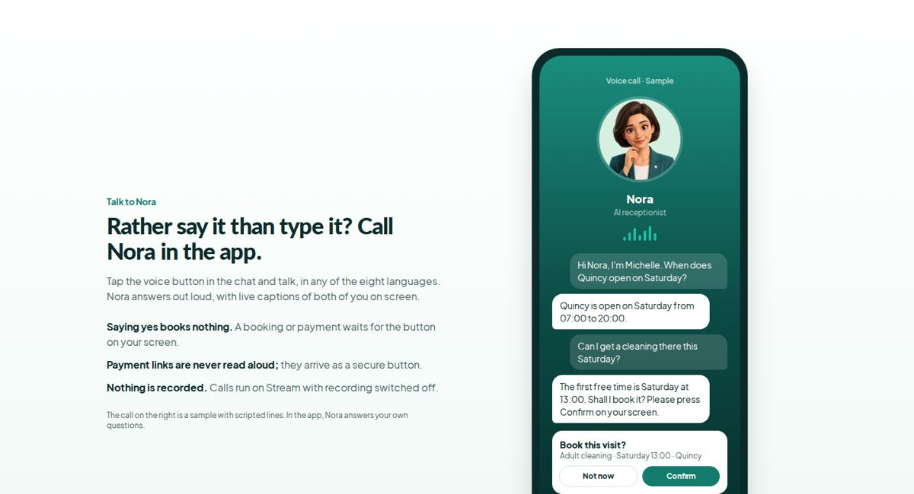 |

## At a glance

| Concern | Decision | Evidence |
| --- | --- | --- |
| Where patient data lives | One Postgres database (Supabase, us-east-1), row level security on every table; the phone keeps only an encrypted session and an aligner log | 542 pgTAP checks, each rule with an allowed and a refused case |
| Who decides what is allowed | The database: writes go through functions that check the caller; the app, n8n and Nora only ask | Payment, booking and link functions tested as each role, including n8n's |
| The AI receptionist | One LangGraph agent, Gemma 4 on our own server, eight languages; safety text is fixed, never generated; every write waits for the patient's button | 102 agent tests with a scripted model; a retrieval evaluation gate in CI |
| How AI reaches the rest of the system | Model Context Protocol: "know" tools from our MCP server, "do" tools published by n8n; identity always from the verified session | Live MCP probes; forged-identity and n8n-down tests |
| Delivery | Transactional outbox on Supabase Queues; idempotent consumers; one email per kind, however often a message is delivered | Worker tests against a real database |
| Operations | Prometheus metrics, a Grafana dashboard, four alerts to the on-call phone, a public status page, a scripted journey check every 15 minutes | Alert rules with runbooks; status page with six live checks |
| Security at the edge | Private VM behind a load balancer, ModSecurity with the OWASP Core Rule Set, only webhooks and the status page public | 25 WAF checks in CI against a running stack |

## Architecture

Northgate is deliberately lean. Patient data lives in **one place**, a managed Postgres database (Supabase, US East). Everything else either reads from it under the database's own access rules, or holds no patient data at all. That makes the most important question a healthcare client asks, "where does my data go?", short to answer.

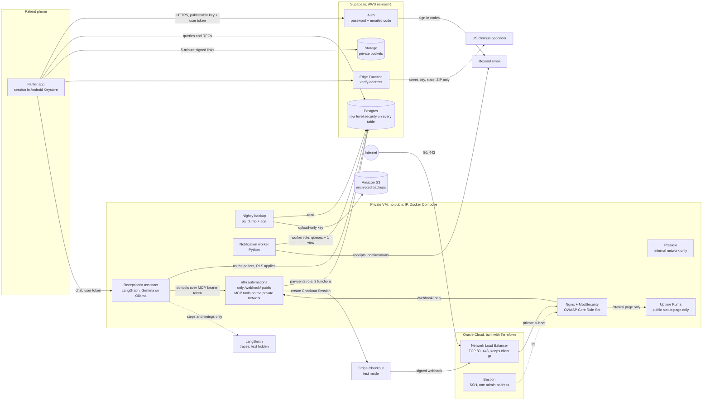

<details>
<summary><b>How a request is protected, layer by layer</b></summary>

1. **On the phone:** the session token is kept in the Android Keystore through `flutter_secure_storage`, never in plain preferences. The app holds only a publishable key, which grants nothing on its own.
2. **Sign-in:** an email and password, then a 6-digit code emailed at every sign-in. Until the code is confirmed, the session is marked unverified in `private.verified_sessions`, and every patient policy refuses it.
3. **In the database:** every table has row level security. A patient's queries pass through `private.my_patient_ids()` (their own record, plus children they are a proxy for), so a query for someone else's record returns nothing rather than an error. Staff policies additionally require a second factor (`aal2`).
4. **Writes go through functions:** booking, cancelling, linking a record and updating details are Postgres functions that check the caller themselves. The patient's identity comes from the signed-in session, never from a parameter the app sends.
5. **Files:** X-rays and visit summaries sit in a private bucket. The app receives a signed link valid for 5 minutes and opens the PDF inside the app.
6. **On the server:** every public request passes through ModSecurity with the OWASP Core Rule Set, which refuses cross-site scripting, SQL injection, path traversal and command injection with a 403, before any service sees the request.

**Principles:** defence in depth and least privilege: the WAF, the network rules and row level security are each sufficient on their own, and every service has its own database role with only the functions it needs.

</details>

<details>
<summary><b>Where each kind of data lives</b></summary>

| Data | Stored in | Region | Who can read it |
| --- | --- | --- | --- |
| Patient records, visits, charts, plans, appointments | Supabase Postgres | us-east-1 | The patient (and parent proxies) under row level security; staff with 2FA at their locations |
| X-rays, visit summaries | Supabase Storage, private bucket | us-east-1 | Same rules as the records; 5-minute signed links |
| Sign-in session | The phone's Keystore | On the device | The app only; cleared on sign-out |
| Aligner wear log | The phone, encrypted | On the device | The app only; wiped on sign-out |
| Audit log | Supabase Postgres, append-only | us-east-1 | Administrators; updates and deletes are revoked |
| Web access logs | Oracle VM | af-johannesburg-1 | Operators; path and status only, never query strings or bodies |
| Backups | Amazon S3, encrypted twice | eu-north-1 | Nobody on the server: the VM can add files but not read or delete them |

The Oracle VM and the S3 bucket sit outside the US. That is a recorded exception, allowed only because no real patient data exists here, and caused by account regions that cannot be changed. A deployment with real patient data would move both into US regions before going live.

</details>

## Why each technology was chosen

<details>
<summary><b>Supabase (Postgres, Auth, Storage, Edge Functions)</b></summary>

A dental group's data is relational: patients, appointments, clinicians, rooms, services, prices and plans all refer to each other. Postgres is the natural home for it. Supabase adds sign-in, file storage and small server functions around the same database, so there is no separate API server to secure.

- **Row level security** puts the access rules next to the data. A forgotten check in an API endpoint cannot leak records, because the database itself refuses the query.
- **Exclusion constraints** (with `btree_gist`) make double booking impossible at the database level: two appointments for the same clinician or room cannot overlap, even if two people book at the same instant.
- **pgTAP** tests every policy with real sign-ins, for both what each role may do and what it must be refused.
- **Region:** us-east-1, so US patient data stays in the US.
- **Trade-off accepted:** the free plan has no point-in-time recovery, which is why the nightly encrypted backup exists.

**Principles:** a ubiquitous language: tables, functions and files use the clinic's own words (appointment, hold, proxy, recall), kept in a glossary; and the simplest thing that could possibly work: one database, with no separate broker, cache or vector store until a measured need says otherwise.

</details>

<details>
<summary><b>Supabase Queues, the transactional outbox and the notification worker</b></summary>

Everything that happens *after* a change (confirmations, reminders, cancellations, later payments and check-ins) runs through queues inside the same Postgres database. Northgate uses **Supabase Queues** (the `pgmq` extension) instead of a separate broker such as RabbitMQ. With one database there is one store to secure, back up and explain, and a queue message can be written in the same transaction as the data change that caused it.

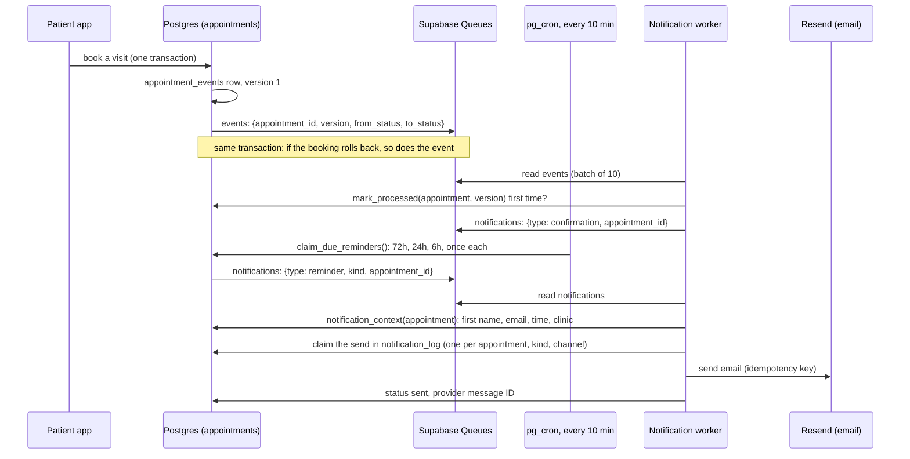

**Why it is built this way:**

| Design choice | What it prevents |
| --- | --- |
| **Transactional outbox:** a trigger on `appointment_events` sends the event in the same transaction as the change | An event lost because the app crashed between saving and publishing, or a published event for a change that rolled back |
| **Events carry IDs, a version and statuses only** | Names, contact details or clinical text sitting in queue tables (tested) |
| **Version numbers per appointment** | Changes applied out of order; the worker checks the appointment's current status before sending, so a late "booked" never confirms a cancelled visit |
| **`mark_processed(consumer, key)`**, true only the first time | A redelivered message running twice |
| **`notification_log`, unique per appointment, kind and channel**, claimed *before* sending | Two confirmation emails, even if the worker crashes after sending and the message is retried |
| **Resend idempotency key** on every email | A second guard behind the log, for 24 hours |
| **Reminders claimed in `reminder_log`** (unique per appointment and kind), each with a two-hour window | Duplicate reminders, and very late reminders after an outage |
| **Quiet hours** 21:00 to 08:00 in the clinic's time zone; a reminder that would fall inside them moves to 20:00 the evening before | Messages at night |
| **A separate `urgent` queue** for clinical messages | A red-flag message waiting behind a campaign |
| **Fixed batches of 10, one message per transaction, dead-letter after 5 failures** | A worker taking more than it can finish, and a poison message blocking the queue |
| **pg_cron inside the database** runs the reminder scanner | A separate scheduler that can stop without anyone noticing |

**What a patient message contains:** first name, the service, the date and time in the clinic's own time zone, the clinic and its phone number. It never contains a surname, date of birth, record number, address, insurance or anything clinical, because email providers and WhatsApp sign no BAA. The worker reads a visit only through `private.notification_context()`, a database function that returns exactly those fields to the worker's role and nothing to anyone else.

**Who can touch the queues:** neither patients nor staff. The schema is closed to `anon` and `authenticated`, and a dedicated `northgate_worker` role gets the queues, the send log and the idempotency check only. Its login is created by hand on each project, so no password lives in Git.

**Proof:**
- 24 database tests (`20_queues`, `21_worker_context`).
- The worker's tests, including one against a real database. It books a visit for the canary patient, checks that exactly one email is sent and that a repeat sends nothing, and scans the logs for every canary value.

**Principles:** the **transactional outbox**: the event is written in the booking's own transaction, so it can never be lost or describe a change that rolled back. **Idempotent consumers** give an exactly-once *effect* from at-least-once delivery. **Ordering by version**: the worker re-reads the current status, so a late "booked" never confirms a cancelled visit. **Stability patterns**: timeouts, a separate `urgent` queue as a bulkhead, fixed batches for a steady state, and a **dead-letter queue** after five tries.

</details>

<details>
<summary><b>Payments with Stripe Checkout (test mode), relayed by n8n, decided in Postgres</b></summary>

A receptionist, the app's Pay button or Nora (`send_payment_link`, after the patient presses "Send it") asks for a payment link for a visit; the patient pays on Stripe's hosted Checkout page; Stripe tells us it was paid; the patient gets a receipt. Stripe Checkout was chosen over building a card form because **card numbers never touch Northgate's systems at all**, which keeps the product out of PCI DSS scope beyond the simplest self-assessment (SAQ A).

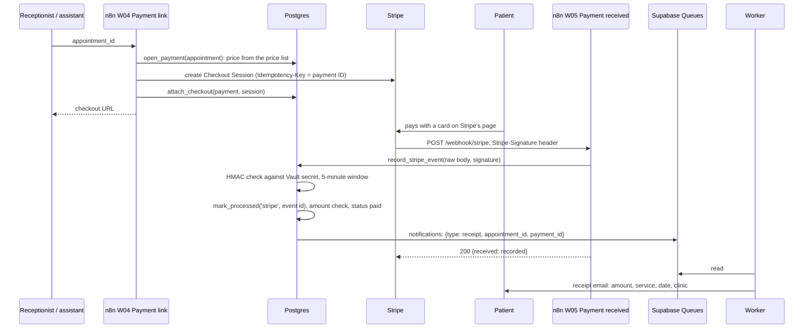

**The key decision: n8n relays, Postgres decides.** All money rules live in three database functions with 17 pgTAP tests. n8n holds no logic and no secret it could leak: the webhook signing secret is in **Supabase Vault**, loaded there by the deploy workflow from a GitHub environment secret, and was piped from Stripe's API into GitHub without ever being printed.

| Design choice | What it prevents |
| --- | --- |
| **The amount comes from `location_services.price_cents`** inside `open_payment()`, never from the caller | A tampered or mistaken request charging the wrong amount |
| **One live payment per visit** (partial unique index on `appointment_id` where status is pending or paid) | Two payment links, and a visit paid twice |
| **Stripe idempotency key = our payment ID** | A retried request creating a second Checkout Session |
| **HMAC-SHA256 signature check over the exact raw body**, in Postgres with `pgcrypto` | Anyone who finds the webhook URL marking a payment as paid |
| **Five-minute timestamp window** | A captured, genuine event being replayed later |
| **`mark_processed('stripe', event.id)`** | Stripe's at-least-once delivery recording a payment (and sending a receipt) twice |
| **Amount and currency must match** what we asked for | A session paid at a different price being accepted |
| **Adaptive Pricing switched off** | A US clinic being paid in the payer's local currency (it showed Kenyan shillings in testing until disabled) |
| **Unknown sessions are ignored, not errors** | The shared test account's other products' events filling the error log |
| **Money in whole cents** (integers) | Floating-point rounding errors |
| **A dedicated `northgate_payments` role** with execute on three functions and nothing else | A leaked n8n credential reading patient records (tested: it cannot) |
| **n8n trusts Supabase's root CA** (fingerprint checked against Supabase's published copy) instead of skipping certificate checks | A man-in-the-middle on the database connection |
| **W05 keeps no data from failed runs**, and successful runs keep none either | The email a payer types at Checkout lingering in n8n's database |

**What Stripe receives:** an amount in cents, the item name "Northgate Dental visit" and our payment ID. Never the patient's name, email, date of birth or the service (a service name is health information). Stripe does not sign a BAA, but HIPAA exempts payment processing (Social Security Act section 1179), so the rule here is simple: nothing clinical goes to Stripe.

**Products considered:** Payments (Checkout and webhooks) is used now. Billing (invoices) fits patient statements and arrives with W06. Connect was rejected: it is for platforms paying out to *other* businesses, and Northgate is one dental group with one bank account, so it would add onboarding, compliance and fees for nothing.

**Proof:**
- `22_payments.test.sql`: tampered body, wrong secret, a replay older than five minutes, a wrong amount, a duplicate event, and writes by a signed-in user are all refused; a correct event is recorded once and queues one receipt carrying IDs only.
- The worker test signs an event in Python, so it proves Python's HMAC and Postgres's agree byte for byte.
- On staging, on 27 November 2026, twice: Nora emailed a payment link, the patient paid $110.00 with Stripe's test
  card on the Checkout page, the database recorded it as paid, and the receipt email followed within seconds (the
  recorded run: link at 08:05 UTC, paid at 08:13:06, receipt delivered at 08:13:09).

**Watch it** (1 min 17 s, captioned): asking Nora in the app, the confirmation button, Nora's reply with the link,
the "Pay securely" email, Stripe Checkout with the test card, and the receipt three seconds after payment. The moments
while Nora works are cut out; her measured reply times are in "Evaluating Nora". Select the picture to play the video.

[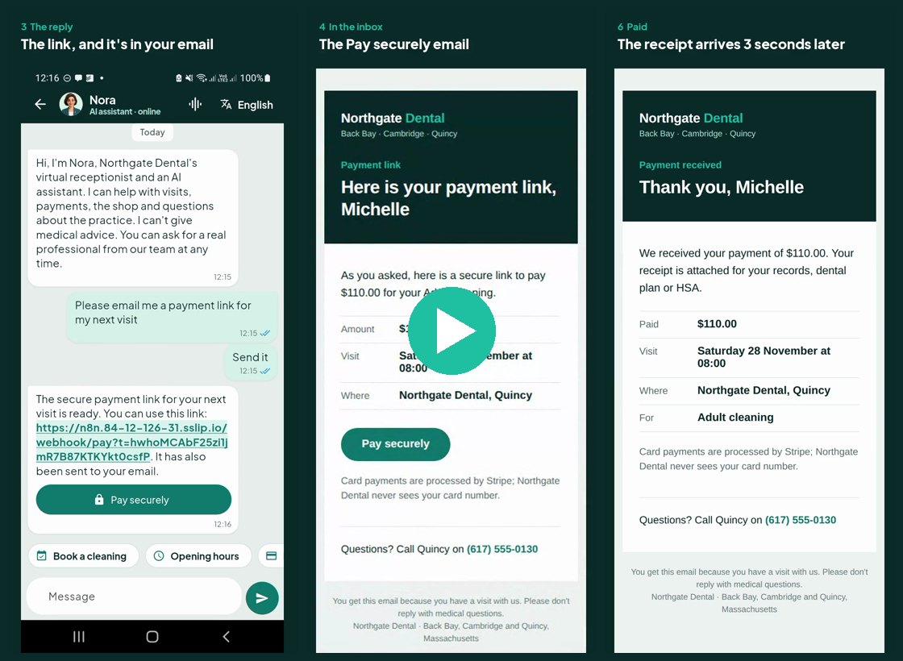](https://github.com/FionaMich/northgate-dental/releases/download/demo-2026-11-27/nora-payment-demo.mp4)

| In the chat | Nora's "Pay securely" email | Stripe Checkout, test card |
| --- | --- | --- |
| 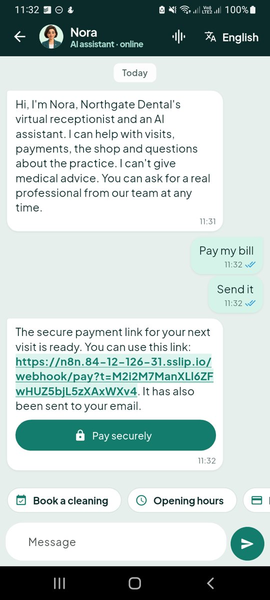 | 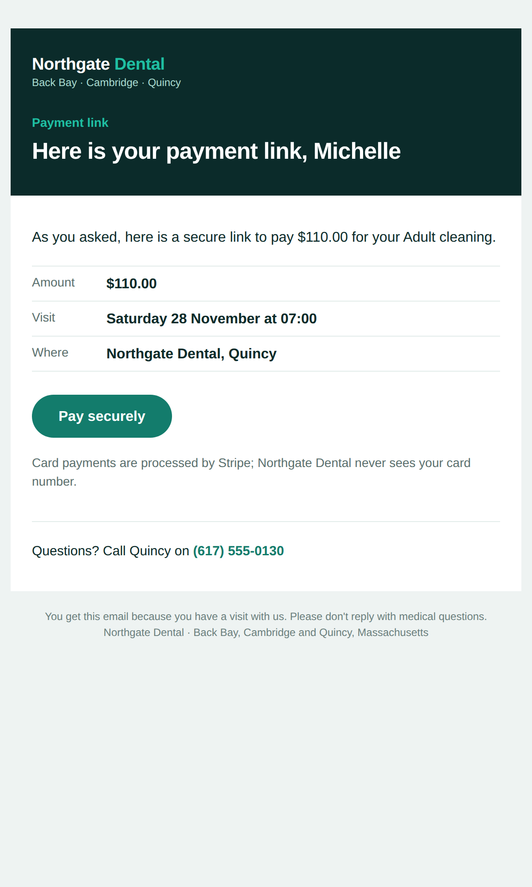 | 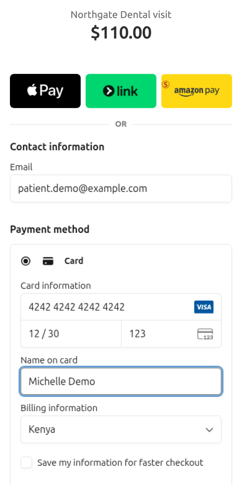 |

| Forged webhook refused | Payment tests |
| --- | --- |
| 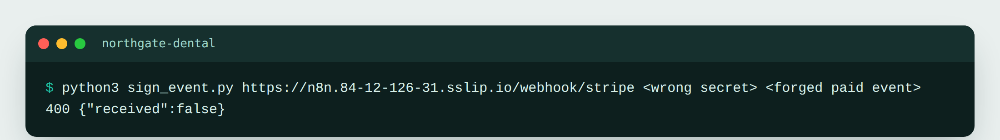 | 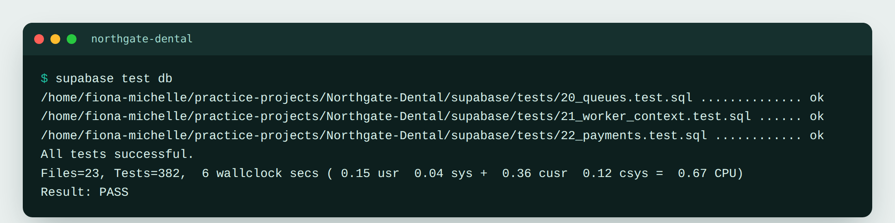 |

**Principles:** **deep modules**: `record_stripe_event(raw_body, signature)` is one call that hides signature checks, replay protection, de-duplication, amount checks, state changes and the receipt. **Make illegal states unrepresentable**: a payment is `paid` if and only if `paid_at` is set, money is whole cents, and one live payment per visit is a unique index, not a hope.

</details>

<details>
<summary><b>n8n for event and time based automations</b></summary>

n8n runs the automations a clinic changes most often: payment links, payment webhooks and, next, statements and post-visit check-ins. It is self-hosted on the VM, not n8n Cloud, so patient-adjacent events never leave infrastructure we control.

- **Built through n8n's MCP server.** Each workflow is written as n8n Workflow SDK code (`n8n/sdk/*.ts`), validated by the MCP server's `validate_workflow`, created with `create_workflow_from_code`, tested, then exported as JSON to `n8n/workflows/`. The JSON holds credential *references* only (an ID and a name), never a secret.
- **Same version everywhere:** n8n 2.43.7 on the laptop and on the VM.
- **Only webhooks are public.** Nginx proxies `https://n8n.84-12-126-31.sslip.io/webhook/*` through the WAF and answers 404 for everything else, including the editor and the REST API (tested in CI).
- **The editor is reached through an SSH tunnel** over Oracle Bastion and bound to `127.0.0.1` on the VM, so it has no internet-facing login page to attack.

**How to open the editor:**

| Who | How | Address |
| --- | --- | --- |
| The admin, today | `TUNNEL=15678 infra/scripts/ssh-vm.sh deploy` (leave it running; works without Terraform installed) | http://localhost:15678 |
| The developer's laptop copy | The local n8n where workflows are built through the MCP server | http://localhost:5678 |
| A team, without the tunnel (option) | Tailscale on the VM and each person's device; free for small teams; the editor stays off the internet | http://northgate-vm:5678 |
| A public demo (option) | Route the editor through the WAF with n8n's own login, two-factor required and an IP allow-list | https://n8n.84-12-126-31.sslip.io |

The first visit to a new n8n asks for the owner account; only someone who can already reach the editor can create it.

**Step by step: opening the VM's n8n through the tunnel**

1. Prerequisites, once per laptop: the OCI CLI signed in (`~/.oci/config`), the SSH key `~/.ssh/northgate_oracle` loaded (`ssh-add ~/.ssh/northgate_oracle`), and your current public IP in the Bastion's allowed range (`client_cidr` in `infra/terraform/oci/terraform.tfvars`).
2. In a terminal, from the repository folder, open the tunnel and leave it running:
   ```bash
   cd ~/practice-projects/Northgate-Dental
   TUNNEL=15678 infra/scripts/ssh-vm.sh deploy
   ```
   The script finds or creates an Oracle Bastion session (up to three hours), then forwards `localhost:15678` on the laptop to `127.0.0.1:5678` on the private VM. It prints nothing while the tunnel is open.
3. In a browser, open **http://localhost:15678**. Local port 15678 avoids the laptop's own n8n on 5678.
4. The first time, create the owner account; after that, sign in. W03, W04, W05, W06 and W11 are listed and active.
5. To close the tunnel, press Ctrl+C in that terminal.

If the page does not load: the Bastion refuses sessions from an IP outside `client_cidr` (update it and run `terraform apply`), and a brand-new session takes about ten seconds before it accepts the key.
- **Its own Postgres** (`n8n-db`, on the internal `data` network) for workflows and encrypted credentials; it joins the nightly encrypted backup.
- **Hardening:** `N8N_BLOCK_ENV_ACCESS_IN_NODE` stops Code nodes reading server secrets; successful runs save no data; failed runs are pruned after 7 days; telemetry is off.
- **Credentials** are imported with `n8n import:credentials` from stdin inside the container, so passwords never sit on the VM's disk or in shell history. The Stripe key is read from the VM's own `.env` and never travels again.
- **n8n never does AI.** The project rule is one assistant, built in LangGraph; n8n only runs triggered automations and, from section 09, publishes a few workflows as MCP tools for it.

**The workflows** (each picture is the n8n editor; the green note says what triggers it and what it does, the red note
what data it touches and which control protects it):

| W03 Cancel link | W04 Payment link |
| --- | --- |
| 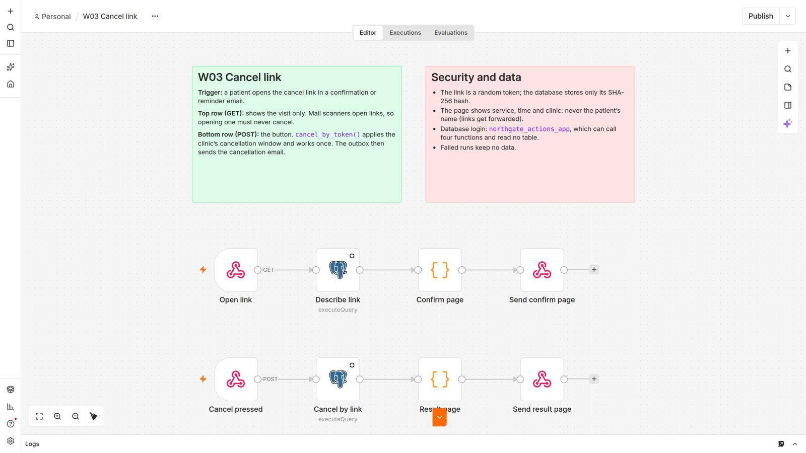 | 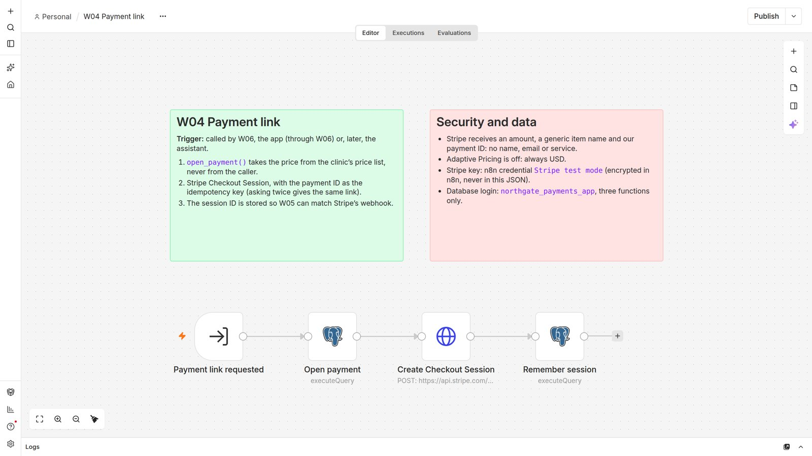 |

| W05 Stripe payment received | W06 Pay link |
| --- | --- |
| 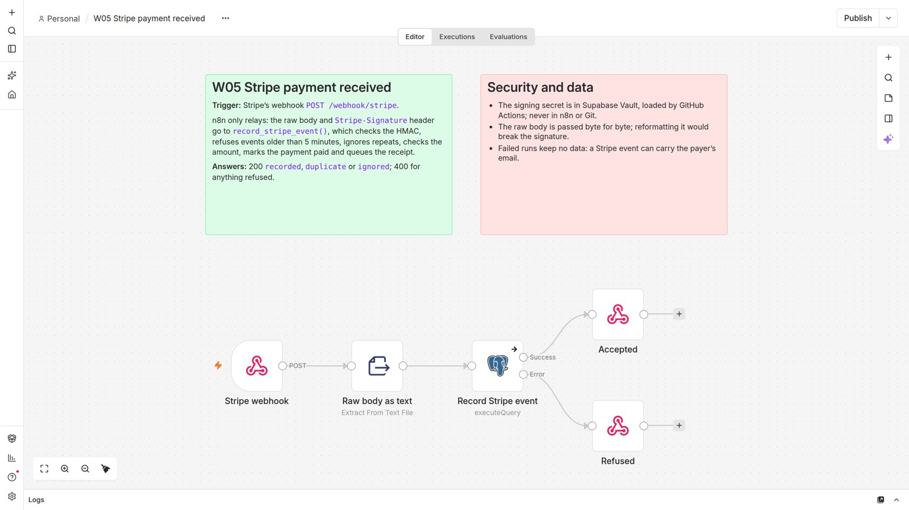 | 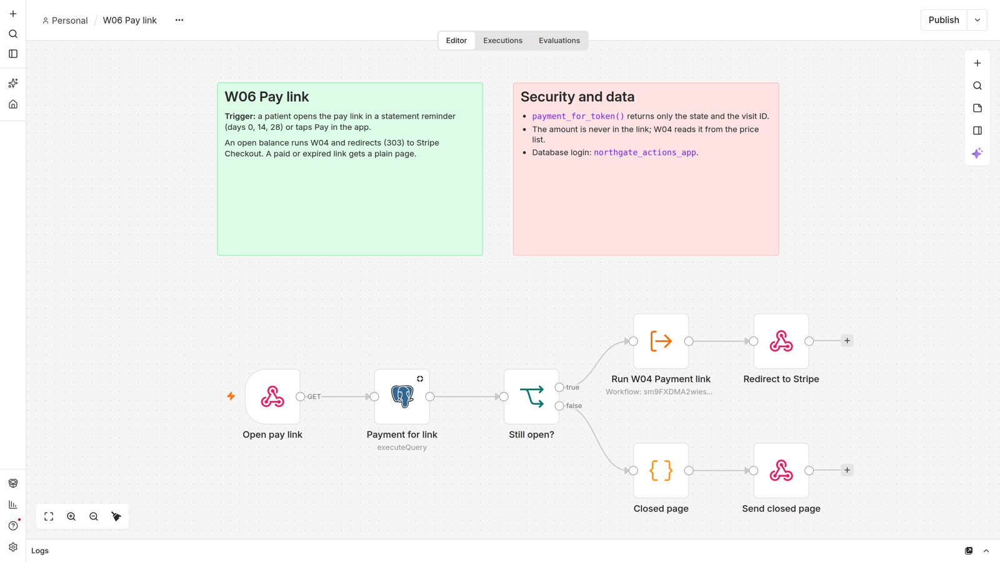 |

| W11 Post-visit check-in | W12 Shop checkout |
| --- | --- |
| 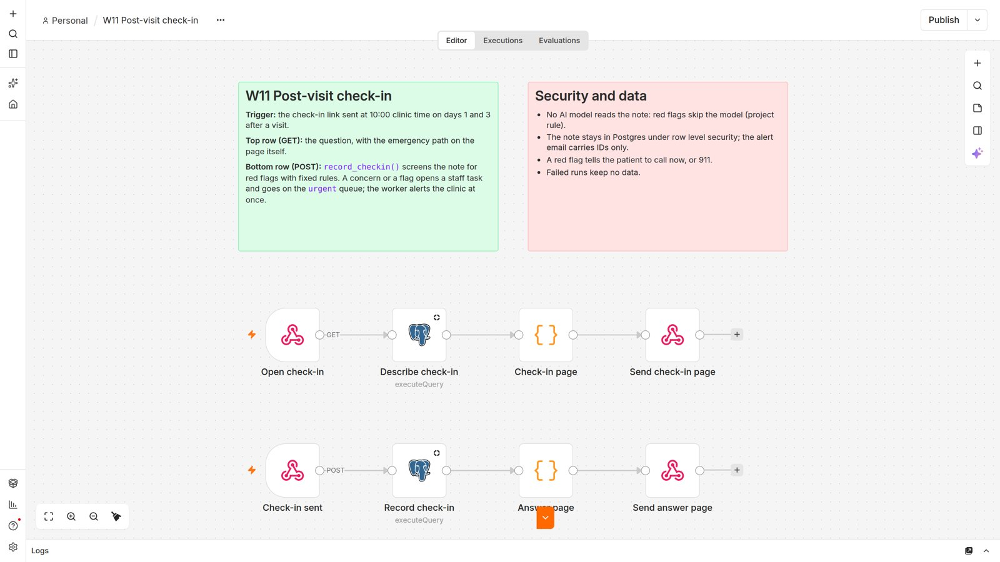 | 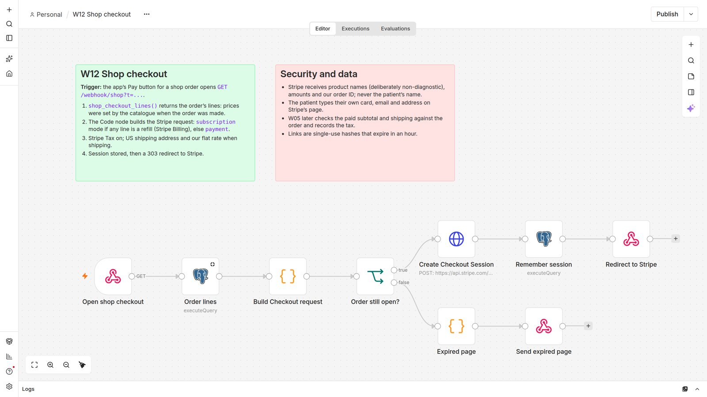 |

| W14 Nora action tools (MCP) | W15 Reschedule link |
| --- | --- |
| 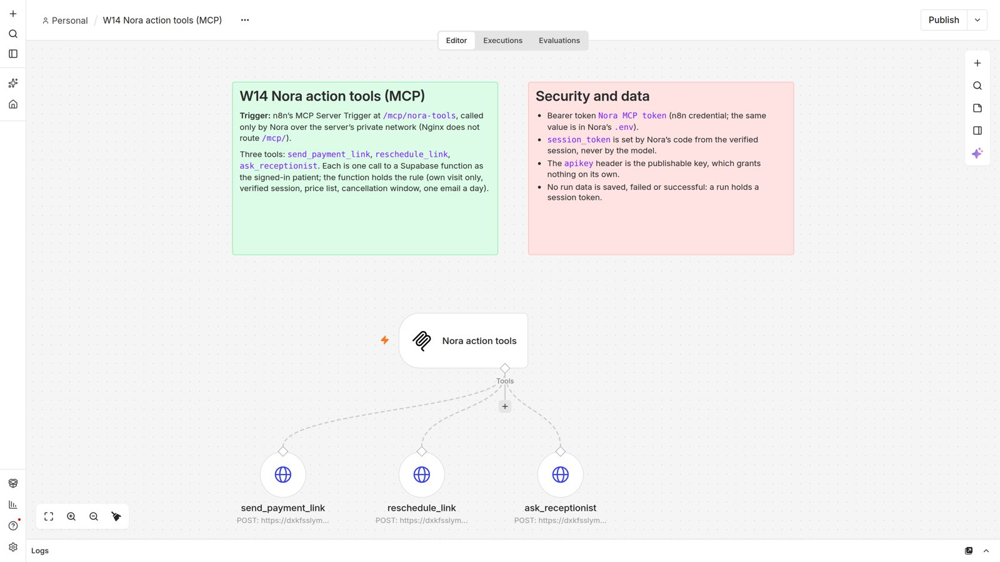 | 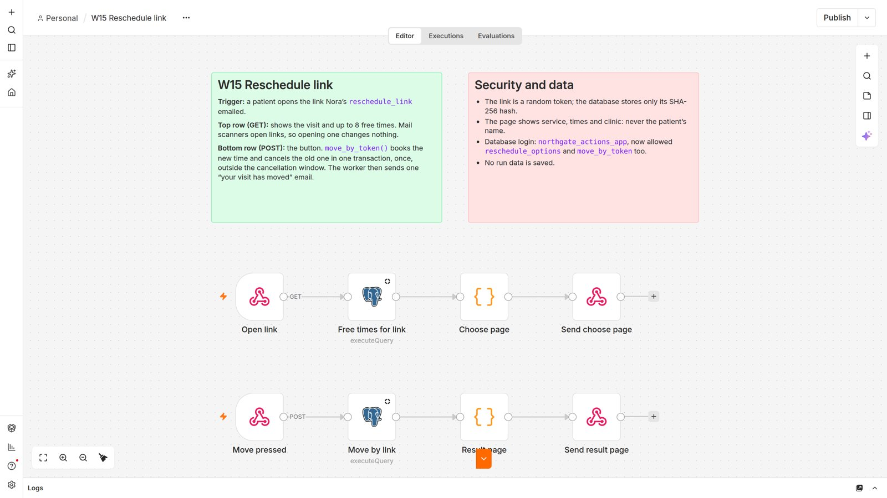 |

</details>

<details>
<summary><b>Links in patient emails: cancel, check-in and pay, single use and never naming the patient</b></summary>

Confirmations, reminders, check-ins and balance reminders each carry at most one link. Each link is a random 32-character token; the database stores only its SHA-256 hash (`private.action_tokens`), so a copy of the database cannot be turned into working links.

| Link | Sent in | What the page does | Rule enforced in Postgres |
| --- | --- | --- | --- |
| **Cancel** (W03) | Confirmation and every reminder | Shows the visit; the button cancels | Not inside the clinic's cancellation window (24 hours by default, per location); works once; the cancellation then goes through the outbox like any other |
| **Check-in** (W11) | 10:00 clinic time, 1 and 3 days after a completed visit | "Fine" or "I have a concern", plus an optional note | Fixed red-flag rules (bleeding that will not stop, spreading swelling, fever, trouble breathing or swallowing, lasting numbness, signs of infection, severe pain); a flag tells the patient to call now or 911, opens an urgent staff task and goes on the `urgent` queue; no AI model reads the note |
| **Pay** (W06) | Balance reminders on days 0, 14 and 28 after a visit; a billing task on day 35 | Redirects to Stripe Checkout through W04 | The amount comes from the price list; a paid link shows "already paid" |

**Opening a link never changes anything.** Mail scanners and link previews open links automatically, so a GET only shows the page; only the button (a POST) acts. Pages name the service, time and clinic, never the patient, because links get forwarded. Each workflow's database login (`northgate_actions_app`) can call four functions and read no table.

**The worker** adds the link when it writes the email, inside the same transaction as the send, so a failed send also discards its link. Urgent check-in alerts go to the clinic inbox at once, carrying IDs only; the patient's words stay in Postgres.

</details>

<details>
<summary><b>Conflict scanner (W22) and the staff task inbox</b></summary>

When a dentist books leave or a clinic closes, visits already booked can become impossible. `private.detect_schedule_conflicts()` finds four kinds: the clinician unavailable (leave, training, sick), the location closed, too little travel time between two clinics for the same clinician, and the same patient booked within 30 minutes of another visit.

- **When it runs:** a trigger on every change to leave or closures, so a conflict shows within seconds; and pg_cron every 15 minutes over the next 30 days, for changes no trigger sees.
- **Recorded once:** `schedule_conflicts` is unique per appointment and conflict type; scanning again raises nothing new.
- **Fixes itself:** when the leave is cancelled or the visit moved, the conflict is resolved and its task closed.
- **One inbox:** `staff_tasks` holds schedule conflicts, check-ins that need a clinician, balances that need billing follow-up and shop orders to set aside, each pointing at an appointment or order by ID. Staff see only their own clinics' tasks; patients see none. The web portal (next section) shows this inbox.
- **Nothing is sent to a patient from here:** a person decides, as the blueprint requires.

</details>

<details>
<summary><b>PDF receipts from an internal renderer</b></summary>

Receipt emails carry a PDF receipt, rendered from HTML by **Gotenberg**, a maintained container that wraps headless Chromium. It does the job the blueprint gives Puppeteer without any browser code of our own to keep patched.


- **Internal only:** it sits on the `data` network, which has no route in or out; only the worker can reach it.
- **Locked down:** JavaScript is off and it may load nothing but the HTML it is sent; the receipt document is self-contained (no fonts, images or scripts to fetch).
- **Never blocks a receipt:** if the renderer is down, the email still goes without the attachment and the log says so (tested).

</details>

<details>
<summary><b>The dental shop: clinician-curated, with refills and sales tax</b></summary>

A small shop inside the patient app for the products our dentists and hygienists already recommend at the chair. It is not a marketplace: its value over Amazon is trust and fit, "what my dentist recommends for my mouth".

| Shop | Product | Bag | Stripe Checkout |
| --- | --- | --- | --- |
|  |  | 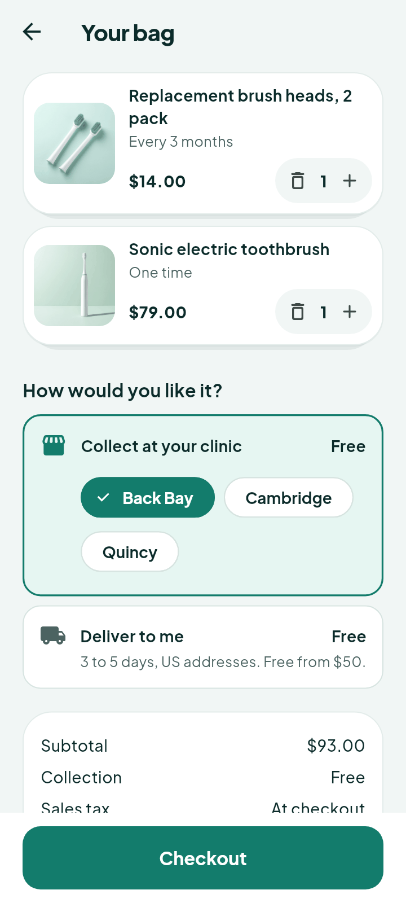 | 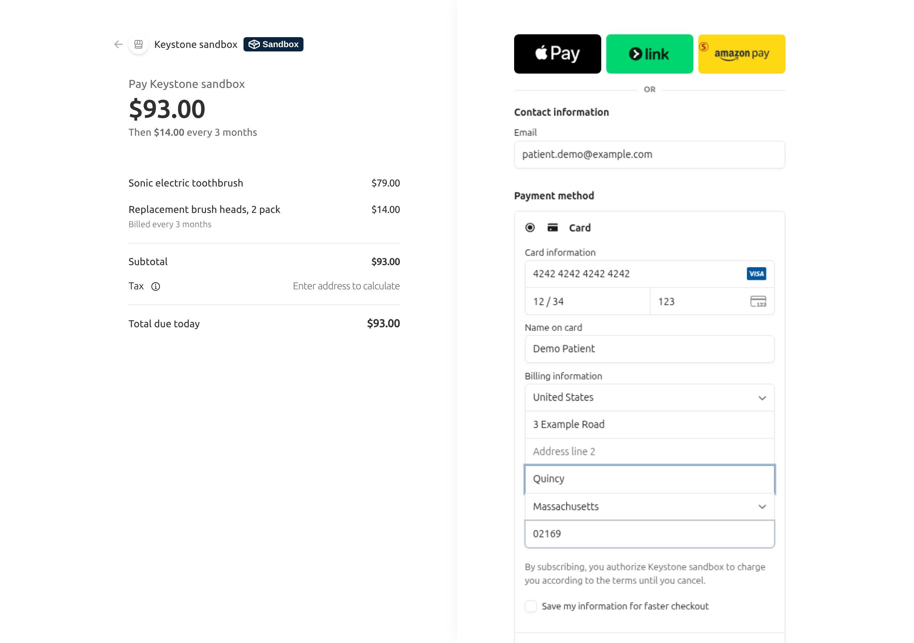 |

**Benchmarks, and what was taken from each:**

| Benchmark | What it does well | Taken here |
| --- | --- | --- |
| quip | Refill subscriptions as the default | Refills every 1, 2, 3 or 6 months through Stripe Billing, offered first on refillable products |
| Oral-B and Philips Sonicare apps | Replacement reminders tied to the product | Brush heads on a 3-month refill |
| Byte, Invisalign aftercare | Aftercare kits at the moment of treatment | An aligner category: chewies, cases, cleaning crystals |
| Hims and Hers, Curology | Clinician-gated products | Prescription-strength items locked until a dentist approves them for that patient |
| DUA, Fellow | Calm premium retail | Category chips, large product cards on one consistent mint stage, benefit labels |

**Rules, all enforced on the server** (`create_shop_order`, 25 database tests):

| Rule | How |
| --- | --- |
| The price is the catalogue's | The app sends product IDs, quantities and refill choices only; a price it sends is ignored (tested) |
| Prescription-strength items need a dentist | `shop_approvals`, per patient and product, expiring; only a clinician who can see the patient may approve |
| Whitening is for adults with a recent exam | Age 18 or over and an exam encounter in the last 12 months |
| Collection needs stock | `shop_stock` per clinic; paid collection orders take the stock |
| Refills only where offered | `refill_interval_months` on the product |
| Payment matches the order | W05 compares Stripe's item subtotal and shipping with the order, then records the tax Stripe calculated |

**Paying:** W12 turns the order's lines into a Stripe Checkout Session: subscription mode when any line is a refill (Stripe Billing), payment mode otherwise; **Stripe Tax** on (Massachusetts registration, 6.25 per cent verified); a US address and a flat $7.99 rate when delivered (free from $50), or only country and ZIP when collected; Adaptive Pricing off, so a US clinic always charges US dollars. Each refill cycle (`invoice.paid`) becomes a new paid order with a fulfilment task.

**What Stripe receives:** product names (deliberately non-diagnostic: "High-fluoride toothpaste", never a condition), amounts and our order ID; the patient types their own card, email and address on Stripe's page.

**Product photography:** one approved style for every product (white product, teal accent, pale mint stage, soft studio light), generated and checked on a sample before the set.

</details>

<details>
<summary><b>The receptionist assistant: LangGraph, 8 languages, safety first</b></summary>

A virtual receptionist in the patient app, benchmarked on OralSync's "Lisa" (the leading AI receptionist for Dutch dental practices), without the phone line. It books, moves and cancels visits, answers questions about the clinics, payments and the shop, and hands anything else to the team with a written summary.

| Chat | Confirm a booking | Voice call | Confirm by button, never by voice |
| --- | --- | --- | --- |
| 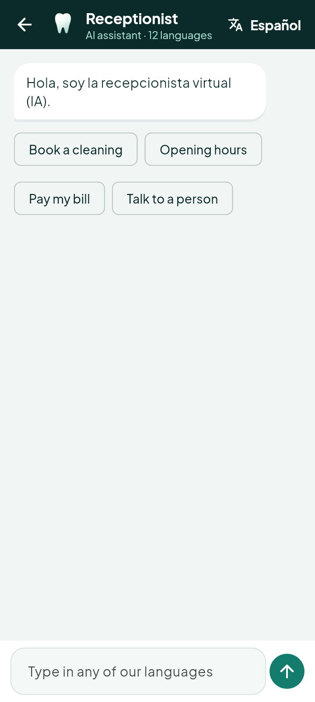 |  | 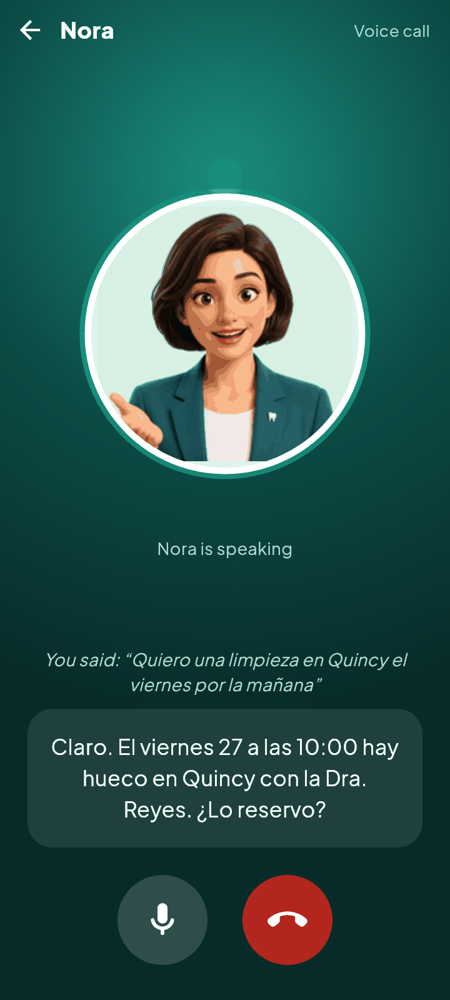 | 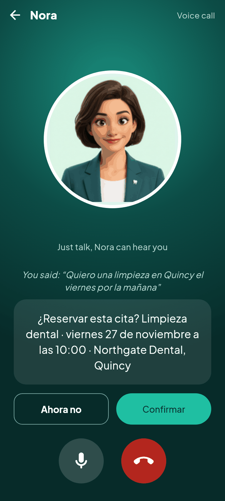 |

**How a message is handled** (`services/agent/src/agent/graph.py`):

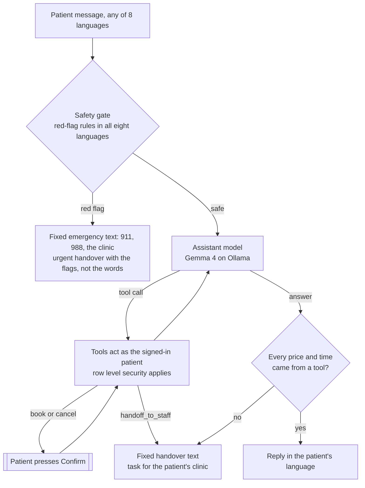

**What Lisa does, and how Northgate does it:**

| Lisa | Northgate |
| --- | --- |
| Answers the phone around the clock | Chat in the app around the clock (website next, with the portal) |
| Books in slots the practice keeps free | The same `available_slots`, `hold_slot` and `confirm_booking` the app uses, under the patient's own session |
| The team gets a summary after each conversation | `request_handover`: a task for the patient's own clinic with a short English summary, whatever language the patient used |
| AI Act text for the practice's website | The first message of every conversation says it is an AI (EU AI Act Article 50, US state bot-disclosure laws) |
| Specialty variants (orthodontics, implants, children) | Planned as reviewed playbooks per service family |

**Safety rules, each with a test** (`services/agent/tests/`, 28 tests):

| Rule | How it is enforced |
| --- | --- |
| Emergencies never reach the model | Red-flag patterns for breathing or swallowing trouble, heavy bleeding, spreading swelling, chest pain and self-harm, in every language, run on every message; a match returns fixed text and an urgent handover |
| Safety text is never generated | Disclosure, emergency, "I can't give medical advice", handover and the confirmation card come from `texts/fixed.yaml`, one reviewed entry per language |
| No medical advice | Any question about symptoms, medicines or treatment goes to the team with the fixed reply |
| Identity is never a model argument | The patient comes from the verified token; tools call Supabase with that token, so the database decides what the assistant may see |
| Nothing is booked or cancelled without the patient | LangGraph pauses (`interrupt`) until the patient presses Confirm; declining books nothing (tested) |
| No invented prices or times | A grounding check replaces a reply whose price or time no tool returned, and really hands it over |
| Only clinic-approved policy answers | Policy questions are answered only from approved documents (hybrid RAG). A weak match, or a failed search, makes Nora offer the team instead of guessing |
| The team is reached by buttons, not by the model | When Nora hands over, the app shows "Reply in the app" or "Call me back", with a checked phone number, so the handover cannot be promised and then forgotten |
| Nora can be switched off at once | A practice manager turns her off in the portal. Within 30 seconds every patient gets a fixed message with the clinic's number, and the model is not used |
| Every turn is on record | `ai_events` logs each turn's outcome, tools, model, prompt version and timing, never the words. A failed write sets off an alert |
| A long reply cannot outlive the sign-in | The app refreshes the session before talking to Nora when less than 5 minutes are left, since a reply can take minutes on the CPU server |

**Languages:** English, French, Dutch, German, Spanish, Italian, Lithuanian and Swedish (Fiona's choice, 23 November 2026). Every non-English safety text is marked draft until a native speaker reviews it, as health messaging requires.

**Model:** `model_for(role)` picks the model from one setting. The demo runs Gemma 4 on Ollama, so nothing leaves our own machines. On a CPU a reply takes 7 to 40 seconds, shown as a typing indicator; Amazon Bedrock is one setting away if speed matters more than keeping everything in-house.

**Voice calls with Nora:** the voice button in the chat starts a Stream Video call. Our server checks the patient's session and signs a one-hour call token for a random call ID, the phone joins with the Stream SDK under the fixed name "Patient", and Nora joins from our voice service, where she listens, thinks with the same LangGraph assistant as the chat, and speaks. The call screen shows her portrait, live captions of both sides and the same Confirm buttons as the chat: saying "yes" books nothing, only the button does. A payment link is never read aloud; it arrives as a "Pay securely" button. Nora takes strict turns: she keeps the caller's audio until a second of quiet, transcribes the whole question once, and does not listen while she thinks or speaks, so noise can never cut her answer short. We record nothing; the call type has recording and transcription switched off.

Three calls, one per language, each solving four requests in one conversation: opening hours, paying a bill, booking a cleaning (confirmed with the button) and a handover to the team. Select a picture to play the video.

| English (85 s) | French (98 s) | German (102 s) |
| :-: | :-: | :-: |
| [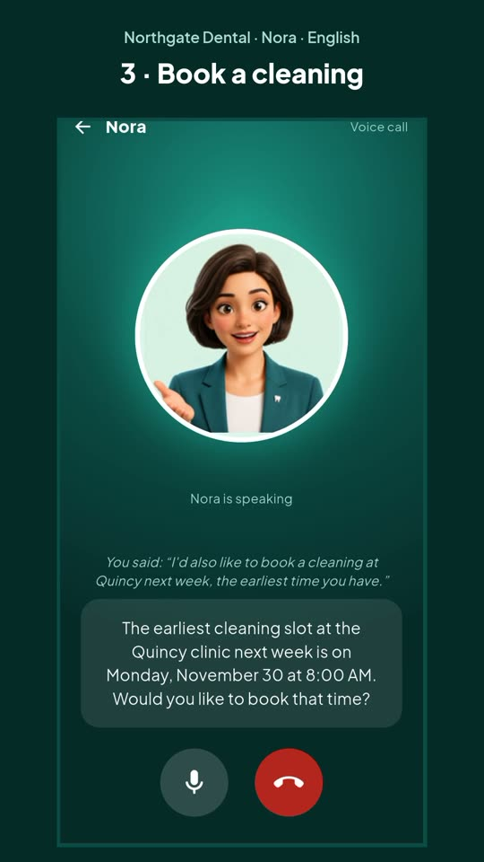](https://github.com/FionaMich/northgate-dental/releases/download/demo-2026-11-24/nora-call-en.mp4) | [](https://github.com/FionaMich/northgate-dental/releases/download/demo-2026-11-24/nora-call-fr.mp4) | [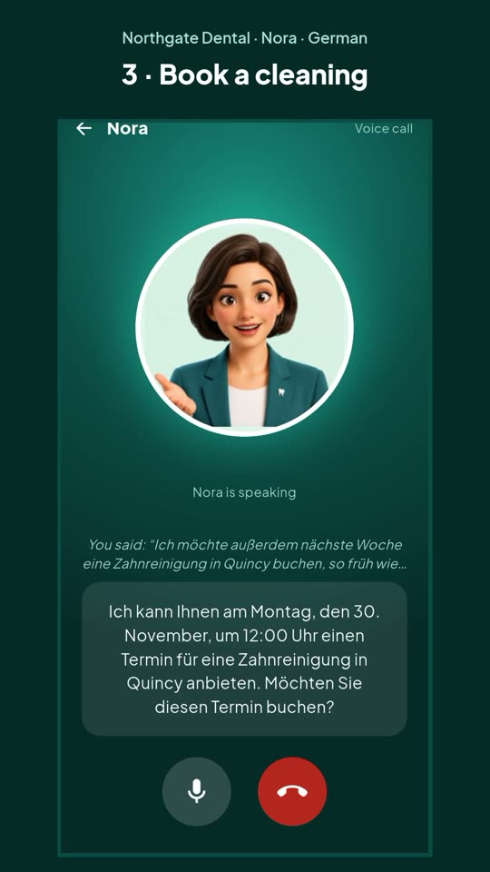](https://github.com/FionaMich/northgate-dental/releases/download/demo-2026-11-24/nora-call-de.mp4) |

**Chat with Nora in other languages** (6 min 36 s, one video): the same requests typed in the app, in Dutch, then Spanish, then Italian; each part opens with its language on screen ("Nora in Dutch", "Nora in Spanish", "Nora in Italian"). Opening hours, paying a bill, booking a cleaning confirmed with the button, then a member of the Northgate team chosen with the reply buttons and the team's answer in the app. Waits for Nora's replies are fast-forwarded and marked.

[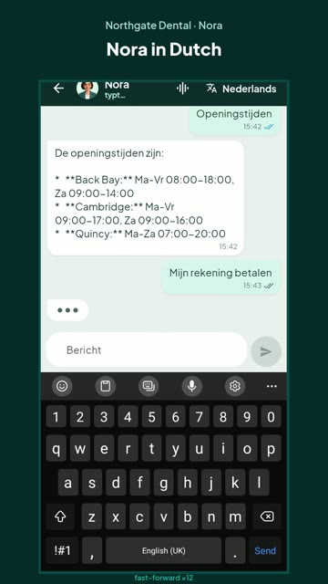](https://github.com/FionaMich/northgate-dental/releases/download/demo-2026-11-24/nora-chat-languages.mp4)

After the booking is confirmed, each video shows the confirmation email the notification worker sends for that visit (the same template and details; the image is a render of it).

How the videos were made, so nothing in them is taken for more than it is: each is one real call on a phone against the staging server, and every answer, tool call, booking and payment link is the assistant's own. The patient ("Michelle") is a generated voice played through a speaker beside the phone. For these recordings her words were given to the assistant as text from the script, so the videos show the conversation, the tools and the voice, not speech recognition; recognition was checked separately in English, where a live take transcribed her question word for word. The waiting between turns (7 to 40 seconds on a CPU-only server) is cut, Nora's voice is the audio our voice service sent to the phone, and both voices are levelled to the same loudness.

**Chat with the clinic team:** when Nora passes something to the team, the app offers a second conversation, with real people. It runs on Stream Chat and looks like a messenger: each message shows its time, grey ticks when the team has it and blue ticks when they have read it, and "typing…" while they write. Our server checks the session, makes the patient's own channel and signs the token, so nobody can open another patient's conversation; writing as the team needs the server's internal key. Stream learns an opaque user ID and the fixed name "Patient"; it does store the conversation text, which is why this is for demo data until Stream's HIPAA plan and agreement are in place. The staff side arrives with the staff portal; until then the team's replies in the demo are sent through the server's team endpoint.

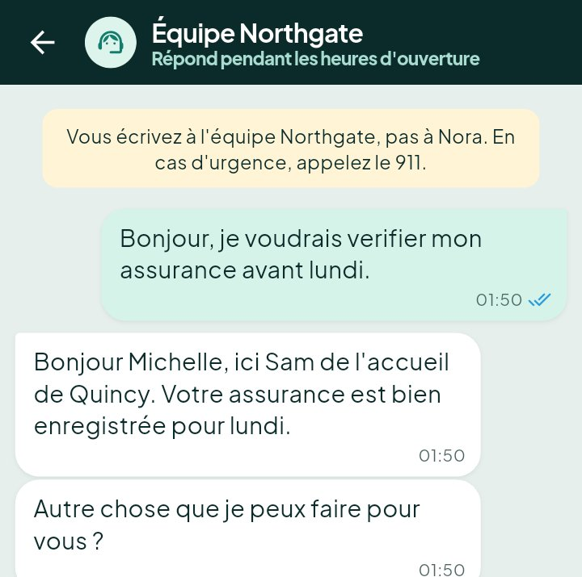

**Tracing:** LangSmith records each conversation's steps, tool calls, timings and outcomes, with inputs and outputs hidden: what the patient wrote never leaves the service.

</details>

<details>
<summary><b>How Nora knows clinic policy: hybrid RAG in Postgres</b></summary>

Patients ask how things work: "is there a fee if I miss a visit?", "can I pay in instalments?", "is there parking in Quincy?". Nora answers these from documents the clinic has approved (`knowledge/`), names the document, and hands over when no document answers.

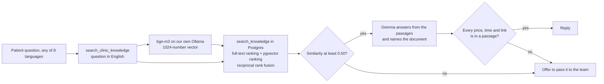

**Which RAG, and why:**

| Choice | Why |
| --- | --- |
| **Hybrid** retrieval: keywords (Postgres full-text search) plus meaning (pgvector), fused by reciprocal rank fusion in one SQL function | Keywords catch exact terms ("no-show fee", "HSA"); meaning catches the same question in other words or another language. Fusing by rank needs no tuning between two score scales. Postgres only: no extra database to run or secure |
| Retrieval as a **tool** Nora calls, not text added to every prompt | Most turns (booking, paying) need no documents; on a CPU every prompt token costs time |
| **Corrective** step as a calibrated similarity gate, not a model grader | A grader would add 20 to 60 seconds per question on a CPU. The floor (0.50) sits between the weakest answerable question (0.563) and the closest out-of-scope one (0.448) in the golden set |
| **No web search** fallback | Health information from the open web is not approved by the clinic |
| The existing **grounding check** covers the answer | A fee or time in the reply must appear in a passage, so the model cannot invent one |
| **Not GraphRAG** | The questions are single-hop and the corpus is a few pages; the relationships Nora needs (patient, visit, clinic) are foreign keys her tools already follow |

**Evaluation** (`services/agent/evals/`): 27 questions in all eight languages and 6 that no document answers. recall@1 1.00, recall@3 1.00, mean reciprocal rank 1.00, every out-of-scope question refused. The thresholds in `thresholds.yaml` fail the run if a score drops.

**Governance:** the embedding model runs on our own server, so questions never leave it; only the question is embedded, with no patient identifier; passages are checked at ingestion for instructions aimed at a model; `ai_events` records that the tool ran, never the question. Clinical aftercare stays with the team until a clinician signs a document off.

</details>

<details>
<summary><b>The tooth chart: sculpted arches, painted surfaces</b></summary>

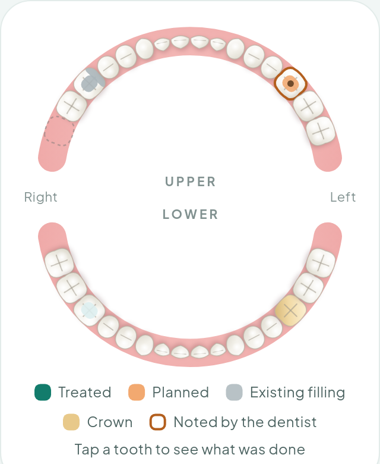

Both jaws seen from above, as a dentist sees them: two U-shaped arches set in the gums, the patient's right on the left of the screen (Universal numbering). Each tooth is drawn by type and shaded like enamel: molars with four cusps and their grooves, premolars with two, pointed canines, thin incisors. What happened is painted on the surface it happened to, read from the record's surface letters (top, front, back, cheek or tongue side): planned treatment in apricot, treatment done in teal, older fillings in silver, crowns in gold, implants in steel, decay as a dark spot, a crack as a line, a missing tooth as a dashed gap. The ring marks only what needs attention. Tapping a tooth opens its name in plain words ("Upper left first molar") and what was done, planned or noted. Drawn with Flutter's `CustomPainter`: no 3D engine, so it stays sharp, fast and readable by screen readers.

</details>

<details>
<summary><b>Flutter for the patient app</b></summary>

One codebase for Android now and iOS later, with full control over every pixel. That matters for an app that has to feel trustworthy, not generic.

- **Riverpod** for state: each screen watches small providers (`careSummaryProvider`, `dentistsProvider`), so data loads once and refreshes where it is used.
- **go_router** for navigation, with a gate that sends people to sign-in, the code screen or their records depending on the session.
- **pdfx** renders documents with Android's own PDF renderer, so patients read their files without downloading them.
- **flutter_local_notifications** schedules visit reminders and aligner alerts on the device. The reminder text is generic ("Dental visit tomorrow at 09:30"), because a lock screen is not private.
- **Fonts are bundled**, never fetched from a font service at runtime, so the app makes no third-party requests that could reveal who is using it.
- **Eight languages, the whole app:** English, French, Dutch, German, Spanish, Italian, Lithuanian and Swedish. The screens stay written in English; the app's own `Text` widget looks each string up on the way to the screen, so no screen carries translation code and a missing translation falls back to English, never to a blank. 571 strings per language, with tests that every language has the same strings and placeholders. The language follows the phone, can be changed in Profile, and Nora starts in it. Clinic data (service and product names) stays as the clinic wrote it.
- **Online-first:** Boston patients have reliable connectivity. Only the session and the aligner log live on the phone, and both are encrypted and wiped on sign-out.

</details>

<details>
<summary><b>Edge Function and the US Census geocoder for addresses</b></summary>

The app accepts only real, verified home addresses. The US Census Bureau geocoder is free, needs no key and covers every US address, but it refuses requests from outside the US. The `verify-address` Edge Function calls it from Supabase's US region, sends only the street line, city, state and ZIP code (no name or record number), and returns up to three official matches for the patient to confirm.

</details>

<details>
<summary><b>Resend for sign-in emails</b></summary>

Supabase sends the sign-in codes through Resend's SMTP service, with branded templates in `supabase/templates/`. The emails carry a code and nothing clinical.

</details>

<details>
<summary><b>Oracle Cloud: a private VM behind a Network Load Balancer, built with Terraform</b></summary>

The always-on services run on one Oracle Cloud VM with Docker Compose. Everything around it is code in `infra/terraform/oci/`, so the whole server can be destroyed and rebuilt from this repository, and every infrastructure change is reviewed as a pull request with a `terraform plan`.

- **No public IP on the VM.** It sits in a private subnet that forbids public addresses. The only way in from the internet is the Network Load Balancer on ports 80 and 443; outbound traffic (updates, image pulls, backups) leaves through a NAT gateway.
- **Network Load Balancer, not an HTTP load balancer:**
  - it passes traffic straight through and keeps each visitor's real IP, so the WAF and rate limits work per visitor (shown in the WAF log);
  - TLS stays end to end to our own Nginx, where it is tested in CI;
  - an HTTP load balancer would end TLS itself and replace every visitor's address with its own.
- **SSH only through Oracle Bastion.** Port 22 is closed to the internet. Sessions last at most three hours and can only be opened from one admin address. `infra/scripts/ssh-vm.sh` opens a session and signs in, in one command.
- **Least-privilege security lists:** the public subnet takes 80 and 443 only. The private subnet takes 80 and 443, and SSH only from the bastion's subnet.
- **Its own compartment,** and every resource tagged with product, environment and `managed_by=terraform`.
- **Shape:** VM.Standard.E3.Flex (1 core, 8 GB) while Johannesburg has no free Ampere A1 capacity. `infra/terraform/oci/retry-a1.sh` checks Oracle's capacity report and moves to the Always Free A1 when it can. The new VM is built before the old one is removed, so a failed attempt never leaves the site without a server.

- **Three networks:** `edge` faces the internet and only the WAF is on it; `app` is for services; `data` is internal-only, with no route in or out, and holds Presidio.
- **Every container** has a pinned version, a memory limit, a health check and log rotation, and every image has amd64 and arm64 builds.
- **Hardening** (`infra/scripts/bootstrap-vm.sh`, run automatically on first boot): keys-only SSH, no root sign-in, fail2ban, automatic security updates, a host firewall for 80 and 443, and a non-root `deploy` user.

**Principles:** **infrastructure as code and immutable servers**: Terraform for both clouds; the VM is replaced, not patched by hand (`create_before_destroy`), and cloud-init hardens it on first boot.

</details>

<details>
<summary><b>Hosting on the VM: one Docker Compose stack, three networks, a memory budget</b></summary>

Everything server-side that is not Supabase or Vercel runs on one Oracle VM (`VM.Standard.E3.Flex`, 2 cores, 16 GB,
Johannesburg, no public IP) as a single Docker Compose project in `/opt/northgate/infra`. Each service is pinned to an
exact image version and has a memory limit, so one runaway container cannot starve the others.

| Service | Job | Memory limit | Networks | Reachable from the internet |
| --- | --- | --- | --- | --- |
| `waf` | Nginx with ModSecurity and the OWASP Core Rule Set; TLS from Let's Encrypt | 300 MB | edge, app | Yes: ports 80 and 443 through the load balancer |
| `assistant` | Nora (FastAPI and LangGraph) | 512 MB | app | `/assistant/` only |
| `ollama` | Gemma 4 and the bge-m3 embedder, one conversation at a time | 9 GB | app | No |
| `voice` | Nora's voice on Stream calls | 2 GB | app | No (outbound only) |
| `n8n` and `n8n-db` | Automations, payment and visit link pages, Nora's MCP action tools | 1 GB and 256 MB | app, data | `/webhook/` only; the editor and `/mcp/` answer 404 |
| `worker` and `pdf` | Queue consumer, emails, receipt PDFs | 128 MB and 768 MB | app, data | No |
| `presidio-analyzer`, `presidio-anonymizer` | Redaction | 1 GB and 256 MB | data | No: the `data` network has no route out |
| `alloy` | Sends metrics to Grafana Cloud | 256 MB | app | No |
| `status` | Uptime Kuma | 256 MB | app | The public status page only |

- **Three networks as bulkheads:** `edge` (the WAF and certificates), `app` (services that talk to each other) and
  `data` (internal only, no route in or out). Presidio sits only on `data`.
- **Profiles** (`assistant`, `worker`, `n8n`, `voice`, `monitoring`, `status`) start each part on its own, so a
  smaller VM can run a subset.
- **Secrets** live in `infra/.env` on the VM (git-ignored, mode 600) and in n8n's encrypted credential store; nothing
  secret is in Git or in an image.
- **Access:** SSH only through Oracle Bastion from one admin address (`infra/scripts/ssh-vm.sh`); the dashboards of
  n8n and Kuma are reached through the same tunnel.
- **Deploying:** `git pull --ff-only origin develop`, then `docker compose --profile <part> up -d --build <service>`.
  Database changes never deploy from the VM; they go through the GitHub Actions workflow on merge.
- **Backups:** a nightly `pg_dump`, encrypted with `age`, uploaded with a key that can add files but not read or
  delete them.

</details>

<details>
<summary><b>AWS account baseline, built with Terraform</b></summary>

The AWS account holds backups only, so it is locked down to match. `infra/terraform/aws/` manages:

- **CloudTrail `northgate-audit`:** records every action in every region, including IAM and sign-ins. Log file validation proves no log was changed or deleted. The logs go to a private, versioned, encrypted bucket that refuses plain HTTP.
- **Account-wide S3 Block Public Access:** no bucket can be made public, whatever its own settings say.
- **Password policy:** at least 14 characters with every character class, and the last 24 passwords blocked. There is no forced expiry, following NIST SP 800-63B; MFA protects instead.
- **Cost alerts:** Cost Anomaly Detection sends a daily email if unusual spend reaches US$1, alongside a US$1 budget.
- **Storage Lens dashboard** (`northgate-storage`, home region Stockholm) for what the account stores, where, and how it changes day by day. It answers the governance question "where does our data sit?" with numbers: total bytes and objects, by bucket, region and storage class, with 14 days of daily history. Today it covers the two buckets in eu-north-1: the nightly encrypted database backups and the CloudTrail audit log. A bucket that appears in another region, or a backup bucket that stops growing, shows here first. It is the free tier, so the numbers live in the console only.

IAM Access Analyzer would normally be part of this baseline. AWS blocks it on free plan accounts with a service control policy, so it waits until the account is upgraded.

</details>

<details>
<summary><b>Two clouds, two jobs: how the Oracle and AWS designs map onto each other</b></summary>

Northgate deliberately uses two providers for two different jobs, so a failure or a mistake in one cannot take the other with it: **Oracle Cloud runs the services** (always-on compute at low cost) and **AWS keeps the backups and the audit trail** (S3's durability and CloudTrail). The backups are encrypted with `age` *before* they leave Oracle, so AWS only ever stores ciphertext, and the key that decrypts them lives on neither cloud.

Both are built with Terraform, so the same habits apply in each: a plan reviewed before every apply, every resource tagged with product, environment and `managed_by=terraform`, and no console clicking that the code does not know about.

| Concern | Oracle Cloud (compute) | AWS (backups and audit) | Why it is done this way |
| --- | --- | --- | --- |
| Isolation boundary | Compartment `northgate` | The account itself, guarded by account-wide S3 Block Public Access | Blast radius: a mistake elsewhere cannot touch these resources |
| Private network | VCN `10.20.0.0/16`, public and private subnets | Not needed: no compute runs on AWS | Build only what a job needs |
| Way in from the internet | Network Load Balancer, TCP 80 and 443, client IP preserved | None: S3 is reached with signed API calls | The WAF must see real visitor IPs for its rate limits |
| Firewall rules | Security lists per subnet, plus the host firewall | Bucket policies that refuse plain HTTP | Defence in depth: two layers, each enough on its own |
| Admin access | Oracle Bastion: time-limited sessions, one source IP, no port 22 open | IAM users per job: upload-only for the VM, read-only for restores | Least privilege; the VM can add backups but never read or delete them |
| Way out | NAT gateway, plus a service gateway for Oracle services | Not applicable | The VM needs updates and images without a public IP |
| Audit | Oracle's audit log (default, 365 days) | CloudTrail in every region, with log file validation | Evidence that cannot be quietly edited |
| Cost guardrails | Always Free limits; `retry-a1.sh` moves to the free Ampere A1 | A US$1 budget and Cost Anomaly Detection | Cost alerts exist before the resources they watch |
| Storage insight | Boot volume metrics | S3 Storage Lens dashboard | Know what is stored where, by region and bucket |
| Region | Johannesburg (Oracle's accepted home region, ADR 0004) | Stockholm (fixed for this account, ADR 0003) | Test data only; a real US client would move both to US regions |

**The same idea in AWS terms:** if the VM moved to AWS, the design would be an EC2 instance in a private subnet behind a Network Load Balancer, Systems Manager Session Manager instead of Oracle Bastion (no SSH port at all), security groups instead of security lists, and an instance role instead of a stored access key for backups. The warm standby planned for section 16 is exactly that.

</details>

<details>
<summary><b>Nginx with ModSecurity and the OWASP Core Rule Set</b></summary>

The WAF is the single public entrance to the server. The OWASP Core Rule Set is the standard open-source rule set against the common web attacks, and OWASP's official image runs it inside Nginx.

- **HTTPS only:** HSTS, TLS 1.2 and 1.3, plus a strict Content Security Policy, frame denial and nosniff headers.
- **Rate limits per client address:** a flood gets 429 Too Many Requests.
- **Logs by allow-list:** the JSON access log records the path without its query string, the status and the timing. A token or ID passed in a URL never reaches a log.
- **A pitfall the tests caught:** Nginx's `return` directive answers before ModSecurity and the rate limiter run, so even a health check written with `return` would skip the WAF. Every answer is served as a file instead, after the checks.
- **Certificates:** from Let's Encrypt through Certbot. Hostnames come from sslip.io, a free wildcard DNS service, so no paid domain is needed.

</details>

<details>
<summary><b>Microsoft Presidio for redaction</b></summary>

Before any text leaves our infrastructure (into a log, an error report, or a model with no data agreement), Presidio finds and replaces names, phone numbers, emails and Northgate's own identifiers: record numbers (`NG` and seven digits) and insurance member IDs. It runs on the internal network with no published port.

Two findings from testing with the canary record:

- Presidio's email recognizer accepts only real top-level domains, so a test address on a made-up domain slipped through. An extra pattern now catches any address.
- With every recognizer switched on, a US phone number was read as a UK NHS number and an email was split into fragments. Callers now ask only for the entity types a US practice handles.

</details>

<details>
<summary><b>Nightly encrypted backups to Amazon S3</b></summary>

Losing the VM, or even the Oracle account, must never mean losing data.

- **Every night at 02:00 UTC:** `pg_dump` (Postgres 17, run in a container) dumps the production database, `age` encrypts the dump with a public key, and the encrypted file is uploaded to S3.
- **The VM can only add backups:** its key allows uploads to one prefix and nothing else, so an attacker on the VM cannot read or delete the history (this was tested).
- **The keys to restore are kept off the VM:** the decryption key and the read-only key both stay elsewhere.
- **The bucket:** blocks public access, keeps versions and encrypts again at rest. A lifecycle rule keeps 30 days.
- **A monthly restore test** (`infra/scripts/restore-test.sh`) restores the latest file into Supabase's own Postgres image and counts the rows. A backup that has never been restored is not a backup.

</details>

<details>
<summary><b>Test data generator (Python, uv)</b></summary>

About 3,000 dental patients with visits, tooth charts, findings and treatment plans, plus named test personas. It also plants **canary records**: unmistakable fake values that must never appear in a log, trace or message. `scripts/canary-scan.sh` fails if one does.

</details>

<details>
<summary><b>Continuous care between visits: recovery check-ins, aligner wear and recall (W24 to W28)</b></summary>

A clinician invites a patient to a care programme. The patient joins in the app, which records their consent, and can leave at any time:
- **Recovery:** after an extraction, implant or root canal.
- **Aligner wear**
- **Recall:** the six-monthly check-up.

| Workflow | When | What happens |
| --- | --- | --- |
| W24 daily check-in | 10:00 clinic time | Today's check-in opens, and an email says it is ready in the app. The patient gives a pain score (0 to 10), says whether they feel better, the same or worse, ticks any symptoms (bleeding, swelling, fever, numbness, a bad taste) and can add a note |
| W25 rules and alerts | On each answer | Fixed rules and clinician-set thresholds, with no model, decide the level. **Emergency:** red-flag words in the note, or swelling with fever; an urgent task and the urgent queue, and the app shows 911 guidance. **Task:** pain at the threshold, or worse after day 3. Otherwise a nudge, or fine |
| W26 weekly summary | Mondays | A summary for the clinician built only from the data points, so nothing in it can be invented |
| W27 nudges | Hourly, 09:00 to 20:00 only | Approved reminders for a check-in still unanswered at 18:00, or aligner wear short of the target for two days |
| W28 check-up flags | After each answer or wear report | A serious side effect, a worsening pain trend, a week of short wear, or missed check-ins becomes a care task and a booking offer to the patient. It stays open until a clinician records the outcome in the portal's Care page |

**Privacy:** aligner wear stays on the phone unless the patient shares yesterday's total, and only the hours are sent. Queue messages carry IDs only. Patients read their own data; staff read their clinics' patients behind two-factor. Medicines are left out on purpose: missed-dose advice needs approved label sources first.

</details>

<details>
<summary><b>MCP: why Northgate has an MCP server, and what n8n's MCP tools do</b></summary>

**The problem it solves.** An AI assistant is only useful if it can reach real systems: the clinic list, the price
list, the booking rules, the payment flow. Without a standard, every assistant needs its own integration with every
system (N assistants times M systems). The Model Context Protocol (MCP) is that standard: a system publishes its
capabilities once, as typed tools with a description and a JSON schema, and any MCP client can discover and call them.
Nora is one client; Claude Desktop on a receptionist's laptop, an IDE assistant or a future voice agent are others,
with no new integration code.

**Why not just a REST API?** A REST API needs documentation and client code written by a person for every consumer.
An MCP server describes itself at run time (`tools/list`), in a form a model can read, so the same server serves
people's tools and AI agents. The business rules still live in Postgres; MCP is only the door.

**Two servers, two jobs** (the blueprint's split):

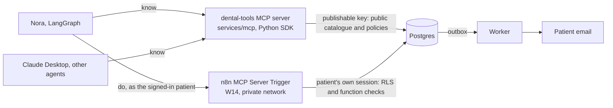

| Server | Tools | Data it can touch |
| --- | --- | --- |
| **dental-tools** (`services/mcp`): "know" | `clinics`, `services_and_prices`, `clinic_policies` (hybrid search), `how_to_book` | Public only: two database functions callable with the publishable key. No patient data by design, so it is safe for any client |
| **n8n W14** (`n8n/workflows/w14-nora-action-tools.json`): "do" | `send_payment_link`, `reschedule_link`, `ask_receptionist` | Only what the signed-in patient may do: each tool is one call to a Supabase function with the patient's own session token |

**Why the "do" tools live in n8n.** n8n owns everything that reaches outside a conversation (emails, links, the
receptionist inbox). Publishing those workflows as MCP tools lets the clinic change how a link is delivered, for
example adding SMS, without a new release of Nora, while the rule itself (own visit only, price from the price list,
cancellation window, one email a day) stays in one database function.

**Security model of the action tools:**
- **Identity never comes from the model.** Nora's code adds the session token from the verified session; a tool
  argument the model invents is ignored (tested with a forged `session_token`).
- **Not on the internet.** Nginx routes only `/webhook/`; `/mcp/` answers 404 (a WAF test). Nora reaches n8n on the
  Docker network with a bearer token; a wrong token is refused.
- **Every action waits for the patient.** "Email me a payment link?" and "Email me a link to choose a new time?" are
  confirmation cards in the patient's language; declining sends nothing.
- **Degrades safely.** If n8n is down, Nora calls the same function directly, so a handover still reaches the inbox.
  A refusal from the database is shown to the patient, never retried around n8n.
- **Nothing kept.** W14 and W15 save no run data, because a run holds a session token.

**The reschedule link** opens W15, a page with up to eight free times. Opening it changes nothing (mail scanners open
links); the button moves the visit in one transaction (`move_by_token`): the new time is booked, the old one cancelled,
and the patient gets one "your visit has moved" email. Inside the cancellation window, or if the time was just taken,
the visit stays as it was.

Run the know server for a desktop client:

```bash
cd services/mcp && uv run dental-mcp                                     # stdio
MCP_TRANSPORT=streamable-http MCP_PORT=8300 uv run dental-mcp            # HTTP
```

```json
{ "mcpServers": { "northgate-dental": { "command": "uv", "args": ["--directory", "services/mcp", "run", "dental-mcp"],
  "env": { "SUPABASE_PUBLISHABLE_KEY": "<the project's publishable key>" } } } }
```

</details>

<details>
<summary><b>The website and the staff portal: Next.js on Vercel, Supabase from the browser</b></summary>

Live at [northgate-dental.vercel.app](https://northgate-dental.vercel.app). The code is in `apps/web`: Next.js with the App Router and Tailwind, exported as static files, and served by Vercel's free Hobby plan. No server code runs at Vercel, so nothing there can read patient data.

| Services and prices | On a phone | Staff sign-in |
| --- | --- | --- |
| 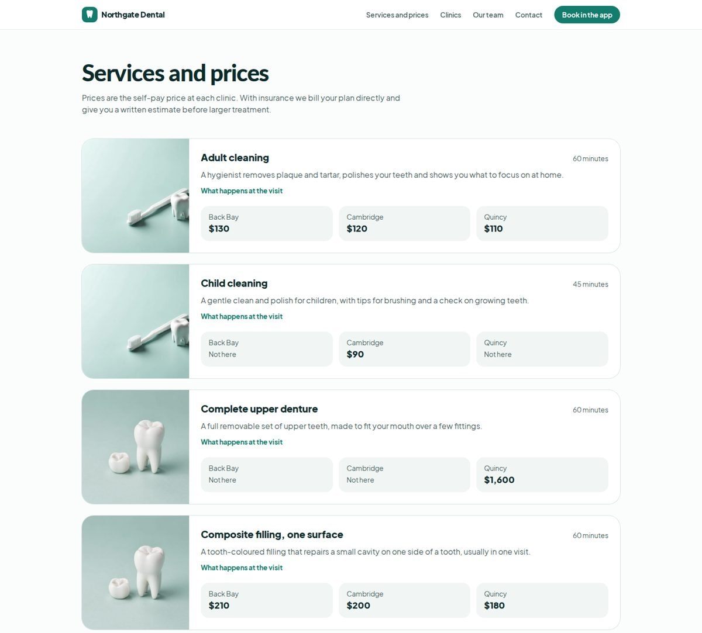 | 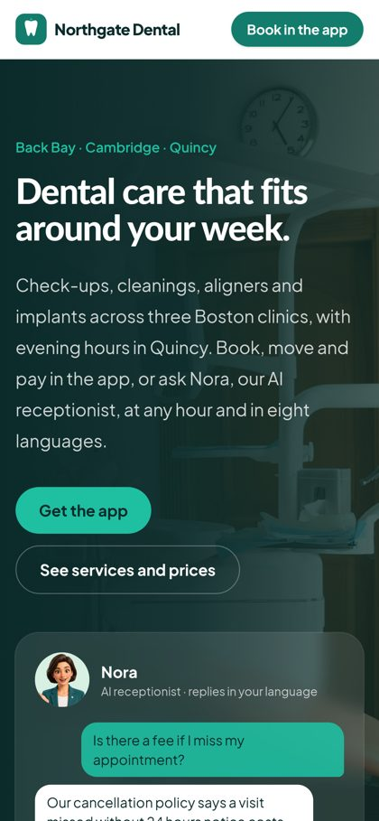 | 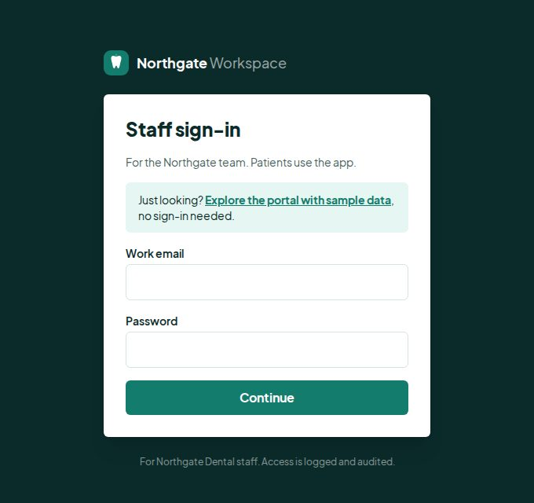 |

- **Pages built from the database.** Services, summaries, prices at each clinic, opening hours and phone numbers come from one database function, `public_catalogue()`, at build time. A bundled snapshot is the fallback, so a build never depends on the API. Each service has its own page: what happens at the visit, who you will usually see, and the price at each clinic.
- **Motion with GSAP and 3D.** Headings flip up word by word in 3D (SplitText), sections and cards rise into view as
  you scroll (ScrollTrigger), cards tilt towards the pointer with a soft light following it, the app's feature tiles
  flip up in 3D, the app panel settles from a tilt as it scrolls in, and Nora's portrait floats in depth. All of it is
  in one component (`src/components/Motion.tsx`) driven by data attributes; nothing moves for visitors whose device
  asks for reduced motion, the tilt is mouse-only so touch scrolling is untouched, and content is never left hidden if
  a script fails (it is visible until its animation starts).
- **The same brand as the app.** Same colours, the same bundled fonts (nothing loaded from a font service), the same photographs and the same team bios.
- **A voice call sample.** It shows how a call with Nora looks in the app: her portrait, captions of both sides, and the Confirm card. It is scripted, because website visitors are not signed in.
- **An enquiry form that keeps visitors out of the database.** Signed-out visitors get two functions and nothing else. `submit_lead()` asks for consent, limits each address to three enquiries a day, and turns each enquiry into a task for the chosen clinic. Only that clinic's staff can read it; it is kept 12 months.
- **The staff portal** (`/portal`), built as a clinical workspace like a hospital's: dense tables, square corners, one accent colour, Boston time throughout. **Try it without an account:** [northgate-dental.vercel.app/portal/demo](https://northgate-dental.vercel.app/portal/demo/) shows every page with sample data made in the browser (60 patients, a day of visits for six clinicians, tasks, insurance cards, payments and Nora activity). Nothing there touches a database, and changes are forgotten on reload.

| Overview | Schedule | Patients |
| --- | --- | --- |
| 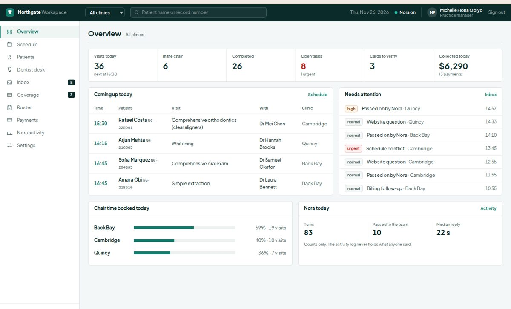 | 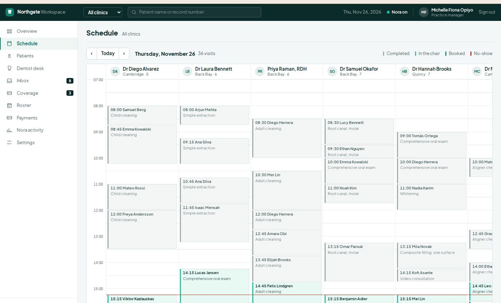 | 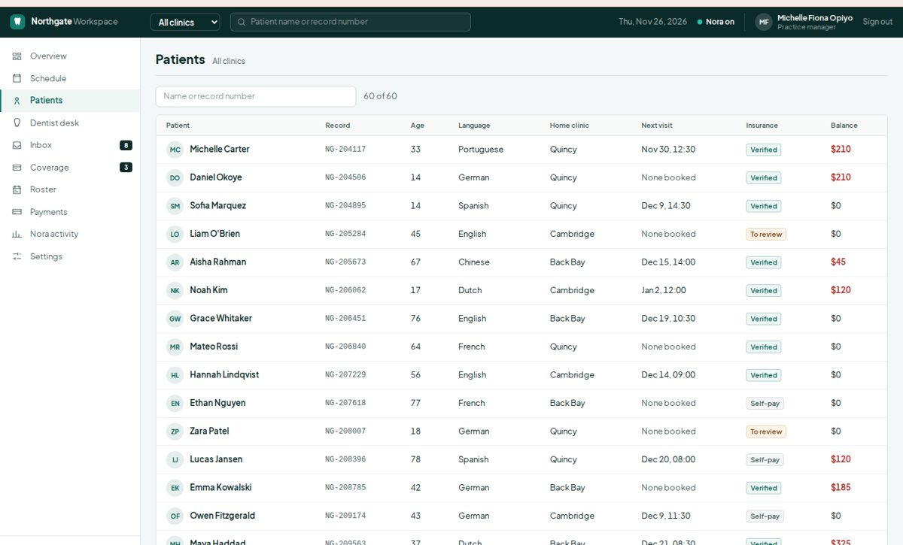 |

  - **Overview:** today's figures, the next patients, what needs attention, chair time booked per clinic, and Nora today.
  - **Schedule:** a time grid, one column per clinician from 07:00 to 20:00, with visits coloured by status and a line at the current time.
  - **Patients:** a register with record number, age, language, home clinic, next visit, insurance and balance.
  - **Dentist desk:** a clinician's own day. A manager picks whose day to view.
  - **Inbox:** Nora's handovers and website questions, with Mark done.
  - **Coverage:** verify or reject insurance cards.
  - **Roster:** the week's shifts per clinician, on-call marked.
  - **Payments**
  - **Nora activity:** from `ai_events`: what Nora did, never what anyone said.
  - **Settings:** the Nora on/off switch (practice manager only) and the clinic settings.

  A clinic switcher and patient search sit in the top bar. Row level security in the database decides what each person sees.

**Staff sign-in: password plus an authenticator app (TOTP).**

| Password | Then the authenticator, enrolled once with a QR code |
| --- | --- |
|  | 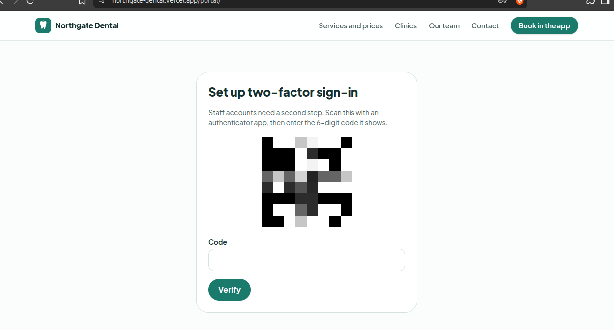 |

*The QR code in the picture is pixelated on purpose: it carries the account's secret key, and anyone who scanned it
could generate that person's codes.*

**How it is built** (`apps/web/src/app/portal/page.tsx`, about 30 lines, all Supabase Auth's own MFA API):

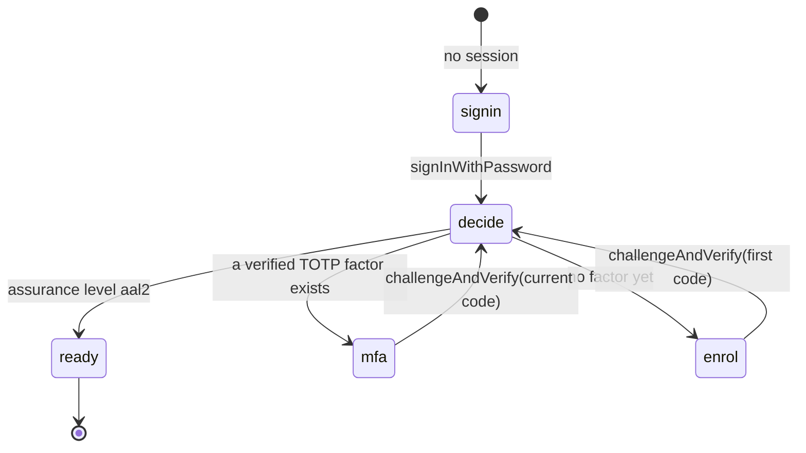

1. **One decision function.** After every step the page asks Supabase for the session's assurance level
   (`getAuthenticatorAssuranceLevel`). `aal2` opens the workspace; otherwise it lists the user's factors: a verified
   TOTP factor means "ask for the code", none means "enrol".
2. **Enrolment.** `mfa.enroll({ factorType: "totp" })` makes Supabase generate a fresh secret and return it as an
   `otpauth://` URI rendered as an SVG QR code. The secret is never stored by the page, never logged and never sent
   anywhere else; it lives in Supabase Auth and in the person's authenticator app (Google Authenticator, Microsoft
   Authenticator, 1Password). An abandoned enrolment stays unverified and can never be used.
3. **Verification.** `mfa.challengeAndVerify({ factorId, code })` checks the 6-digit code (RFC 6238: HMAC-SHA1 over
   30-second steps, a small clock-drift window). Spaces are stripped first, because apps display "123 456". On success
   Supabase issues a new token with `aal: "aal2"`.
4. **The database enforces it, not the page.** Every staff table carries a restrictive row level security policy,
   `staff_need_mfa`, built on `private.passes_staff_gate()`: a staff session that is not `aal2` reads and writes
   nothing, even if someone calls the API directly and skips the page. pgTAP tests prove a password-only staff session
   sees no patient data.

**Why TOTP rather than SMS codes:** no phone number to store or SIM to hijack, it works offline, and it costs nothing.
Passkeys (WebAuthn) are the natural next step.

**Setting it up as a new staff member:** sign in with the work email and password; scan the code with an authenticator
app; type the 6 digits it shows; from then on, enter the current code at each sign-in.

</details>

<details>
<summary><b>Monitoring: Prometheus metrics, Grafana Alloy and a Grafana Cloud dashboard</b></summary>

The assistant counts what it does and Grafana shows it, so "is Nora working, how fast, and what does a conversation cost?" has a measured answer.

| Metric | What it answers |
| --- | --- |
| `nora_turns_total` by channel, language and outcome | How many turns, and how they ended: answered, a confirm card, a handover, an emergency |
| `nora_turn_seconds` | How long a patient waits (p50 and p95, chat and call) |
| `nora_tool_calls_total` by tool | Which jobs patients bring: hours, booking, paying, the shop |
| `nora_model_tokens_total` by direction | Token use, the basis for cost per 100 conversations |
| `nora_grounding_blocks_total` | How often the safety check refused a price, time or link no tool returned |
| `nora_second_looks_total` | How often a reply that used no tool needed a second look, and whether it then called one |
| `nora_calls_started_total` | Voice calls by language |

- **Nothing about a patient can leave in a metric.** Every label is one of a few fixed words. A test puts a canary name in a message and proves it never reaches the metrics page.
- **The page is private.** `/metrics` is outside the `/assistant/` prefix, so Nginx never publishes it; Grafana Alloy reads it on the Docker network and writes to Grafana Cloud's hosted Prometheus.
- **Objectives are written down** in `ops/slos.yaml`: 95 per cent of turns answered within 30 seconds on the demo's CPU-only server, and 99.5 per cent availability.
- **One dashboard** ("Northgate Dental: Nora, the receptionist assistant"): turns by outcome, time to answer, handover rate, safety refusals, tool calls, tokens per turn, languages and calls.

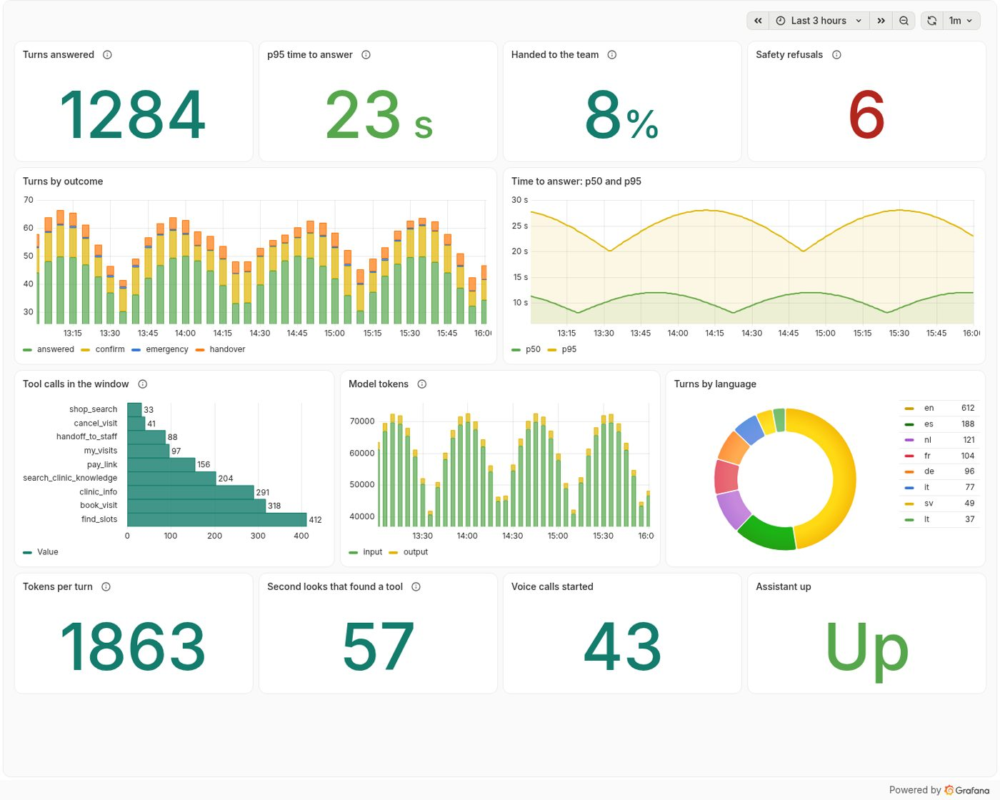

What the dashboard is for: one screen that answers "is Nora up, how long are patients waiting, how often does she pass them to the team, does the safety check refuse her, which jobs do patients bring, in which languages, and what does it cost in tokens?". The picture shows sample values, so that every panel is filled. The live dashboard shows the staging server's real, much smaller traffic.

**Alerts** (Grafana folder "Northgate alerts"), each with a runbook, all sent to the on-call contact point (email to
the on-call phone, grouped per alert, repeated every 4 hours while it fires):
- **Nora is down:** no scrape for 5 minutes.
- **Replies are slow:** p95 over 90 seconds for 15 minutes.
- **The safety check is refusing many replies:** more than 5 in an hour.
- **Turns are missing from `ai_events`:** any failure, because the AI audit trail must have no gaps.

**Public status page** (Uptime Kuma, `infra/status/setup.py`): six live checks grouped by what patients notice (the
website, the services page, Nora, payment and visit links) and the platform behind them (the WAF, the database API).
Only the page is public; Kuma's dashboard is reached through the Bastion tunnel, and the WAF tests prove it answers 404
from the internet.

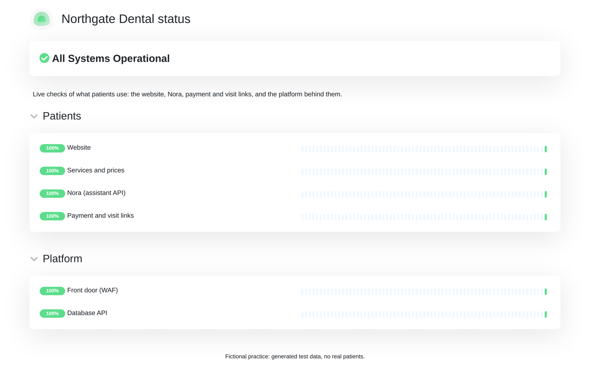

**Scripted journey check:** a GitHub Actions job checks the website, the database catalogue and Nora's health every 15
minutes, so a broken path is noticed even when nobody is using it.

**Principles:** **service level objectives and error budgets**: targets are written down in `ops/slos.yaml` and alerts fire on user-visible symptoms (down, slow, refusing), each with a runbook.

</details>

<details>
<summary><b>GitHub Actions</b></summary>

Every pull request runs:

- a secret scan (gitleaks);
- a guard against private files;
- a house-style check on the documentation;
- the database tests (pgTAP on a fresh database with generated patients);
- the generator tests;
- the Flutter tests;
- the WAF and Presidio tests against a real running stack;
- shellcheck on the server scripts.

Merges into `develop` apply database migrations to staging automatically.

**Principles:** **don't live with broken windows; automate everything**: pre-commit hooks, gitleaks, shellcheck and a commit-message guard, and CI blocks a merge on any failure. **Small batches and deployment automation**: one small pull request per ticket into `develop`, every merge deploys migrations to staging, and production waits for a required reviewer.

</details>

## Testing: every edge case has a test, and the refusals are tested too

Tests are written before the code, and every rule is tested from both
sides: the allowed case and the case that must be refused. All of them run in CI on every pull request; nothing merges
red. Changes are made in small, safe steps with tests around them, never as rewrites.

| Suite | Count | What it proves | Runs against |
| --- | --- | --- | --- |
| Database (pgTAP) | 542 checks in 38 files | Row level security per role, booking rules, money, links, queues, care programmes, Nora's action functions | A fresh Postgres with generated patients |
| Agent (pytest) | 102 | The safety gate in 12 languages, confirmation buttons, grounding, handovers, forged identity, n8n down | A scripted model (no Ollama in CI) |
| Worker (pytest) | 29 | Each email once, however often a message is delivered; no canary name in any log | A real local database |
| App (Flutter) | 113 | Sign-in and linking, booking, payments, the shop, care check-ins, translations | Widget tests with fakes |
| Infra (WAF, Presidio) | 25 checks plus a redaction test | Attacks refused with 403, private paths 404, TLS 1.2+, rate limits, a canary record fully redacted | A running Nginx and ModSecurity stack |
| MCP, voice, generator | 4, 6, 27 | Public tools only; voice turn-taking; generated data is reproducible and marked | Unit tests |
| Retrieval evaluation | 27 questions + 6 out of scope | Recall and refusal thresholds (below) | The real embedding model |

**Edge cases, from `docs/edge-cases.md`, each with its test** (a selection):

| Edge case | Handling | Result |
| --- | --- | --- |
| Two people book the last slot at once | Exclusion constraints on practitioner and room time ranges; the loser gets "no longer available" | Pass |
| A hold is abandoned | Holds expire after 10 minutes and are released before every new hold | Pass |
| Stripe delivers the same event twice, or a forged one | Idempotent event record; HMAC over the raw body; 5-minute replay window | Pass |
| A message is delivered three times | `notification_log` claimed before sending; exactly one email | Pass |
| A patient asks Nora for a link twice | One email per visit, kind and day | Pass |
| A reschedule link is clicked twice at once | One move wins; the other rolls back and says "already changed" | Pass |
| A link is opened by a mail scanner | GET never writes; only the button (POST) acts | Pass |
| Inside the cancellation window | Cancelling or moving online is refused; the page gives the clinic's number | Pass |
| The model invents a price, time or link | Grounding check replaces the reply with a handover | Pass |
| The model passes someone else's identity | Identity comes from the session; the argument is ignored | Pass |
| A red flag in any of 8 languages | Fixed emergency text, model never called, urgent handover | Pass |
| A password-only staff session | Reads no patient data (`aal2` gate in the database) | Pass |
| A session token expires mid-reply | The app refreshes it when under 5 minutes remain | Pass |

**A test that passed for the wrong reason.** The reschedule page first passed its tests because a patient's session
was still set from an earlier step. Re-running the page as n8n's own database role, with nobody signed in, made it fail:
the slot query only answered signed-in callers, so on the server the page would have offered no times. The fix
(`private.free_slots`) came with the corrected test. Tests now run each function as the role that calls it in production.

## Evaluating Nora: quality, speed, tokens and cost

Retrieval and answers are measured separately (AGENTS.md section 14.1), and the measured numbers sit next to their
thresholds in `services/agent/evals/thresholds.yaml`, so CI fails if a change makes them worse.

| What | Measure | Threshold | Measured |
| --- | --- | --- | --- |
| Finding the right document | recall@1 / recall@3 | 0.90 / 0.95 | 1.00 / 1.00 (27 questions, 8 languages) |
| Ranking it first | Mean reciprocal rank | 0.90 | 1.00 |
| Refusing what no document answers | Out-of-scope refusal | 1.00 | 1.00 (6 questions) |
| Behaviour | Tool choice, confirmation, refusal and handover | Every test passes | 102 of 102 |
| Speed (live, staging) | Time per turn, p50 / p95 | 30 s at p95 (SLO, CPU-only server) | 11.7 s / 64.8 s |

**Live traffic on staging** (Prometheus counters since the assistant's last restart; demo traffic, not patients):
82 turns, of which 65 answered, 11 ended in a confirmation card and 6 in a handover. The model read 201,607 tokens and
wrote 3,519, about **2,460 tokens in and 43 out per turn**.

**What the token numbers say:**
- **Input dominates, 57 to 1.** Most of it is the system prompt and the tool definitions sent with every turn; the
  answers themselves are short. The levers are, in order: fewer tool definitions per turn (route by intent first),
  prompt caching on a hosted model, and retrieving documents only when asked (already done: RAG is a tool, not
  context on every turn).
- **Cost per 100 conversations.** At about four turns each, 100 conversations use roughly 984,000 input and 17,000
  output tokens. On our own server that is no per-token charge; the cost is the VM, which is fixed. On a hosted model
  the same numbers multiply by its per-token price, which is why the token counter exists before any move to Bedrock.
- **Speed is the weak point.** p95 of 64.8 seconds misses the 30-second objective on a CPU-only server. The plan is a
  GPU or Amazon Bedrock behind the same `model_for(role)` switch, promoted only after the same evaluations pass.

**How Nora is made fast.** Every choice below takes work away from the model, because on a CPU each prompt token and
each extra model call costs seconds:

| Choice | What it saves |
| --- | --- |
| A small, quantised model: Gemma 4 e4b in its 4-bit quantisation-aware build | A reply fits a 2-core CPU at all; a larger model would take minutes |
| Retrieval is a tool Nora calls, not documents added to every prompt | Booking and paying turns carry no policy text at all |
| A calibrated similarity gate instead of a second model grading the documents | 20 to 60 seconds on every policy question |
| Emergencies, refusals, handover replies and confirmation cards are fixed text | No model call at all: they appear at once |
| Buttons for the common next steps ("Book a cleaning", "Pay my bill", the team) | The patient skips a typed turn and the model reads a short, clear request |
| Tools that finish the job in one call (`pay_link` finds the next unpaid visit; `find_slots` accepts "cleaning") | Fewer model round trips per request |
| Prices returned with the free times | No extra turn to look a price up, and no handover from the grounding check |
| One conversation at a time on the model (`OLLAMA_NUM_PARALLEL=1`) | Each reply gets all 4 threads instead of sharing them |

The result today: a typical reply in 11.7 seconds (p50) and a slow one in 64.8 seconds (p95), measured over 82 live
turns. The next step is speed by design, not by tuning: the same `model_for(role)` switch moves Nora to Amazon Bedrock
or a GPU server, where a reply takes a few seconds, after the same evaluations pass; trimming the tool definitions sent
with each turn and caching the fixed part of the prompt then cut the 2,460 input tokens per turn that dominate the time.

**Not yet done, and stated plainly:** answer faithfulness scored by a separate judge model (RAGAS or DeepEval), checked
against 50 human-labelled answers before its scores are trusted, and a weekly review of sampled conversations. The
golden sets and thresholds are in place for both.

## What happens when the number of users grows

The demo runs on one small VM and Supabase's smallest plan. That is deliberate: every part was chosen so that the next
step up is a configuration change or one well-understood component, not a rewrite. Here is where each part breaks
first, how we would know, and what we would do.

| Part | Today | Breaks first when | We would see it in | The next step |
| --- | --- | --- | --- | --- |
| Website | Static files on Vercel's CDN | Practically never: no server code runs | Vercel analytics | Nothing; it already scales with the CDN |
| App reads and bookings | Supabase Postgres, row level security, PostgREST | Connections and slow policies under hundreds of concurrent users | Supabase query performance, p95 of `available_slots` | Supavisor connection pooling (transaction mode), indexes on every policy predicate (`patient_id`, `location_id`), a bigger compute tier, then a read replica for reads |
| Double booking at peak | Exclusion constraints in the database | Never: the database refuses the second booking whatever the load | The "no longer available" rate | Nothing; correctness does not depend on load |
| Nora (the model) | Gemma on 2 CPU cores, one conversation at a time (`OLLAMA_NUM_PARALLEL=1`) | Immediately: a second patient waits for the first; p95 is already 64.8 s | `nora_turn_seconds` p95 alert | Move the model behind `model_for(role)` to Amazon Bedrock or a GPU server, promoted only after the evaluations pass; replies drop to a few seconds and scale with the provider |
| Nora (the service) | One FastAPI process; paused conversations kept in memory (`MemorySaver`) | A restart loses a conversation waiting for its Confirm button; a second replica would not know the first one's conversations | Confirm-card errors after deploys | LangGraph's Postgres checkpointer, then several stateless replicas behind Nginx |
| Emails and reminders | One worker reading Supabase Queues in batches of 10 | Thousands of reminders at 9:00 | Queue depth and oldest message age | More worker replicas: messages are claimed atomically and every send is idempotent, so replicas need no coordination. Urgent clinical messages already have their own queue and cannot wait behind a campaign |
| n8n | One instance, regular mode | Many webhooks or long workflows at once | Execution time, failed executions | n8n queue mode (main plus workers on Redis); n8n holds no business rules, so this changes nothing else |
| Payments | Stripe Checkout and a signed webhook | Stripe retries during our outage | Webhook failures in Stripe | Nothing new: events are de-duplicated by ID and replayed safely |
| Audit trail | `ai_events` and the audit log in Postgres | Tens of millions of rows | Table size, slow portal pages | Monthly partitions, older ones archived to S3 |
| The VM itself | One VM in one region | Hardware or region failure | The status page and the scripted journey check | The planned three-cloud design: a warm standby on AWS, an automation lease with fencing tokens so only one copy sends messages, and a rehearsed failover |

**Overload behaves predictably.** Nginx rate-limits per address and answers 429 before any service is touched (a WAF
test floods it to prove this), and the worker takes fixed batches. Under pressure the system slows down in a known
order; it does not lose bookings or send a message twice.

**What does not change with scale:** where the data lives, who can see it, and what each model call receives. Adding
replicas or moving the model to Bedrock changes capacity, not the governance answers.

## Patient emails

Every email the practice sends is built by the worker from one shared frame: tables instead of modern CSS so Gmail, Apple Mail and Outlook render it the same, system fonts, dark mode, one main button, and the clinic's number as a tap-to-call link. Service emails carry no images at all, so nothing is fetched and nothing breaks when images are blocked. Campaign emails add one hero picture, an offer card and up to three reasons, in the style of a well-run Mailchimp account, and always carry one-click unsubscribe.

<p align="center">
  
  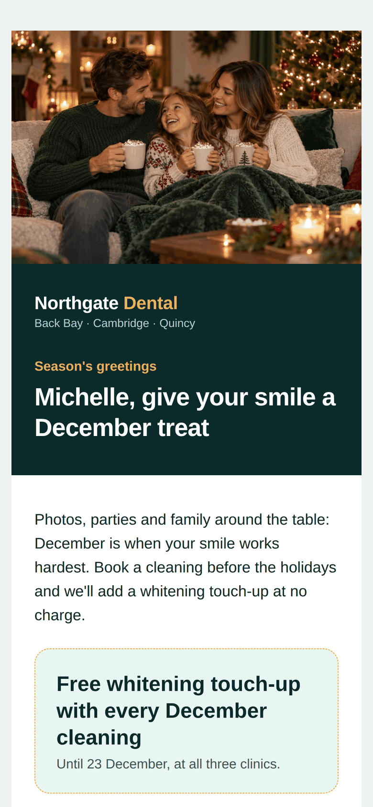
  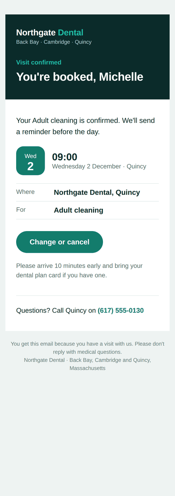
  
</p>
<p align="center">
  
  
</p>

## What the patient app does

<details>
<summary><b>Features</b></summary>

- **Sign in** with email and password, then a code emailed at every sign-in.
- **Find or create a record:** match an existing record by email and date of birth, or register as a new patient.
- **Book, reschedule and cancel:**
  - choose a clinic, then a service (each explained in plain words, searchable and grouped with pictures), then a dentist or "any available", then a time;
  - a slot is held for 10 minutes while the patient confirms.
- **Dentist profiles:** portraits, focus and the clinics each dentist works at.
- **Clinic pages:**
  - a photo, open or closed right now, and the opening hours;
  - directions and a call button;
  - the services offered and the team at that clinic.
- **Visit records:** the reason for the visit, a sculpted tooth chart (tap any tooth), what was done, the findings and the treatment plan.
- **Receptionist assistant:** chat in 8 languages to book, move, cancel or pay, with confirm buttons, and a handover to the team for anything else.
- **Documents from the practice:** visit summaries and X-rays, opened in an in-app PDF viewer.
- **Reminders and recall:** visit reminders the evening before and on the day, check-up recall, and aftercare sheets after treatment.
- **Clear aligner timer** with in-app notifications.
- **Details:** insurance plans picked from a list, and a verified home address.
- **Family access:** parents see their children's records, with limits for teenagers.
- **Payments:** each booked visit shows its price with Pay now or Paid; Payments, under Profile, lists what is due and the receipts; card details go only to Stripe.
- **Shop:** clinician-recommended products by category, refills every few months, collection at a chosen clinic or delivery, prescription items unlocked by the dentist, and orders under Profile.


Each row shows Profile (with the language setting), Home, Visits, Records and Shop on the same account. The language
is chosen once in Profile and applies to the whole app and to Nora.

**English**

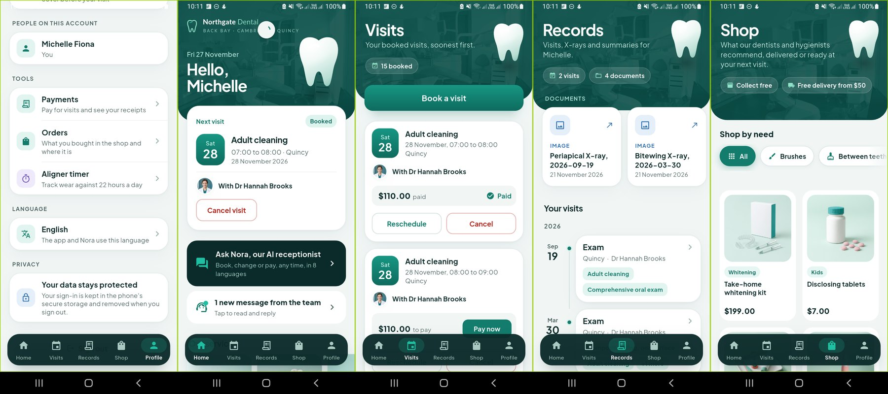

**French**


**German**

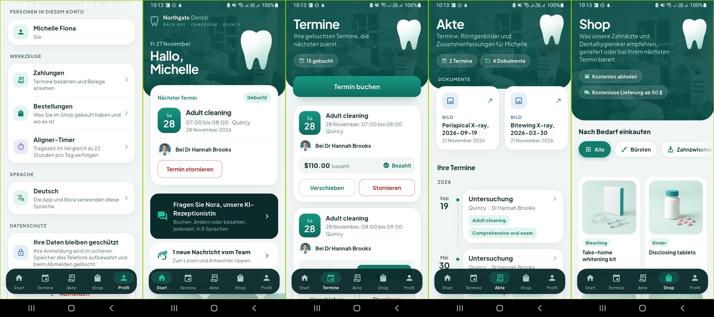

**Spanish**

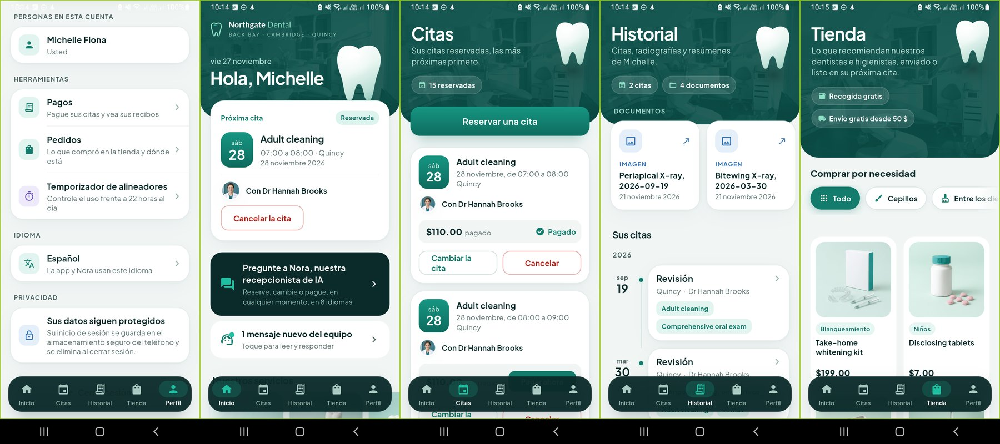

**Italian**


</details>

## Repository layout

| Path | What it holds |
| --- | --- |
| `supabase/migrations/` | Every database change, in order |
| `supabase/tests/` | pgTAP tests, with allowed and refused cases for each role |
| `supabase/seed.sql` | Clinics, hours, rooms, services, prices, insurance plans and staff |
| `supabase/functions/` | Edge Functions |
| `apps/mobile/` | The Flutter patient app and its tests |
| `infra/` | The server: Compose stack, Nginx configuration, certificate, backup, restore and hardening scripts, and their tests |
| `services/worker/` | Notification worker: reads Supabase Queues, sends confirmations and reminders (Python, psycopg, Resend) |
| `infra/terraform/oci/`, `infra/terraform/aws/` | Oracle network, load balancer, bastion and VM; AWS audit trail and account baseline |
| `services/agent/` | The receptionist assistant: LangGraph graph, safety gate, tools, fixed texts in 8 languages, FastAPI |
| `n8n/` | n8n workflows: SDK source (`sdk/`), exported JSON (`workflows/`) and the notes script |
| `services/synthdata/` | Test data generator |
| `scripts/` | Local helpers: database tests, canary scan, guards, mobile toolchain setup |
| `.github/workflows/` | CI, staging deploy and staging data load |

## Running it

<details>
<summary><b>Database</b></summary>

Install Docker, the [Supabase CLI](https://supabase.com/docs/guides/local-development/cli/getting-started) and [uv](https://docs.astral.sh/uv/getting-started/installation/), then:

```bash
supabase start
supabase test db
cd services/synthdata && uv run pytest
```

`scripts/test-db.sh` runs the database tests the way CI does, on a fresh Postgres container.

</details>

<details>
<summary><b>Patient app</b></summary>

```bash
scripts/setup-mobile.sh && source ~/.bashrc     # Flutter 3.50, JDK 17, Android SDK 36, checksums verified, no sudo
cd apps/mobile
cp staging.env.example staging.env              # project URL and publishable key
flutter test
flutter run --dart-define-from-file=staging.env
flutter build apk --release --dart-define-from-file=staging.env
```

</details>

<details>
<summary><b>Server stack on a laptop</b></summary>

```bash
cd infra
sed -e 's/^DOMAIN=.*/DOMAIN=localhost/' -e 's/^HTTP_PORT=.*/HTTP_PORT=18080/' -e 's/^HTTPS_PORT=.*/HTTPS_PORT=18443/' .env.example > .env
scripts/issue-certs.sh       # starts the WAF with a placeholder certificate
tests/test_waf.sh            # 25 checks: attacks refused, private paths hidden, headers, TLS, rate limits, error pages
tests/test_presidio.sh       # canary record fully redacted
```

On the VM, `scripts/bootstrap-vm.sh` hardens the machine once, and `scripts/issue-certs.sh --letsencrypt` gets the real certificate.

</details>

<details>
<summary><b>Receptionist assistant, step by step</b></summary>

1. **Install Ollama and the model** (https://ollama.com), then in a terminal that stays open:
   ```bash
   ollama pull gemma4:e4b-it-qat
   ollama serve
   ```
2. **Install the assistant's dependencies:**
   ```bash
   cd services/agent
   uv sync
   ```
3. **Run the fast tests.** They use a scripted model, so they take about a second:
   ```bash
   uv run pytest -q
   ```
4. **Try the real model** without a database. It runs three conversations (a Spanish booking, a German medicine question, a Swedish opening-hours question); expect 30 to 60 seconds per reply on a CPU:
   ```bash
   uv run python evals/smoke_live_model.py
   ```
5. **Start the API** against a Supabase project:
   ```bash
   export SUPABASE_URL=<project URL> SUPABASE_PUBLISHABLE_KEY=<publishable key> LINK_BASE=https://n8n.<domain>/webhook
   uv run uvicorn agent.api:app --port 8100
   ```
6. **Point the app at it** and open Home, then "Ask our receptionist":
   ```bash
   cd apps/mobile
   flutter run --dart-define-from-file=staging.env --dart-define=ASSISTANT_BASE=http://<laptop IP>:8100
   ```

</details>

<details>
<summary><b>LangSmith tracing, step by step</b></summary>

1. Sign up at https://smith.langchain.com and choose the **US** region. Note the address the dashboard opens on: this account lives on LangSmith's AWS deployment (`aws.smith.langchain.com`), whose API is `https://aws.api.smith.langchain.com`.
2. **Settings → API Keys → + API Key → Personal Access Token** (on the free plan a Service Key is refused with 403). Copy the key; it starts with `lsv2_pt_` and is shown once.
3. Add to `infra/.env` (git-ignored), never to chat or Git:
   ```bash
   LANGSMITH_API_KEY=<the key>
   LANGSMITH_ENDPOINT=https://aws.api.smith.langchain.com
   LANGSMITH_PROJECT=northgate-assistant
   LANGSMITH_HIDE_INPUTS=true
   LANGSMITH_HIDE_OUTPUTS=true
   ```
4. Check it: a 200 here means the key works.
   ```bash
   curl -s -o /dev/null -w "%{http_code}\n" -H "x-api-key: $LANGSMITH_API_KEY" "$LANGSMITH_ENDPOINT/api/v1/sessions?limit=1"  # gitleaks:allow
   ```
5. Tracing switches on by itself when the key is set; the project appears in the dashboard with the first conversation. Hidden inputs and outputs mean the dashboard shows steps, tools and timings, never what a patient wrote.

</details>

## How this was built

The project was built section by section, the way a small product team works:

- **Plan, then build test first.** Each section starts with a written plan and its governance answers: where the data lives, which vendor and region, what goes into every model call. Then the tests are written first: pgTAP for the database, pytest for the services, Flutter widget tests for the app.
- **One change per pull request.** Every pull request runs the whole CI suite before it can merge into `develop`: database, services, app, web, the WAF rules, secret scanning, house style, and a check that no private files are tracked. Changes to row level security, money, patient messages or Nora's safety gate get a line-by-line human review.
- **Deployments are automated:**
  - **Database:** migrations reach staging on every merge into `develop`, and production on every release into `main` after a reviewer approves, through one GitHub Actions workflow that also loads the clinic documents for Nora with their embeddings.
  - **Assistant and workers:** they run as Docker Compose services on the Oracle VM.
  - **Website:** it is a static build on Vercel.
- **Watched in production.** Grafana Cloud receives the assistant's metrics through Alloy. Four alert rules each point to a runbook.
- **Real problems found by real runs.** Recording the demo videos on a phone against staging exposed real problems:
  - **Handovers:** Nora sometimes promised a handover she never made.
  - **Prices:** the safety check refused a correct price written as "$500,", and accepted an invented "$50" because a document said "$500".
  - **Sign-in tokens:** a token expired in the middle of a long reply.

  Each became a failing test first, then a fix.

## Branches, environments and releases

- **Branches:** work happens on `feat/...` branches.
- **Pull requests:** every pull request targets `develop` and is squash-merged once every check passes.
- **Releases:** `main` holds releases. A release is a pull request from `develop` into `main`, merged with a merge
  commit only after the 8 required checks pass on a branch that is up to date with `main`.

| Environment | Database | Reached by | Gate |
| --- | --- | --- | --- |
| Staging | Supabase `northgate-staging` (us-east-1) | Every merge into `develop` | The CI checks on the pull request |
| Production | Supabase `northgate-prod` (us-east-1) | A release merged into `main` | The same checks, then a named reviewer approves the deploy in GitHub |

The database workflow applies the migrations with `supabase db push` and then loads the clinic documents for Nora, so
both environments end each deploy in the same state. Migrations only add (expand, then contract later), so a release
can be rolled back by redeploying the previous application while the database stays as it is.

**Current production release:** 27 November 2026, release #152 (pull requests #102 to #160). Eight migrations were
applied (video consultations, the AI audit trail `ai_events`, the clinic knowledge base, the website catalogue, Nora's
off switch, public policy search for the MCP server, care between visits, and Nora's payment and reschedule links), and
the knowledge load finished with 11 documents and 39 passages, the same as staging.
