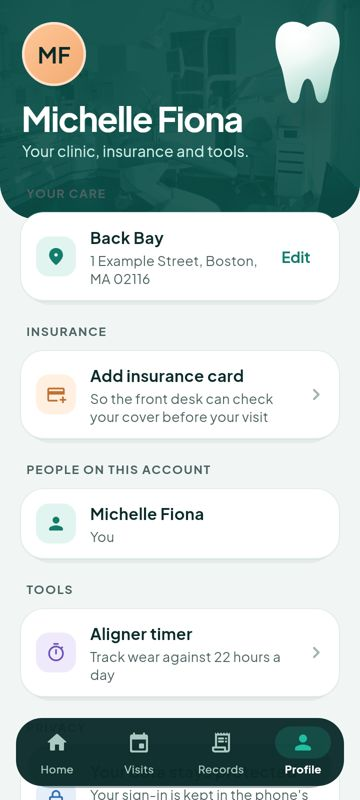
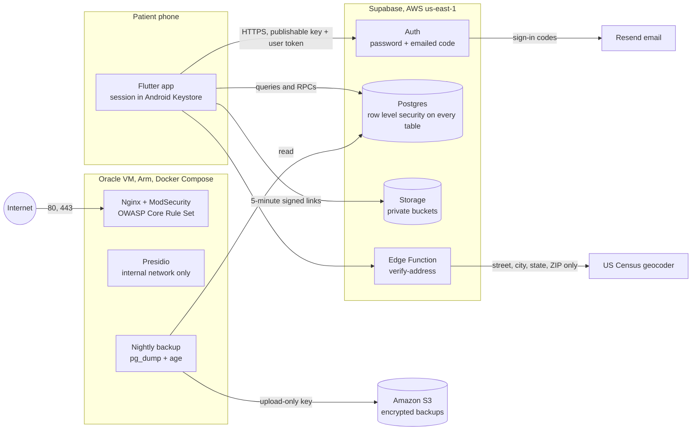
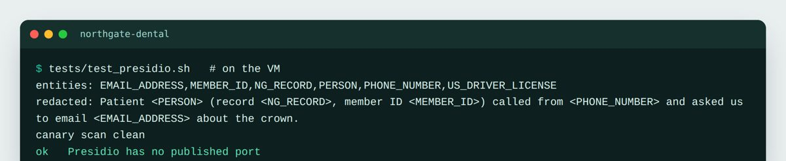
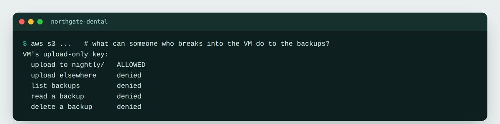

# Northgate Dental

A dental practice system and patient app for a fictional US dental group with three clinics in the Boston area: Back Bay, Cambridge and Quincy.

**All data in this project is synthetic.** Patients, staff, visits and documents are generated test data. X-rays and images are licensed or generated and credited. No real patient data is used anywhere.

| Home | Booking | Visit record |
| --- | --- | --- |
|  |  |  |

| Records | Aligner timer | Profile |
| --- | --- | --- |
|  |  |  |

## Architecture

Northgate is deliberately lean. Patient data lives in **one place**, a managed Postgres database (Supabase, US East). Everything else either reads from it under the database's own access rules, or holds no patient data at all. That makes the most important question a healthcare client asks, "where does my data go?", short to answer.



<details>
<summary><b>How a request is protected, layer by layer</b></summary>

1. **On the phone:** the session token is kept in the Android Keystore through `flutter_secure_storage`, never in plain preferences. The app holds only a publishable key, which grants nothing on its own.
2. **Sign-in:** an email and password, then a 6-digit code emailed at every sign-in. Until the code is confirmed, the session is marked unverified in `private.verified_sessions`, and every patient policy refuses it.
3. **In the database:** every table has row level security. A patient's queries pass through `private.my_patient_ids()` (their own record, plus children they are a proxy for), so a query for someone else's record returns nothing rather than an error. Staff policies additionally require a second factor (`aal2`).
4. **Writes go through functions:** booking, cancelling, linking a record and updating details are Postgres functions that check the caller themselves. The patient's identity comes from the signed-in session, never from a parameter the app sends.
5. **Files:** X-rays and visit summaries sit in a private bucket. The app receives a signed link valid for 5 minutes and opens the PDF inside the app.
6. **On the server:** every public request passes through ModSecurity with the OWASP Core Rule Set, which refuses cross-site scripting, SQL injection, path traversal and command injection with a 403, before any service sees the request.

</details>

<details>
<summary><b>Where each kind of data lives</b></summary>

| Data | Stored in | Region | Who can read it |
| --- | --- | --- | --- |
| Patient records, visits, charts, plans, appointments | Supabase Postgres | us-east-1 | The patient (and parent proxies) under row level security; staff with 2FA at their locations |
| X-rays, visit summaries | Supabase Storage, private bucket | us-east-1 | Same rules as the records; 5-minute signed links |
| Sign-in session | The phone's Keystore | On the device | The app only; cleared on sign-out |
| Aligner wear log | The phone, encrypted | On the device | The app only; wiped on sign-out |
| Audit log | Supabase Postgres, append-only | us-east-1 | Administrators; updates and deletes are revoked |
| Web access logs | Oracle VM | af-johannesburg-1 | Operators; path and status only, never query strings or bodies |
| Backups | Amazon S3, encrypted twice | eu-north-1 | Nobody on the server: the VM can add files but not read or delete them |

The Oracle VM and the S3 bucket sit outside the US. That is a recorded exception for synthetic data, caused by account regions that cannot be changed. A deployment with real patient data would move both into US regions before going live.

</details>

## Why each technology was chosen

<details>
<summary><b>Supabase (Postgres, Auth, Storage, Edge Functions)</b></summary>

A dental group's data is relational: patients, appointments, clinicians, rooms, services, prices and plans all refer to each other. Postgres is the natural home for it. Supabase adds sign-in, file storage and small server functions around the same database, so there is no separate API server to secure.

- **Row level security** puts the access rules next to the data. A forgotten check in an API endpoint cannot leak records, because the database itself refuses the query.
- **Exclusion constraints** (with `btree_gist`) make double booking impossible at the database level: two appointments for the same clinician or room cannot overlap, even if two people book at the same instant.
- **pgTAP** tests every policy with real sign-ins, for both what each role may do and what it must be refused.
- **Region:** us-east-1, so US patient data stays in the US.
- **Trade-off accepted:** the free plan has no point-in-time recovery, which is why the nightly encrypted backup exists.

</details>

<details>
<summary><b>Flutter for the patient app</b></summary>

One codebase for Android now and iOS later, with full control over every pixel. That matters for an app that has to feel trustworthy, not generic.

- **Riverpod** for state: each screen watches small providers (`careSummaryProvider`, `dentistsProvider`), so data loads once and refreshes where it is used.
- **go_router** for navigation, with a gate that sends people to sign-in, the code screen or their records depending on the session.
- **pdfx** renders documents with Android's own PDF renderer, so patients read their files without downloading them.
- **flutter_local_notifications** schedules visit reminders and aligner alerts on the device. The reminder text is generic ("Dental visit tomorrow at 09:30"), because a lock screen is not private.
- **Fonts are bundled**, never fetched from a font service at runtime, so the app makes no third-party requests that could reveal who is using it.
- **Online-first:** Boston patients have reliable connectivity. Only the session and the aligner log live on the phone, and both are encrypted and wiped on sign-out.

</details>

<details>
<summary><b>Edge Function and the US Census geocoder for addresses</b></summary>

The app accepts only real, verified home addresses. The US Census Bureau geocoder is free, needs no key and covers every US address, but it refuses requests from outside the US. The `verify-address` Edge Function calls it from Supabase's US region, sends only the street line, city, state and ZIP code (no name or record number), and returns up to three official matches for the patient to confirm.

</details>

<details>
<summary><b>Resend for sign-in emails</b></summary>

Supabase sends the sign-in codes through Resend's SMTP service, with branded templates in `supabase/templates/`. The emails carry a code and nothing clinical.

</details>

<details>
<summary><b>Oracle VM with Docker Compose</b></summary>

The always-on services run on an Oracle Cloud Always Free Arm (Ampere) VM with Docker Compose. A single VM keeps the cost at zero, and Compose makes the server reproducible: it can be rebuilt from this repository with two scripts.

- **Three networks:** `edge` faces the internet and only the WAF is on it; `app` is for services; `data` is internal-only, with no route in or out, and holds Presidio.
- **Every container** has a pinned version, a memory limit, a health check and log rotation, and every image has an arm64 build.
- **Hardening** (`infra/scripts/bootstrap-vm.sh`): keys-only SSH, no root sign-in, fail2ban, automatic security updates, a firewall open only on 22, 80 and 443, and a non-root `deploy` user.

</details>

<details>
<summary><b>Nginx with ModSecurity and the OWASP Core Rule Set</b></summary>

The WAF is the single public entrance to the server. The OWASP Core Rule Set is the standard open-source rule set against the common web attacks, and OWASP's official image runs it inside Nginx.

- **HTTPS only:** HSTS, TLS 1.2 and 1.3, plus a strict Content Security Policy, frame denial and nosniff headers.
- **Rate limits per client address:** a flood gets 429 Too Many Requests.
- **Logs by allow-list:** the JSON access log records the path without its query string, the status and the timing. A token or ID passed in a URL never reaches a log.
- **A pitfall the tests caught:** Nginx's `return` directive answers before ModSecurity and the rate limiter run, so even a health check written with `return` would skip the WAF. Every answer is served as a file instead, after the checks.
- **Certificates:** from Let's Encrypt through Certbot. Hostnames come from sslip.io, a free wildcard DNS service, so no paid domain is needed.

</details>

<details>
<summary><b>Microsoft Presidio for redaction</b></summary>

Before any text leaves our infrastructure (into a log, an error report, or a model with no data agreement), Presidio finds and replaces names, phone numbers, emails and Northgate's own identifiers: record numbers (`NG` and seven digits) and insurance member IDs. It runs on the internal network with no published port.

Two findings from testing with the canary record:

- Presidio's email recognizer accepts only real top-level domains, so a `.synthetic` address slipped through. An extra pattern now catches any address.
- With every recognizer switched on, a US phone number was read as a UK NHS number and an email was split into fragments. Callers now ask only for the entity types a US practice handles.

</details>

<details>
<summary><b>Nightly encrypted backups to Amazon S3</b></summary>

Losing the VM, or even the Oracle account, must never mean losing data.

- **Every night at 02:00 UTC:** `pg_dump` (Postgres 17, run in a container) dumps the production database, `age` encrypts the dump with a public key, and the encrypted file is uploaded to S3.
- **The VM can only add backups:** its key allows uploads to one prefix and nothing else, so an attacker on the VM cannot read or delete the history (this was tested).
- **The keys to restore are kept off the VM:** the decryption key and the read-only key both stay elsewhere.
- **The bucket:** blocks public access, keeps versions and encrypts again at rest. A lifecycle rule keeps 30 days.
- **A monthly restore test** (`infra/scripts/restore-test.sh`) restores the latest file into Supabase's own Postgres image and counts the rows. A backup that has never been restored is not a backup.

</details>

<details>
<summary><b>Synthetic data generator (Python, uv)</b></summary>

About 3,000 dental patients with visits, tooth charts, findings and treatment plans, plus named test personas. It also plants **canary records**: unmistakable fake values that must never appear in a log, trace or message. `scripts/canary-scan.sh` fails if one does.

</details>

<details>
<summary><b>GitHub Actions</b></summary>

Every pull request runs:

- a secret scan (gitleaks);
- a guard against private files;
- a house-style check on the documentation;
- the database tests (pgTAP on a fresh database with generated patients);
- the generator tests;
- the Flutter tests;
- the WAF and Presidio tests against a real running stack;
- shellcheck on the server scripts.

Merges into `develop` apply database migrations to staging automatically.

</details>

## What the patient app does

<details>
<summary><b>Features</b></summary>

- **Sign in** with email and password, then a code emailed at every sign-in.
- **Find or create a record:** match an existing record by email and date of birth, or register as a new patient.
- **Book, reschedule and cancel:**
  - choose a clinic, then a service (each explained in plain words, searchable and grouped with pictures), then a dentist or "any available", then a time;
  - a slot is held for 10 minutes while the patient confirms.
- **Dentist profiles:** portraits, focus and the clinics each dentist works at.
- **Clinic pages:**
  - a photo, open or closed right now, and the opening hours;
  - directions and a call button;
  - the services offered and the team at that clinic.
- **Visit records:** the reason for the visit, a tooth chart drawn as two arches, what was done, the findings and the treatment plan.
- **Documents from the practice:** visit summaries and X-rays, opened in an in-app PDF viewer.
- **Reminders and recall:** visit reminders the evening before and on the day, check-up recall, and aftercare sheets after treatment.
- **Clear aligner timer** with in-app notifications.
- **Details:** insurance plans picked from a list, and a verified home address.
- **Family access:** parents see their children's records, with limits for teenagers.

</details>

## Deployments

<details>
<summary><b>21 November 2026: hardened server on Oracle Cloud, live at <code>https://145-241-98-74.sslip.io</code></b></summary>

**What went live:**
- the WAF front door, with HTTPS from Let's Encrypt;
- Presidio for redaction;
- nightly encrypted backups of the production database to Amazon S3, with a restore test on a separate machine.

| Gateway page | On a phone |
| --- | --- |
|  |  |

**The firewall, tested on the live server:** every attack is refused, the headers are set, and floods get 429.


**From the internet:** attacks get 403, and the certificate is valid.


**Presidio removes every canary value:**



**Backups:** encrypted on the VM, and the VM's key can only upload.




**Restore test:** downloaded with a read-only key, decrypted on a laptop, and restored into Supabase's own Postgres image.


**Commands, in order** (placeholders stand in for secrets):

```bash
# one-time AWS set-up from a laptop: bucket, upload-only and read-only users, budget alert
aws login --profile northgate
infra/aws/backup-bucket.sh

# harden the VM (Oracle Linux 9): updates, firewall, fail2ban, keys-only SSH, Docker, age, deploy user, cron
ssh opc@145.241.98.74 'sudo bash -s' < infra/scripts/bootstrap-vm.sh

# backup key pair: the private key never leaves the laptop
age-keygen -o ~/.config/northgate/backup-age-key.txt

# on the VM, as the deploy user
ssh deploy@145.241.98.74
cd /opt/northgate/infra
nano .env                                   # DOMAIN, SUBDOMAINS, SUPABASE_DB_URL=<pooler URI>, backup keys
scripts/issue-certs.sh --letsencrypt         # start the WAF, get the certificate
docker compose up -d --wait                  # Presidio
tests/test_waf.sh && tests/test_presidio.sh  # prove it
scripts/backup.sh                            # first backup; cron runs it at 02:00 UTC

# back on the laptop: prove the backup restores
infra/scripts/restore-test.sh s3://<bucket>/nightly/<file>.dump.age ~/.config/northgate/backup-age-key.txt
```

**Console screenshots still to take** (they need a sign-in):

- [ ] Oracle instance page, showing the shape, OS and public IP: https://cloud.oracle.com/compute/instances?region=af-johannesburg-1
- [ ] Oracle security list with only 22, 80 and 443 open (VM page → Networking → Subnet → Security)
- [ ] S3 bucket properties, showing versioning, encryption, Block Public Access and the lifecycle rule: https://eu-north-1.console.aws.amazon.com/s3/buckets?region=eu-north-1
- [ ] The nightly backups in the bucket (`nightly/`)
- [ ] IAM user `northgate-backup-upload` with its single inline policy: https://us-east-1.console.aws.amazon.com/iam/home#/users
- [ ] Storage Lens dashboard `northgate-storage` (first data within 48 hours): https://eu-north-1.console.aws.amazon.com/s3/lens?region=eu-north-1
- [ ] AWS Budgets, showing the US$1 alert: https://us-east-1.console.aws.amazon.com/costmanagement/home#/budgets
- [ ] GitHub rulesets, showing 8 required checks on `develop` and `main`

</details>

## Repository layout

| Path | What it holds |
| --- | --- |
| `supabase/migrations/` | Every database change, in order |
| `supabase/tests/` | pgTAP tests, with allowed and refused cases for each role |
| `supabase/seed.sql` | Clinics, hours, rooms, services, prices, insurance plans and staff |
| `supabase/functions/` | Edge Functions |
| `apps/mobile/` | The Flutter patient app and its tests |
| `infra/` | The server: Compose stack, Nginx configuration, certificate, backup, restore and hardening scripts, and their tests |
| `services/synthdata/` | Synthetic data generator |
| `scripts/` | Local helpers: database tests, canary scan, guards, mobile toolchain setup |
| `.github/workflows/` | CI, staging deploy and staging data load |

## Running it

<details>
<summary><b>Database</b></summary>

Install Docker, the [Supabase CLI](https://supabase.com/docs/guides/local-development/cli/getting-started) and [uv](https://docs.astral.sh/uv/getting-started/installation/), then:

```bash
supabase start
supabase test db
cd services/synthdata && uv run pytest
```

`scripts/test-db.sh` runs the database tests the way CI does, on a fresh Postgres container.

</details>

<details>
<summary><b>Patient app</b></summary>

```bash
scripts/setup-mobile.sh && source ~/.bashrc     # Flutter 3.50, JDK 17, Android SDK 36, checksums verified, no sudo
cd apps/mobile
cp staging.env.example staging.env              # project URL and publishable key
flutter test
flutter run --dart-define-from-file=staging.env
flutter build apk --release --dart-define-from-file=staging.env
```

</details>

<details>
<summary><b>Server stack on a laptop</b></summary>

```bash
cd infra
sed -e 's/^DOMAIN=.*/DOMAIN=localhost/' -e 's/^HTTP_PORT=.*/HTTP_PORT=18080/' -e 's/^HTTPS_PORT=.*/HTTPS_PORT=18443/' .env.example > .env
scripts/issue-certs.sh       # starts the WAF with a placeholder certificate
tests/test_waf.sh            # 21 checks: attacks refused, headers, TLS, rate limits, logs, error pages
tests/test_presidio.sh       # canary record fully redacted
```

On the VM, `scripts/bootstrap-vm.sh` hardens the machine once, and `scripts/issue-certs.sh --letsencrypt` gets the real certificate.

</details>

## Branches and pull requests

- **Branches:** work happens on `feat/...` branches.
- **Pull requests:** every pull request targets `develop` and is squash-merged once every check passes.
- **Releases:** `main` holds releases.
