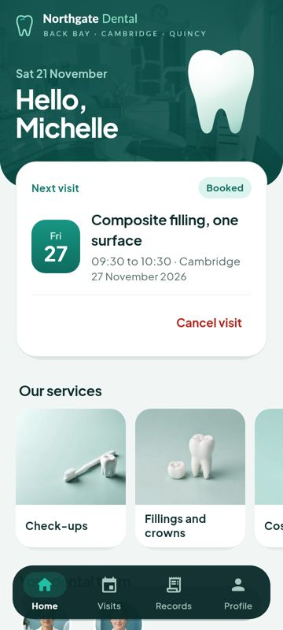
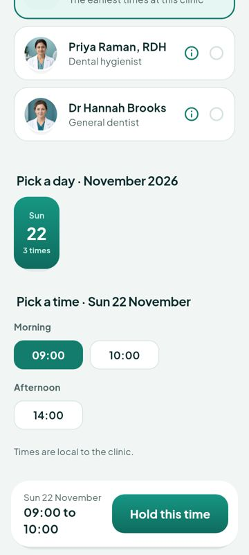

# Northgate Dental

A dental practice system and patient app for a fictional US dental group with three clinics in the Boston area: Back Bay, Cambridge and Quincy.

**All data in this project is synthetic.** No real patient data is used anywhere. Patients, staff, visits, X-rays and documents are generated or licensed test material.

It is the first of three US healthcare products in this portfolio:

| Product | What it shows |
| --- | --- |
| **Northgate Dental** (this repository) | A lean practice system on Supabase: patient app, scheduling, automations, an AI assistant with strict governance |
| CareLoop | A clinical care loop on OpenEMR, with imaging for clinicians, Synthea patients and a React Native app |
| ClaimFlow | Claims processing and medical coding with Epic on FHIR, built as microservices |

## The patient app

| Home | Booking | Visit record |
| --- | --- | --- |
|  |  |  |

| Records | Aligner timer | Profile |
| --- | --- | --- |
|  |  |  |

What a patient can do (Flutter, Android):

- **Sign in safely:** email and password, then a 6-digit code emailed at every sign-in. Records stay locked until both are done.
- **Find or create their record:** match an existing record by email and date of birth, or register as a new patient.
- **Book, reschedule and cancel:** choose a clinic, a service (each explained in plain words, searchable and grouped with pictures), a dentist or "any available", then a day and time. A slot is held for 10 minutes while they confirm.
- **Know their dentists:** profiles with portraits, focus and the clinics they work at.
- **Know their clinics:** photo, open now or closed, hours, directions, a call button, the services offered and the team there.
- **See their records:** every visit with the reason, a tooth chart drawn as two arches, what was done, findings and the treatment plan.
- **Read their documents:** visit summaries and X-rays from the practice, opened in an in-app PDF viewer through short-lived signed links.
- **Get reminders:** visit reminders the evening before and on the day, check-up recall, and aftercare sheets after treatment.
- **Track clear aligners:** a wear timer with in-app notifications.
- **Manage insurance and details:** pick an insurance plan from a list, and keep a verified home address.
- **Manage family members:** parents see their children's records, with limits for teenagers.

## How it is built

| Part | Technology | Where |
| --- | --- | --- |
| Database | Supabase Postgres (US East), row level security on every table, append-only audit log | `supabase/` |
| Patient app | Flutter 3.50, Riverpod, go_router, session in the Android Keystore | `apps/mobile/` |
| Address check | Supabase Edge Function calling the US Census geocoder from a US region | `supabase/functions/verify-address/` |
| Synthetic data | Python generator for about 3,000 dental patients, named test personas and canary records | `services/synthdata/` |
| CI and deploys | GitHub Actions: tests on every pull request, migrations to staging on merge | `.github/workflows/` |

Security and privacy choices:

- **Who sees what is decided by the database:** row level security on every table, with tests that prove both allowed and refused access for each role.
- **Staff need two factors:** staff accounts must use 2FA, and they cannot use the patient app.
- **Patient files are private:** they sit in private storage buckets and are opened only through short-lived signed links.
- **No patient data in logs, URLs or notifications:** IDs only. Reminders say "Dental visit tomorrow at 09:30" and nothing more.
- **Every pull request is checked:** secret scan, private-file guard, house style, database tests, generator tests and app tests. A canary-record scan (`scripts/canary-scan.sh`) checks logs for planted test records.

## Build log, section by section

| Section | Status | What it added |
| --- | --- | --- |
| 00 Accounts | Done | Every vendor account with 2FA, and a region chosen and recorded for each service before anything was created |
| 01 Repository and CI | Done | Repository layout, pre-commit hooks, secret scanning, CI pipeline |
| 02 Database foundation | Done | Organisation, clinics, services and prices, rooms, staff, roster, settings, row level security, staff 2FA, audit log |
| 03 Synthetic data | Done | Dental patient generator, test personas, canary records for leak scans |
| 04 Scheduling | Done | Appointments that cannot double-book a clinician or a room, versioned appointment history, available slots, holds, self-booking, record linking |
| 05 Patient app | Done | Everything in "The patient app" above, 62 app tests and 341 database tests |
| 06 Server and security | Next | Oracle VM with Docker Compose, Nginx with ModSecurity and the OWASP Core Rule Set, HTTPS, Presidio for redaction, encrypted backups to S3 |
| 07 Queue and automations | Planned | Supabase Queues with a transactional outbox, n8n workflows, email and WhatsApp messages, payments |
| 08 Web | Planned | Website with lead form, staff portal (schedule board, inbox, coverage queue, payments), dentist desk |
| 09 Knowledge and MCP | Planned | Document ingestion with hybrid search in Postgres, a tool service and an MCP server |
| 10 Assistant | Planned | A LangGraph assistant with corrective retrieval, confirmations and handover to a receptionist, traced with LangSmith |
| 11 Coverage, video and care | Planned | Eligibility, video consultations, post-procedure and recall programmes |
| 12 Governance and security tests | Planned | Safety gate, evaluations, kill switch, attack tests, leak scan, monitoring |
| 13 Operate and demo | Planned | Backups and restore test, runbooks, Spanish templates, demo video |

## Repository layout

| Path | What it holds |
| --- | --- |
| `supabase/migrations/` | Every database change, in order |
| `supabase/tests/` | pgTAP tests, including allowed and refused cases for each role |
| `supabase/seed.sql` | The organisation: clinics, hours, rooms, services, prices, insurance plans and staff |
| `supabase/functions/` | Edge Functions |
| `apps/mobile/` | The Flutter patient app and its tests |
| `services/synthdata/` | Synthetic data generator (Python 3.12, uv) |
| `scripts/` | Local helpers: database tests, canary scan, guards, mobile toolchain setup, document seeding |
| `.github/workflows/` | CI, staging deploy and staging data load |

## Running it

### Database

1. Install Docker, the [Supabase CLI](https://supabase.com/docs/guides/local-development/cli/getting-started) and [uv](https://docs.astral.sh/uv/getting-started/installation/).
2. Start a local stack and run the tests:

   ```bash
   supabase start
   supabase test db
   ```

   `scripts/test-db.sh` runs the same tests the way CI does, on a fresh Postgres container.
3. Run the generator tests:

   ```bash
   cd services/synthdata && uv run pytest
   ```

### Patient app

1. Install the toolchain once (no admin password needed; it installs into `~/development`):

   ```bash
   scripts/setup-mobile.sh
   source ~/.bashrc
   ```

   It installs Flutter 3.50.0, Temurin JDK 17 and the Android SDK 36, checking every download against its published checksum.
2. Point the app at a Supabase project:

   ```bash
   cd apps/mobile
   cp staging.env.example staging.env   # fill in the project URL and publishable key
   ```

3. Run the tests, then the app on a phone or emulator:

   ```bash
   flutter test
   flutter run --dart-define-from-file=staging.env
   ```

4. Build a signed release APK:

   ```bash
   flutter build apk --release --dart-define-from-file=staging.env
   ```

## Branches and pull requests

- **Branches:** work happens on `feat/...` branches.
- **Pull requests:** every pull request targets `develop` and is squash-merged once every check passes.
- **Releases:** `main` holds releases.
